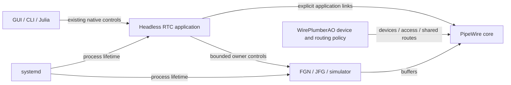

# Headless RTC application ownership

## Decision and scope

User decision on 2026-10-21, **RTC-ARCH-026**: the headless RTC application owns
its lifecycle and explicit application connections. This supersedes
RTC-ARCH-025's allocation of those responsibilities to the WirePlumber daemon.
It preserves RTC-ARCH-024's native control protocol and the observable states,
identity checks, source hold/release, bounded waits and cleanup requirements in
RTC-DEV-002/003/004/009/012/013/021/022/030/031. Historical results retain their
original providers and qualification scope.

WirePlumberAO owns device enablement/configuration, access and shared routing
policy. It does not decide RTC scientific readiness, reset/update sequencing or
the lifetime of declared RTC links. A private simulated RTC needs no device
session manager. Hardware profiles may require one for their devices; hardware
and access-policy qualification remain deferred.

This boundary separates a device session manager from an application, as in a
DAW. It does not change PipeWire's graph scheduler or create a scientific
scheduler in the RTC.

## Owners and interfaces

The following diagram shows authority, not frame scheduling:

The headless application uses public libwireplumber APIs: `WpCore`, `WpConf`,
`ObjectManager`, asynchronous hooks/transitions and the public `WpLink` API. Reusing that library does not run the WirePlumber
daemon. The application must not advertise `wireplumber.daemon=true`, select a
privileged manager socket, or load desktop auto-connect/device policy.

The existing AO Lua policy, native control shim and asynchronous SQLite journal
move to this repository's `native/` tree. They retain one serialized session
authority and one native public endpoint. Link/SI interfaces follow upstream WirePlumber; RTC does not add methods to
those library classes. Application modules, scripts and their tests
are removed from the WirePlumber daemon build/install surface.

Scientific owners still apply values and report adoption. The RTC coordinates
operations and journals requests/completions; it does not decode FITS or perform
database work in scientific callbacks. Artifact-management features remain
paused. GUI/CLI/Julia retain the same wire protocol and shared history.

## Naming and deployment

| Surface | Meaning and authority |
| --- | --- |
| `pipewireao-rtc` | Headless application executable; existing product name |
| `SessionConfiguration`, `SessionLaunch`, `SessionInstall`, `SessionRuntime`, `SessionCLI` | Application configuration and existing one-shot tooling, moved from their former `WirePlumber*` names |
| `session-runtime`, placement `session` | Deployment declaration and CPU placement for the headless application |
| `rtc/rtc.conf`, `RTC_CONFIG` | Invocation-local application configuration |
| `wireplumber.profiles`, `wireplumber.components`, `WIREPLUMBER_*` library search paths | Adopted libwireplumber configuration/API names; these do not grant daemon authority |
| `libwireplumber-module-ao-*`, `ao/session.lua`, native protocol names | Existing plugin/script/wire boundaries retained during relocation |

Each systemd invocation starts the real headless executable, with a sealed
minimal configuration. There is no fallback to the WirePlumber daemon or
retired runtime coordinators. The process still binds owners by PID/start time,
publishes the same native session endpoint, and uses the existing core/source
first emergency cleanup. Optional device policy must not independently link or
auto-reconnect the RTC's declared application ports.

## Implementation and acceptance

1. Move the application modules, Lua policy and tests without rewriting their
   scientific or lifecycle semantics. Add a small library-based native host;
   distinguish acknowledged Quit from initialization/Core failure.
2. Switch configuration, export/staging, registered-package assets, systemd and
   discovery to the new process. Update callers directly, with no second provider.
3. Verify native hooks, exact port selection, pending retirement, journal and
   policy fault behavior. Run Julia configuration/deployment/discovery tests.
4. On an isolated CPU-only PipeWire core, demonstrate that the headless
   application owns the observed links, transfers arrays, withdraws the exact
   cohort, and leaves unrelated objects intact. Verify process/client metadata
   and the existing native controls. Independently review the final ownership
   and cleanup boundaries.

The live workstation simulation remains stopped and the GPU remains available
for other work. CPU software checks do not establish GPU, hardware, sustained
cadence, tail-latency or all-instrument qualification. Deployment/release is a
separate action; this increment is developed in the existing isolated
`codex/wireplumber-reuse` worktrees, preserving prior relevant changes.

## Standard link APIs — 2026-10-21

The application constructs ordinary `WpLink` objects through the upstream Lua
`Link` constructor and activates their public features. Exact endpoint IDs,
passive/non-lingering properties and cohort paths use ordinary PipeWire factory
properties. There is no `link.exact`, selected-port SessionItem context or custom
library withdrawal method. Deployment loads no SessionItem factories for RTC
application connections. RTC-ARCH-026 ownership and all scientific/cleanup
requirements remain unchanged.

Lua's binding does not expose the public C activation-abort/disposal operations.
A narrow binding in the existing RTC native control module retires an owned
Link on the application main loop. Lua waits for both activation callbacks and
native retirement completion, then performs its existing Core sync and exact
registry-absence proof. A deadline leaves an unknown fault; it never proves
cleanup or permits automatic readmission. No new public command protocol or
second connection-policy owner is introduced.

The former custom Link Format getter is also removed. The RTC reads the public
`pw_link_info` via `wp_pipewire_object_get_native_info`, copies its Format, and
observes public PipeWire Link info events. Format-only changes remain visible;
an invalid update cannot be hidden by a later valid update.

The native RTC and libwireplumber build use `libpipewire-ao-0.3` and
`libspa-ao-0.2`. This is upstream Link/SI API use with PipeWireAO's ABI and formats,
not a claim that ordinary PipeWire implements NDArray transport. Existing generic
Lua/POD bindings outside the Link API remain separately inventoried. Genuine
component-loader, POD-filter-capacity and event-property defects are separate
from the removed interface extensions.

Acceptance reuses the existing exact endpoint/format/provenance tests, all
pending-retirement stages, malformed/passive/lifetime checks, the real native
Status test and the CPU NDArray/coexistence test. API-specific former tests map
to the corresponding caller invariant or an explicit no-longer-applicable
surface; they must not disappear without a disposition. The library build must
lack the removed symbols and match upstream Link/SI sources. Dynamic dependency
inspection must show PipeWireAO and no regular PipeWire or GPU runtime.
