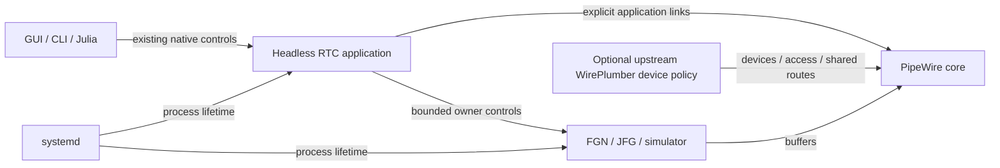

# Headless RTC application ownership

## Decision and scope

User decision on 2026-10-21, **RTC-ARCH-026**: the headless RTC application owns
its lifecycle and explicit application connections. This supersedes
RTC-ARCH-025's allocation of those responsibilities to the WirePlumber daemon.
It preserves RTC-ARCH-024's native control protocol and the observable states,
identity checks, source hold/release, bounded waits and cleanup requirements in
RTC-DEV-002/003/004/009/012/013/021/022/030/031. Historical results retain their
original providers and qualification scope.

Upstream WirePlumber may manage separately configured site/device policy. No
AO-specific device policy is currently defined or qualified. The ordinary Git
fork is a contribution vehicle for upstream patches. Device policy does not
decide RTC scientific readiness,
reset/update sequencing or the lifetime of declared RTC links. A private
simulated RTC needs no device session manager. Hardware profiles may require
one for their devices; hardware and access-policy qualification remain deferred.

This boundary separates a device session manager from an application, as in a
DAW. It does not change PipeWire's graph scheduler or create a scientific
scheduler in the RTC.

## Owners and interfaces

The following diagram shows authority, not frame scheduling:

The headless application uses public libwireplumber APIs: `WpCore`, `WpConf`,
`ObjectManager`, asynchronous hooks/transitions and the public `WpLink` API. Reusing that library does not run the WirePlumber
daemon. The application must not advertise `wireplumber.daemon=true`, select a
privileged manager socket, or load desktop auto-connect/device policy.

The existing AO Lua policy, native control shim and asynchronous SQLite journal
move to this repository's `native/` tree. They retain one serialized session
authority and one native public endpoint. Link/SI interfaces follow upstream WirePlumber; RTC does not add methods to
those library classes. Application modules, scripts and their tests
are removed from the WirePlumber daemon build/install surface.

Scientific owners still apply values and report adoption. The RTC coordinates
operations and journals requests/completions; it does not decode FITS or perform
database work in scientific callbacks. Artifact-management features remain
paused. GUI/CLI/Julia retain the same wire protocol and shared history.

## Correction-loop control — investigation, 2026-10-26

The RTC `Running` state describes application execution. Correction closure is
an independent runtime Boolean property, `closed`, on the scientific controller.
It uses the existing RTC-mediated property transaction, owner-generation
acknowledgement and query paths; no new native operation or lifecycle state is
introduced. Editing gain is not a substitute for loop control.

Opening holds the committed correction and mathematical integrator state while
frame processing, acquisition, reconstruction, diagnostics and required command
exchange continue. Reclosing retains that state and resumes the normal
constraint-feedback recurrence. Downstream temporal filters and the plant keep
evolving, so this does not promise an instantaneous hold of mechanical position.
There is no implicit zero, flat restoration, reset or gain change. Existing
startup behavior is preserved (`closed=true` unless explicitly configured).

The generic GUI session binding `correction_loops` references an exact graph and
qualified Boolean property. It supplies presentation only: native owner readback
is authoritative. Open/Close buttons use the same verified property path as
Settings, CLI and Julia clients. A submitted write is not active adoption;
unknown outcomes are retained and never retried automatically. Ordinary CPU JFG
owners support runtime transitions. Captured JFG owners retain their existing
prepare-a-new-owner requirement for property changes.

The current GPI coupled integrator provides one coordinated correction loop.
Independent device/mode-group closure needs an explicit allocation and feedback
policy; disabling a device after integration would allow hidden state buildup.
Separate clear/flat operations, bumpless transfer and device fault policies are
not delivered by the Boolean hold/resume contract.

The inspected HEART core revision `02c85a6490f33b057f1d0410a6c9db1564ae57b0`
and GPI source revision `973b20af778949e62bd048c219cb872e8bb09d2b` establish:

- `hrtBlock.c` permits READY → RUNNING → CORRECTING → RUNNING. GPI calls
  `scaoTemplate_main`, which installs the legacy template command handler.
- In `hrtTemplateCmds.c`, `CORRECT` selects configured WFS/DM/TT masks;
  `LOOP_HO` and `LOOP_LO` accept subsets and preserve the other WFS path.
  Closure requires a WFS and at least one DM or TT output. `LOOP_OPEN` sends RUN.
- CLWC applies pending PDM and TT enables at frame boundaries and gates their
  output triggers independently. CORRECTING therefore does not inherently mean
  every device is enabled. There is no prescribed stage → woofer → tweeter
  sequence, and selected correctors receive vectors rather than sequential
  actuator enables.
- CLWC normally clears its VDM integrator on entry to CORRECTING unless
  `enableNotClearingIntg` is set. Its exit callback is a no-op; this does not
  establish automatic flattening on opening. TFC has no enter/exit-CORRECTING
  callbacks, so automatic temporal-filter reset is not demonstrated.
- The newer `hrtApi_LOOP.yaml` describes richer RUNNING/CONTROLLING/CORRECTING
  and reset behavior. Its inspected C handler maps both nonzero states to
  legacy CORRECT and does not read the reset argument. Those documented
  semantics must not be copied as if fully implemented.

CACAO's [modal filter implementation](https://github.com/cacao-org/cacao/blob/dev/AOloopControl/modalfilter.c)
separates `loopON` (opening freezes correction), `loopZERO` (explicitly clears
and publishes correction), gain and a finite step count. The local comparison
at `ecfb694cb319c9cfcde3727d35414715d122c482` confirms the separate update paths;
an open loop does not imply a zero mirror command.
The [MagAO-X operating procedure](https://magao-x.org/docs/handbook/operating/alignment.html)
closes the HO loop on a small mode set, increases the controlled mode set and
adjusts woofer offloading separately. Its [CACAO setup guide](https://magao-x.org/docs/handbook/operating/cacao.html)
also exposes distinct HO and low-order loop interfaces. These are logical loop
and mode-group operations, not a universal ordering of individual actuators.

The implementation and remaining design obligations follow these boundaries:

- Keep acquisition, reconstruction, diagnostics and required command exchange
  running while correction is open. Do not implement opening by stopping an
  execution group, disconnecting devices or omitting required command ports.
- Declare participating sensors, mode groups and correctors in instrument/RTC
  configuration. Permit coordinated closure and instrument-defined sequences;
  do not hard-code a GPI-specific order in the GUI or headless RTC.
- Define open/hold, explicit clear/flat restoration, integrator/filter reset or
  retention, and bumpless closure as separate semantics. Device bias/flat is not
  necessarily a vector of zeros. Opening on a fault needs an explicit
  profile/device policy rather than an assumed safe mechanical state.
- Keep the headless RTC authoritative, using the existing native control and
  owner acknowledgement paths. Report requested versus applied loop state and
  the frame where a transition takes effect. Every GUI, CLI and script uses
  that same interface.
- Extend the scientific controller's state transition contract with its owner.
  The current coupled integrator, stage allocation and clipping feedback must
  remain consistent when groups are disabled; multiplying a DM output by zero
  after integration would permit hidden state buildup.

The scientific `closed` property and generic GUI hold/resume controls implement
the coordinated-loop case. Richer participation, explicit flat/reset policies
and transition-frame reporting remain separate capabilities; they are not
implied by a property-generation acknowledgement.

### RTC correction-loop adoption tracking

An ordinary Julia graph owner can declare each qualified Boolean with
`--correction-property NODE:PROPERTY`. The RTC uses Hsm 0.3.2 to track `Open`,
`Closing`, `Closed` and `Opening`; an uninitialized or inconsistent observation
is `Unknown`. This is owner-local tracking of the existing native property
contract, not another lifecycle authority or a new native control operation.

The graph adapter reports a cold initial snapshot before admission, accepted
desired values after successful staging, and applied snapshots on its existing
native property notification path. It reconciles a previous adoption before
reporting the next accepted request. Applied values and native readback use
the same atomic snapshot. Hsm runs only on the serialized owner control thread,
never on the scientific processing or parameter worker paths.

Matching owner incarnation, requested/active generations and Boolean readback
confirm a transition. Submission alone cannot confirm it. Other-property writes
retain the current closure state; duplicate observations are harmless. Stale or
other-incarnation observations cannot confirm a change. Inconsistent facts latch
`Unknown` without retrying a command. A new owner gets new machines.

The native transaction slot continues to reject busy writes. The observer cannot
veto an already accepted write. An unexpected adapter-observer failure disables
further notifications and is logged without changing staging or native readback;
the RTC observer also contains its own failures. Native property readback remains
authoritative. This increment does not publish another FSM status property,
add transition-frame reporting, or enable runtime writes to captured graphs.

## Naming and deployment

| Surface | Meaning and authority |
| --- | --- |
| `pipewireao-rtc` | Headless application executable; existing product name |
| `SessionConfiguration`, `SessionLaunch`, `SessionInstall`, `SessionRuntime`, `SessionCLI` | Application configuration and existing one-shot tooling, moved from their former `WirePlumber*` names |
| `session-runtime`, placement `session` | Deployment declaration and CPU placement for the headless application |
| `rtc/rtc.conf`, `RTC_CONFIG` | Invocation-local application configuration |
| `wireplumber.profiles`, `wireplumber.components`, `WIREPLUMBER_*` library search paths | Adopted libwireplumber configuration/API names; these do not grant daemon authority |
| `libwireplumber-module-ao-*`, `ao/session.lua`, native protocol names | Existing plugin/script/wire boundaries retained during relocation |

Each systemd invocation starts the real headless executable, with a sealed
minimal configuration. There is no fallback to the WirePlumber daemon or
retired runtime coordinators. The process still binds owners by PID/start time,
publishes the same native session endpoint, and uses the existing core/source
first emergency cleanup. Optional device policy must not independently link or
auto-reconnect the RTC's declared application ports.

## Implementation and acceptance

1. Move the application modules, Lua policy and tests without rewriting their
   scientific or lifecycle semantics. Add a small library-based native host;
   distinguish acknowledged Quit from initialization/Core failure.
2. Switch configuration, export/staging, registered-package assets, systemd and
   discovery to the new process. Update callers directly, with no second provider.
3. Verify native hooks, exact port selection, pending retirement, journal and
   policy fault behavior. Run Julia configuration/deployment/discovery tests.
4. On an isolated CPU-only PipeWire core, demonstrate that the headless
   application owns the observed links, transfers arrays, withdraws the exact
   cohort, and leaves unrelated objects intact. Verify process/client metadata
   and the existing native controls. Independently review the final ownership
   and cleanup boundaries.

The live workstation simulation remains stopped and the GPU remains available
for other work. CPU software checks do not establish GPU, hardware, sustained
cadence, tail-latency or all-instrument qualification. Deployment/release is a
separate action; this increment is developed in the existing isolated
`codex/wireplumber-reuse` worktrees, preserving prior relevant changes.

## Standard link APIs — 2026-10-21

The application constructs ordinary `WpLink` objects through the upstream Lua
`Link` constructor and activates their public features. Exact endpoint IDs,
passive/non-lingering properties and cohort paths use ordinary PipeWire factory
properties. There is no `link.exact`, selected-port SessionItem context or custom
library withdrawal method. Deployment loads no SessionItem factories for RTC
application connections. RTC-ARCH-026 ownership and all scientific/cleanup
requirements remain unchanged.

Lua's binding does not expose the public C activation-abort/disposal operations.
A narrow binding in the existing RTC native control module retires an owned
Link on the application main loop. Lua waits for both activation callbacks and
native retirement completion, then performs its existing Core sync and exact
registry-absence proof. A deadline leaves an unknown fault; it never proves
cleanup or permits automatic readmission. No new public command protocol or
second connection-policy owner is introduced.

The former custom Link Format getter is also removed. The RTC reads the public
`pw_link_info` via `wp_pipewire_object_get_native_info`, copies its Format, and
observes public PipeWire Link info events. Format-only changes remain visible;
an invalid update cannot be hidden by a later valid update.

The native RTC and libwireplumber build use `libpipewire-ao-0.3` and
`libspa-ao-0.2`. This is upstream Link/SI API use with PipeWireAO's ABI and formats,
not a claim that ordinary PipeWire implements NDArray transport. The generic Lua/POD bindings were separately inventoried at this stage and
are removed in the RTC-owned binding increment below. Genuine
component-loader, POD-filter-capacity and event-property defects are separate
from the removed interface extensions.

Acceptance reuses the existing exact endpoint/format/provenance tests, all
pending-retirement stages, malformed/passive/lifetime checks, the real native
Status test and the CPU NDArray/coexistence test. API-specific former tests map
to the corresponding caller invariant or an explicit no-longer-applicable
surface; they must not disappear without a disposition. The library build must
lack the removed symbols and match upstream Link/SI sources. Dynamic dependency
inspection must show PipeWireAO and no regular PipeWire or GPU runtime.

## RTC-owned Lua bindings — 2026-10-21

RTC-ARCH-026 continues to use upstream libwireplumber as its application library.
Application Lua modules use the existing `GLib.get_monotonic_time` binding for
absolute deadlines. The redundant downstream Core clock binding is removed.

A small RTC-native `ao-lua` plugin and its local Lua module expose the remaining
public C operations missing from stock Lua: selected-feature ObjectManager
construction, POD child/property inspection and copying, and native event
construction with epoch properties. The plugin is a library binding; it owns no
application lifecycle, routing decision, frame processing or external command
protocol. Native event hooks and ordinary Link objects remain upstream.

Discovery constructs a fresh upstream ObjectManager, requests only its declared
features, adds interests and installs it through the standard interface. It must
not construct the stock all-feature Lua manager and attempt to remove features
afterwards. Selective subscriptions protect external scientific owners from
unrequested property/parameter activation.

POD bindings preserve types and full integer values. Property IDs and flags come
from bounded traversal of the public SPA Object, rather than libwireplumber's
private property wrapper. Returned child values have independent ownership;
iteration preserves duplicates so existing validation can reject them. Metadata
conversion cannot replace the typed values used for scientific/control checks.
No global Lua class or constructor is monkeypatched.

The library under test must be upstream source with only build dependency
selection for `libpipewire-ao-0.3` and `libspa-ao-0.2`. Any genuine upstream bug
fix is a separate patch and validation cohort. API relocation must not conceal
failed upstream behavior or weaken identity, Format, cancellation, deadlines,
source-first fault handling, pending callback accounting or cleanup proof.

## Standard SPA-JSON generation — 2026-10-21

The existing configuration writer emits conventional SPA-JSON objects with
`key = value`, whitespace-separated array entries and conservative bare simple
strings. JSON3 supplies quoted-string escaping and scalar serialization; the
PipeWireAO dependency's standard parser verifies the completed document before
the destination is created or replaced. Ambiguous primitive-looking strings
remain quoted. Invalid UTF-8, NUL and representations the native parser cannot
roundtrip are rejected without changing the destination.

This removes the generated configuration's dependence on the component-loader
string patch. Upstream JSON syntax remains valid SPA-JSON; the selected relaxed
spelling avoids the upstream 0.5.18 component loader's quoted-dependency behavior.
No alternate parser or configuration language is introduced, and artifact/journal
JSON remains unchanged. The loader source is restored to upstream. The separate
POD-filter and Lua event-property fixes are preserved independently; the tested
RTC dependency is the clean upstream library built against PipeWireAO.
