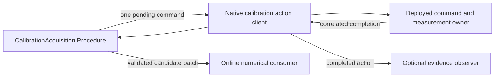
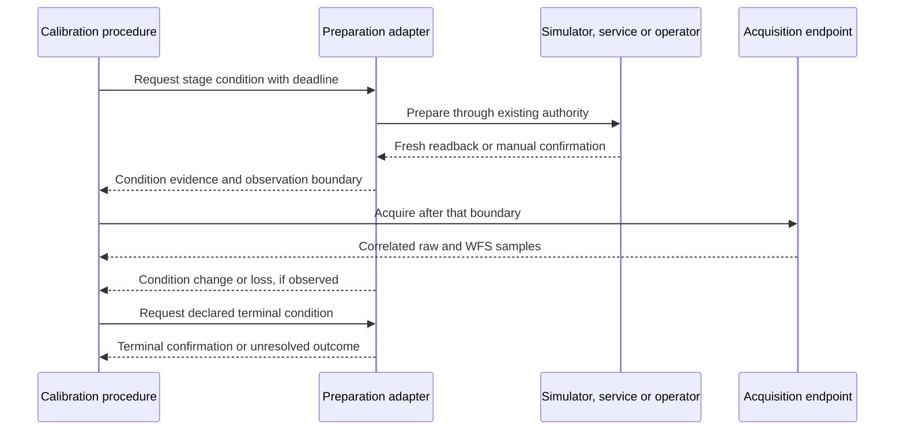

# Julia interaction acquisition

The shared `CalibrationAcquisition` driver acquires prepared probe responses
through `pipewireao.rtc.calibration-actions/1`. AOC constructs probes and estimates
interaction matrices; instrument recipes select illumination, coordinates,
units, amplitudes and scientific acceptance. The driver contains no instrument
names, optical algorithms, graph scheduling or session lifecycle policy.

## Entry points

A fresh calibration export provides `bin/rtc-calibrate` as a thin Julia
entrypoint. The exporter includes and seals the operational package; an external
Rust calibrator is no longer an export input. The native binding flags, saved
v1 plan and stdout result shape are retained:

```sh
PACKAGE/bin/rtc-calibrate \
  --remote /absolute/path/to/private-core \
  --node declared-calibration-owner.actions \
  --owner-pid OWNER_PID --owner-instance OWNER_INSTANCE \
  --plan /absolute/path/to/prepared-plan.json
```

Binding values are hints until the native client proves the current owner and
controller. Start/admit the selected session through the existing systemd and
WirePlumber tools first. This command does not start a session or grant physical
actuation authority. Existing sealed exports keep their original executable;
create a fresh export to select the Julia driver.

The reusable Julia API uses the same driver:

```julia
using PipeWireAORTC
const Acquisition = PipeWireAORTC.CalibrationAcquisition
const Native = PipeWireAORTC.NativeCalibrationActionClient

plan = Acquisition.read_plan(plan_path)
binding = Native.Binding(remote, action_node, owner_pid, owner_instance)
result = Acquisition.acquire(binding, plan)
report = Acquisition.document(result)
```

`Plan(run, reference, probes, measurements, frames_per_probe, settling,
timeouts)` also accepts prepared host arrays. Figures are owned Float32
snapshots in their declared order; host array index labels are not wire
coordinates. `Timeouts` contains positive Int64 nanosecond budgets for ownership,
adoption, settling, collection and restoration. Settling uses the existing
`Immediate`, `DiscardExposures` or `ModelTime` native types. Package loading and
acquisition do not require AOC, AOS, JFG or an accelerator dependency in this
operational environment.

## Completion and recovery

The finite workflow is Hold, then Adopt → Settle → Collect for each probe,
followed by Restore → Release. Native correlation proves run/serial, controller,
operation and terminal outcome; submission alone proves none of those effects.
The driver validates adopted figures, clipping, epoch continuity, settling
boundaries and exact consecutive contributing exposure IDs/model times.
Only a complete, restored and released run publishes response batches.

`acquire!` accepts an already proved fresh native connection. It accepts
`cancelled=()->false`, `check=()->nothing` and an optional completion observer.
Cancellation is checked at completed action boundaries. An in-flight action
resolves within its finite deadline; cancellation never cuts restoration/release
in half. Recovery uses its own restoration/ownership budgets. An external
supervision exception while waiting or an unknown transport outcome stops
submissions; there is no automatic retry, reconnect or rebind. A fault report
cannot authorize resume. `acquire` closes its own controller on every exit;
`acquire!` leaves ordinary connection cleanup with its caller.

A successful CLI run exits 0. A completed aborted/fault acquisition exits 1 and
prints its v1 result. Input, binding or diagnostic-output failure exits 2.
Scientific acceptance remains the instrument/AOC consumer's responsibility.

## Event-driven procedures and online numerical consumers

`CalibrationAcquisition.Procedure` is the shared, instrument-independent
interaction-acquisition state machine. One control task owns each procedure.
It emits one pending typed native `command`, with an absolute monotonic
`deadline`. A transport submits that command once and delivers a correlated
terminal result through `complete!`. `cancel!` requests cancellation at a
completed action boundary; `expire!` handles a deadline event; `fail!` reports
endpoint failure. A terminal procedure has `command === nothing` and `result`.
There is no transport, file I/O, sleep, polling loop or device callback inside
the procedure. The existing `acquire`/`acquire!` functions drive the same state
machine over the existing version-1 native action protocol.

This is the ownership and data flow for the first shared procedure:



The native client now wakes its task on registry, identity, parameter and
failure callbacks through an `AsyncCondition`; a one-shot deadline timer bounds
an idle request. Callbacks only publish observations and wake the control task.
The default calibration path has no periodic completion polling. Explicit
legacy `check` hooks retain periodic supervision because they can inspect
external processes; this is separate from probe settling and exposure counts.
Awaiting a completion suspends the Julia task, so callers may run acquisition
in a task while keeping their own control/event loop responsive.

An online consumer receives every validated batch before the next probe is
issued, using either native acquisition or typed replay:

```julia
responses = zeros(Float32, length(plan.probes), Int(plan.measurements))
function consume(probe, batch)
    copyto!(view(responses, probe, :), batch.values)
    # Update a response estimate or diagnostics as each signed pair completes.
end
result = Acquisition.acquire(binding, plan; consume)
if result.phase == "complete"
    # Apply the declared AOC estimator, reconstruction and acceptance policy.
end
```

The consumer owns its batch snapshot; mutation cannot alter retained receipt
data. Its outputs remain candidates even after being delivered: a later fault
or failed restoration invalidates the run as a complete calibration. Consumers
do not activate parameters. A consumer exception requests restoration and
release and reports `Processing`. Consumers execute outside PipeWire callbacks
and do bounded work; an expensive factorization belongs on a numerical worker
with an explicitly bounded handoff. The procedure does not create an unbounded
worker queue or asynchronous recorder. Its existing finite response-retention
bound remains in force.

For an external event loop, prepare `Procedure(plan; consume, clock)` and submit
its `command`. After owner/controller validation, deliver
`complete!(procedure, run, serial, result)`. The optional `at` keyword is the
local monotonic receipt time captured before dispatching the reducer, not a
remote timestamp or an opportunity to extend a deadline. Arm the current
deadline after each issued command, cancel obsolete timers, and use `expire!`
for a deadline notification. A wrong run, serial or operation faults without
another command. Unknown in-flight outcomes never authorize restoration or
ordinary-loop resumption. Recording can retain typed events for replay; it is
not required to calculate a response during acquisition.

### CPU initial-session endpoint

`InstrumentCalibration.calibration_graph(application; inputs, outputs)` derives
cold projections from a built regular graph. For the Classic initial session,
select raw `pixel-calibration:raw` to existing `slopes`, `flux`, `validity` outputs,
and absolute `pdm-command:requested` to `demanded`, `constraint-feedback`.
`prepare_initial_calibration(application, remote, frontend, command;
reference, name, instance, deadline)` owns both prepared projections and returns
`NativeCalibrationEndpoint.Endpoint`. Serve it with `serve!(endpoint; deadline)`
on a control task and close it after the native client disconnects. Use at least
three Julia default threads; the private-core optical selector uses four.

This CPU simulation endpoint uses normal configured detector noise and ADC,
actual transported command adoption and correlated raw/WFS streams. It rechecks
the built graph and selected FITS inputs before starting. Reference and probe
figures are absolute physical commands in the declared wire units, including
completion and reference; this endpoint adds no flat or offset. Its sole full
wire acquisition domain is retained as `endpoint.effects.acquisition_domain`
and mapped to coordinator domain ID `1` for that endpoint lifetime. Preserve
that association with acquisition evidence. Responses are averaged online;
raw recording and offline reduction are not prerequisites.

An in-flight synchronous HIL operation resolves or reaches its finite deadline
before the owner can check revocation. The owner checks the native ticket before
starting another exposure and during capture notifications. Unknown outcomes
fence endpoints without restoration or retry. This initial-session API does not
transfer a running controller's state, actuate devices, publish a calibration
bundle or implement the optional `Capture` file-export action.

See the [implementation and verification record](validation/calibration-owner-20261027/PLAN.md)
and [independent review](validation/calibration-owner-20261027/REVIEW.md).

### Source and mechanism preparation

The shared procedure describes the required optical condition, rather than a
manufacturer's commands. A dark blocks light at the detector while retaining the
selected exposure, gain, temperature/readout policy and raw ADC contract. An
illuminated acquisition uses a declared source and optical path. A reference
additionally binds the nominal mirror figure and mechanism positions. An
illuminated image is not automatically a detector flat field or a WFS reference;
these remain separate scientific operations.
Dark reduction consumes raw ADC images. Capture retains the deployed WFS
validity flags even when unilluminated ROIs are invalid; interaction-response
eligibility is not reused as a dark-image acceptance rule. Detector quality and
background-estimation acceptance need their own declared checks.

| Endpoint | Preparation owner | Evidence needed before acquisition |
| --- | --- | --- |
| Classic simulator | Selected built AOS graph | `dark` feeds zero incident photon rate to the unchanged detector; `internal-source` retains the declared source and detector without atmosphere |
| Physical REVOLT | Operator; user confirms preparation is completely manual | Run/stage-specific confirmation of prescribed beam blocking or illuminated configuration, recorded as manual evidence; detector settings and independent data checks remain required |
| Physical SPIDERS | Existing SuperK, Thorlabs and Galil services | Service identity, actual emission/interlock and mechanism readbacks, motion completion and declared position tolerance; submission alone is insufficient |
| Physical GPI | Existing instrument/mechanism-control software | Completed configuration and readbacks from that software, bound to this stage and detector configuration |

This is an integration contract and implementation plan. Physical adapters,
manual confirmation transport and automatic campaign orchestration are not yet
implemented. Selecting a simulation graph authorizes no physical device command.
Preparation conditions belong to the authored calibration recipe; physical
mechanism identity/geometry remains instrument data, and service connection
settings belong to the application/host configuration. The ordinary instrument
and RTC graphs remain the scientific authority. Do not author a second controller
graph or duplicate mechanism-control software for these stages.
Adapters use each service's existing protocol; mechanisms need not become
PipeWire graph nodes. The common interface is the preparation request and its
verified completion, followed by the existing acquisition actions.

The intended event sequence leaves device authority in the existing owner:
the initial-calibration session excludes the ordinary correction producer before
any preparation request. Calibration of a running loop needs separately
qualified hold/state preservation; source or mechanism movement cannot begin
merely because a client has requested Hold.



Evidence binds the exact run/stage request, service incarnation, detector
configuration and optical condition. Subscribe before commanding and establish
readiness from subsequent readbacks. A cached status, acknowledgment, elapsed
delay or file cannot establish readiness. Exposure starts follow the verified
preparation boundary; buffered earlier frames are excluded. Cross-process clocks
need an explicit mapping or a causal acquisition boundary. Monitor required
conditions during acquisition; state loss or an unobserved gap invalidates
affected candidates. Manual confirmation retains its weaker operator-attested
scope and never masquerades as continuous hardware readback.

One control task owns stage progression. Device I/O stays in the existing
services or a bounded worker, outside RTC frame callbacks. Initially allow one
preparation request and one acquisition action in flight, a finite declared
mechanism set, finite event storage and an absolute deadline for each stage.
Overflow, stale/out-of-order evidence, service restart, motion fault or deadline
expiry abort the candidate. Unknown command outcomes do not authorize retries.
Adapters can consume legacy polled telemetry, with explicit polling cadence and
freshness limits; orchestration does not advance through sleeps. No physical
settling or latency claim follows from this software contract.
A coordinator deadline does not stop a motor or interrupt a blocking SDK call.
Qualify backend timeouts/abort behavior before claiming bounded physical
completion; an unresolved call retains its resource ownership and cannot be
replaced by another worker or command to the same mechanism.

Cleanup requests the instrument's declared terminal condition through its
current authority, without blindly replaying an earlier state. A beam block can
leave a warmed source on; no universally available shutter or switch is assumed.
An unresolved preparation or cleanup outcome fences acquisition and automatic
loop resumption. Cancellation resolves in-flight actions and records mirror
restoration and optical cleanup separately. Device interlocks and collision
policy stay with their existing owners.

Implementation order: diagnose repeated exposure completion; qualify simulated
dark and illuminated acquisition; implement the bounded preparation adapter and
manual REVOLT interaction; then automate dark, lamp training and independent
reference/eligibility stages with existing AOC methods. Add SPIDERS/GPI adapters
after establishing their completion/readback contracts. Independent qualification
cannot change a frozen training mask. Optional recording supports diagnosis and
replay while scientific consumers reduce candidate data online. Source levels,
masks, thresholds, filters and gains retain their own acceptance requirements.

### Delivery state and next gates

The procedure and native client are implemented in PipeWireAORTC, rather than
introducing another acquisition owner or requiring AOS in the numerical API.
The intended users are Classic, Copper, GPI and a future PipeWireAO SPIDERS RTC.
Instrument-specific equations remain in scientific packages, with recipe data
in each instrument. This increment supplies the shared interaction procedure;
it does not migrate every existing campaign or authorize physical actuation.

| Order | Work | Completion evidence |
| --- | --- | --- |
| 1 | Shared completion-driven interaction acquisition and online consumers | Typed linear-sensor live/replay parity; invalid identity/exposure, cancellation, processing failure and restoration tests; private-core native request and retirement checks |
| 2 | Connect Classic's declared probe basis and AOC estimator to the online consumer | Actual deployed private-core DM/WFS acquisition, incremental and retained-input numerical agreement, restoration and aborted-candidate rejection |
| 3 | Add standard dark/lamp/reference procedures using existing AOC methods | Independent reference windows, unchanged estimator conventions, typed artifacts and repeatability diagnostics |
| 4 | Adopt Copper and GPI through declared measurement/command contracts | Same procedure API with their actual coordinates, normalization, correctors and accepted probe association; no guessed mappings |
| 5 | Add multi-WFS acquisition, bounded numerical workers and optional recording/replay | Per-source adoption/exposure evidence, all-required-source completion, bounded overload policy and missing-source tests |
| 6 | Add SPIDERS LOWFS, SCC and sharpening procedures | Scientific parity over retained inputs, then the future PipeWireAO RTC path; explicit grouped-probe decoding and optimization state |

The version-1 interaction protocol currently represents one command figure and
one declared measurement vector per acquisition owner. This is not a generic
four-WFS barrier, multi-corrector transaction or physical settling witness.
Those contracts need explicit extension and qualification before claiming them.
The simulated and physical implementations should share the same procedure;
neither an adopted setpoint nor a model-time cursor establishes physical
settling. No new default amplitude, filter, mask or gain is selected here.

## Bounds and diagnostics

Plans are limited to 16 MiB, 16,384 probes, 4,096 commands/frames and the existing
native request/reply capacities. Unknown or duplicate saved-plan fields reject
before Hold. Projected retained figures/responses are limited to 512 MiB,
including a conservative per-probe metadata charge. This payload bound is not
an allocator-independent Julia heap/RSS limit. Acquisition and serialization
are cold control work; the driver imposes no new allocation in frame callbacks.

Optional `--evidence NEW_PATH` creates an exclusive file before connecting and
retains a completion journal until the workflow returns. It performs no file
writes from the completion observer while ownership is held. The charged
journal budget is 64 MiB; exhausting it does not interrupt safe recovery, and
finalization reports the diagnostic failure. Journal **version 2** records typed
completed actions and the final acquisition outcome. It does not claim that an
unconfirmed request was accepted and is not byte-compatible with the temporary
Rust journal. Saved plans, reports and this journal use JSON; live controls use
native SPA PODs throughout.

See [software/native verification and limitations](validation/julia-acquisition-20261008/README.md).
