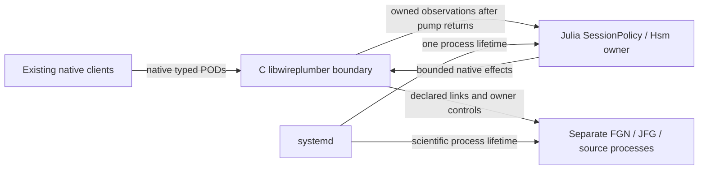

# Julia session policy migration

## Baseline and accepted boundary

User decision, 2026-11-04: replace the Lua session policy, use Hsm.jl where
appropriate, retain one session authority, and commit verified changesets.
The source baseline is `a0e47d2d84aac27d2ccaf8bdc3e5fc9f5a45d278` on the
dedicated `codex/julia-session-policy-20261104` branch. The worktree was clean.
RTC-ARCH-024/026 and the stable RTC-DEV identities remain authoritative.

The selected implementation has one Julia session owner in the RTC process.
The existing executable enters Julia with `exec`, preserving its PID and
systemd lifetime. A C library owns WpCore, discovery, public WpLink objects and
native callback storage. Julia calls its bounded pump; C never calls Julia.
No Lua policy component is loaded. The retired DeploymentRunner is not restored.

This diagram shows the authority and callback boundary, not frame scheduling:

Scientific processing remains on its existing PipeWire data threads. The policy
is cold control; Julia compilation and GC consume request deadlines and are not
qualified for strict RT. No priority, affinity, live service or installed
application changes are part of implementation validation.

## Interfaces and ownership

`SessionPolicy` names the existing session-policy responsibility. Its Machine
uses Hsm hierarchy for Configuring, admitted Ready/Running, transient operations,
fault compensation and shutdown. Public mutation functions dispatch typed
events. Stable wire lifecycle IDs remain 1–5; transient states add no wire IDs.
The owner uses a sticky Julia task on one OS thread and one cached clock sample
per cycle. Absolute native receipt/deadline checks use fresh monotonic time.

`runtime/session.h` defines a private C ABI, not another control protocol.
It exposes copied native POD observations and opaque object handles, asynchronous
enumeration, activation, retirement, sync and journal receipts. C owns GObjects
and native callbacks; Julia owns lifecycle, exact identities and policy decisions.
Calls check the opening OS thread and acquire the GMainContext. Event count,
retained bytes and object handles are bounded; overflow is sticky and fails
admission closed while permitting cleanup. Native destruction waits for pending
callbacks. No borrowed native pointer survives an event release in Julia.

Effects run outside Hsm dispatch as coroutines on the same owner thread.
Completion carries session, operation epoch, effect serial, kind and target.
Retirement fences the epoch before cancellation; late replies cannot advance
another transition. Scientific mutations are submitted once. Fault compensation
has a separate five-second budget and holds sources before consumers/links.

Configuration remains standard relaxed SPA-JSON. The authoritative generator
stores the former policy arguments under `pipewireao.session` and loads only
the native control/journal components. Export stages the C bridge and Julia
package; installed launchers select their pinned Julia/project/library paths.
Existing sealed applications are not rewritten.

## Requirement closure and delivery gates

Each row is initially planned / evidence missing. Completion requires the normal,
boundary, rejection, timeout, cancellation and cleanup cases named below.
The claimed surface is Linux non-actuating private-core development sessions;
no existing hardware, GPU, sustained cadence or strict deadline claim transfers.

| Requirement | Allocation and verification closure |
| --- | --- |
| RTC-DEV-003 | Exact node/port/client/core/Link identities, negotiated formats; creation failure at each step; pending activation retirement, sync and absence fence; unrelated objects preserved |
| RTC-DEV-004 | Stable lifecycle IDs, prepare/warmup/admit, start/stop/reset; unload from every managed leaf including Configuring/Fault and pending work; unknown cleanup stays Fault |
| RTC-DEV-009/012 | One state writer and in-flight effect; session/epoch/kind/target correlation; invalid groups, duplicates and late callbacks; stop/quit/loss fences pending work |
| RTC-DEV-010/013 | Existing multi-graph/groups/passive boundaries, external ownership and exact full port schemas; no graph parser/scheduler or external node ownership added |
| RTC-DEV-021/025 | Exact owner readiness and resource-admission controller; held startup, graph-before-source Run, source-before-graph Hold; cursor/reset proofs, ordered shutdown and emergency cleanup |
| RTC-DEV-022/030 | Same native envelope and limits, receipt-based deadlines, competing/stale/busy/malformed callers, retained terminal/rejection; typed scalar/parameter queries/updates and correction guards |
| RTC-DEV-022 journal | Requested durability before mutation, completed durability before publication; pre/post-dispatch failure and expiry/controller-loss races; no replay or inferred rollback |

Two observed Lua behaviors are implementation gaps, not compatibility promises:
Quit currently rejects Configuring/Fault, and pending public work rejects Quit.
The migration implements RTC-DEV-004 cancellation/unload instead of preserving
those restrictions. Other scientific ordering, protocol fields, first-fault
retention and unknown-outcome rules remain unchanged.

## Commit sequence and verification

1. Commit this boundary/closure plan and implementation-language wording updates.
2. Add the C observation/effect bridge and focused native tests; preserve the old
   executable until the replacement entry point is integrated.
3. Add the pure Hsm session machine with gated effect tests for normal sequences,
   all-managed-state Quit, cancellation, stale replies, failure and expiry.
4. Add the native effect/ingress adapter, source/correction/property semantics and
   journal ordering. Connect the executable and authoritative generators together;
   remove production Lua loading and dependencies. Test fresh export/load and
   native control against a private core and external graph process.
5. Obtain independent review, run relevant native/core/private integration gates,
   record exact results and residual qualification limits, and commit closure.

Each implemented slice is committed when its checks pass. Intermediate commits
must not promote the replacement as ready before the integration gate closes.
The roadmap owns current status; dated evidence will be indexed separately.
