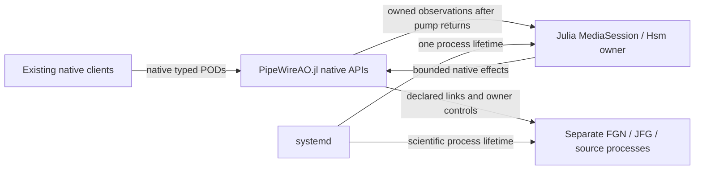

# Julia session policy migration

## Baseline and accepted boundary

User decision, 2026-11-04: replace the Lua session policy, use Hsm.jl where
appropriate, retain one session authority, and commit verified changesets.
The source baseline is `a0e47d2d84aac27d2ccaf8bdc3e5fc9f5a45d278` on the
dedicated `codex/julia-session-policy-20261104` branch. The worktree was clean.
RTC-ARCH-024/026 and the stable RTC-DEV identities remain authoritative.

The user subsequently selected removal of both Lua and libwireplumber, using
PipeWireAO.jl directly. One Julia session owner remains in the RTC process.
The generated launcher enters Julia with `exec`, preserving its PID and
systemd lifetime. PipeWireAO supplies public discovery, proxy, Link, native POD
and loop APIs. The retired DeploymentRunner is not restored.

Terminology follows upstream [media-session](https://gitlab.freedesktop.org/pipewire/media-session),
inspected at `7376c167f1ad20b3968d7a5d6c395a8b698d31d8`: `sm_media_session`,
object, node, port, client, link, find object, create links and remove links.
The Julia module is `MediaSession` in `src/media_session/MediaSession.jl`.
Julia casing, dispatch and mutation suffixes apply; C `sm_` prefixes do not.
Existing RTC lifecycle and wire terms retain their precise meanings.

This diagram shows the authority and callback boundary, not frame scheduling:

Scientific processing remains on its existing PipeWire data threads. The policy
is cold control; Julia compilation and GC consume request deadlines and are not
qualified for strict RT. No priority, affinity, live service or installed
application changes are part of implementation validation.

## Interfaces and ownership

The package-wide [Julia design conventions](architecture.md#julia-design-conventions)
record the user's consistency, interface, trait, Hsm, ownership and clock
decisions. The implementation is being checked against those conventions as
coherent interface changes, not as isolated spelling or formatting fixes.

`MediaSession` names the session-management responsibility. Its Machine
uses Hsm hierarchy for Configuring, admitted Ready/Running, transient operations,
fault compensation and shutdown. Public mutation functions dispatch typed
events. Stable wire lifecycle IDs remain 1–5; transient states add no wire IDs.
The owner uses a sticky Julia task on one OS thread and one cached clock sample
per cycle. Absolute native receipt/deadline checks use fresh monotonic time.

PipeWireAO's public loop pump runs on its opening OS thread. Existing native
callbacks enter Julia on that same thread and stage bounded owned observations;
they never dispatch the application Hsm or perform blocking/scientific work.
The owner applies observations after the pump returns. Event count and retained
bytes are bounded; overflow is sticky and fails admission closed while permitting
cleanup. Native destruction accounts for pending callbacks. No borrowed native
pointer escapes a callback. This cold-control boundary makes no zero-allocation
or GC-independent callback claim.

Effects run outside Hsm dispatch as coroutines on the same owner thread.
Completion carries session, operation epoch, effect serial, kind and target.
Retirement fences the epoch before cancellation; late replies cannot advance
another transition. Scientific mutations are submitted once. Fault compensation
has a separate five-second budget and holds sources before consumers/links.

Configuration remains standard relaxed SPA-JSON. The authoritative generator
stores policy arguments under `pipewireao.session`; WirePlumber profiles,
components and Lua plugins are removed. Export stages the generated Julia
launcher and package; installed launchers select their pinned Julia/project paths.
Existing sealed applications are not rewritten.

The private per-invocation launch ledger now uses version 2 and the fields
`session_pid` / `session_start_ticks`. `SessionRuntime.ready` uses those same
names. These identify the RTC process; they are not WirePlumber protocol fields.
No old-name aliases are emitted. Readable unsupported versions are refused
before manager mutations or ledger writes. Unreadable evidence retains the
existing exact-invocation ingress-only emergency path; strict post-cleanup
identity checks still apply. Old installed sessions retain their pinned tools,
and historical `final-launch.json` reports are not rewritten or upgraded.

### Interface and trait decisions — 2026-11-05

Interfaces describe operations and evidence, not a required field layout. Concrete
types distinguish protocol and scientific kinds; traits describe independent
properties. Reuse these existing contracts when changing their consumers:

| Owning interface | Required operations and independent traits | Contract coverage |
| --- | --- | --- |
| `ControlClient.AbstractProfile` | The abstract type documents client/server codec methods and correlation. `reply_endpoint`, `maximum_budget` and `node_identity` describe independent wire limits and identity requirements. Clients and endpoints consume those traits without selecting concrete profiles. | `test_control_client.jl`, `control_type_dispatch.jl` and profile/endpoint selectors |
| `CorrectionRecovery.AbstractObservation` / `AbstractLoopObservation` | Identity, token, serial, requested/applied generation and closure accessors accept alternative layouts. `controller_scope` returns `SingleController`, `CoupledControllers{N}` or `nothing` for malformed evidence. Scope is independent of observation inheritance; comparisons preserve ordered, componentwise partial ordering. | `test_recovery_observations.jl`, `test_correction_recovery.jl`, coupled-controller and native-client selectors; [interface guide](RECOVERY_OBSERVATIONS.md) |
| `MediaSession.AbstractEvent` | Owned records implement `update!(session, event)` after native pumping; shared submission/completion records dispatch directly. No borrowed native pointers cross this boundary. | `media_session_objects.jl`, `media_session_transport.jl`, private-core selectors |
| `MediaSession.AbstractOwner` / `AbstractSource` | `check_owner!` and `request_owner!` retain exact incarnation and reply correlation. Source methods prepare, connect, operate and shut down through concrete protocol bindings. Initial unconnected Hold retains actual Status evidence rather than inventing a connected cursor or Pause receipt. | `media_session_controls.jl`, `media_session_effects.jl`, `media_session_acquisition_private_core.jl` |
| `MediaSession.AbstractEffect` | Hsm handlers emit typed effects; `perform!` executes once outside dispatch. `budgeted` returns a Boolean independent of phase; only emergency `Disconnect` bypasses the scientific-operation deadline. Correlated origin belongs to the effect ticket and must not be reconstructed from mutable lifecycle state. | `test_media_session.jl`, `media_session_effects.jl`, transport and private-core selectors |
| `MediaSession.Ingress.AbstractTicket` / `AbstractAction` | Copied request tickets produce bounded dispatch, publication, journal and authority-failure actions for the session task. Journal acknowledgement precedes dispatch/publication where required. | `media_session_ingress.jl`, `media_session_journal.jl` |
| Calibration preparation/acquisition and correction loops | These are concrete Hsm machines, not missing abstract interfaces. Their event and effect contracts retain run/serial/deadline and restoration/release invariants. Acquisition's parametric `Plan` reuses the codec-owned `AbstractRule` rather than creating another rule hierarchy. | `test_calibration_preparation.jl`, `test_calibration_acquisition.jl`, `test_calibration_procedure.jl`, `test_correction_loops.jl`, `hsm_allocations.jl` |

An internal adapter interface does not by itself promise a public plugin API.
Required method docstrings live beside their owning abstract type; this table
connects those contracts to the migration and existing tests. Do not add an
abstract type or trait solely to make every module look alike. In particular,
Hsm state hierarchy decides phase behavior, protocol dispatch validates external
evidence, and capability traits do not replace either responsibility.

Review found two concrete integration seams: property effects discarded their
captured origin and reread mutable lifecycle state; link withdrawal globally
suppressed required-loss observations. Their remediations and discriminating
tests belong in the [migration evidence](reviews/20261104-media-session/REVIEW.md).
The clock exceptions below remain explicit migration work, not a second clock
convention. This inventory establishes source contracts, not completion of every
optional integration or hardware gate.

### Clock consistency audit — 2026-11-05

This is a source inventory and migration order, not implementation completion.
The inspected baseline is `0fb7403f8570ef3a908f0240784f8eeeb6e14534` plus the
current formatting/integration worktree. The initial audit read runtime files
only; subsequently verified implementation slices are identified in the table. The
[Julia clock convention](architecture.md#julia-design-conventions) requires direct
signed `Clocks.time_nanos` control time, one cached sample per Agent cycle and
fresh validation at native submission. Search matches are not equivalent tasks:
they include compatibility APIs, scientific model time, wire identities and
measurement counters.

| Slice | Observed contract and affected source | Smallest coherent change and required checks |
| --- | --- | --- |
| CLK-01 — session owner | **Verified 2026-11-05:** Session samples its cache at Agent.do_work; Machine/Ingress tickets use signed Int64 ns. Transport retains a fresh native-submission check. Controls now passes signed receipt/deadline ticks directly to ControlClient. | Preserve cached decisions, producer receipts and fresh submission guards. MediaSession control checks pass 186; client counting-clock tests cover one sample per decision iteration and fresh expiry refusal. See [evidence](reviews/20261105-clocks/REVIEW.md#clk-0103-native-client-receipts-and-decisions). |
| CLK-02 — shared adapters | [Common](../src/common.jl) returns `Int64` for cached clocks, reinterprets SystemNanoClock as `UInt64`, and accepts unit-dependent callable fallbacks. `test_common.jl` explicitly tests this mixed contract. | Remove these representations/fallbacks after migrating their consumers, rather than changing the default underneath unsigned observers. Use concrete `AbstractNanoClock` arguments and direct reads; no replacement clock-wrapper hierarchy. Test negative origins, regression and exact ns above 2⁵³. |
| CLK-03 — native clients and owner control | **Verified 2026-11-05:** Client receipts, ControlEndpoint tickets, bootstrap cleanup, calibration effects/capture waits, lifecycle publication and parameter-owner timers use signed Int64 ns. AbstractNanoClock is forwarded through each caller chain. Float64 seconds convert at public entries; saved reports retain seconds. Producer receipt, cached decision and fresh native/I/O guards remain separate. | Client 60/session selection 18/MediaSession control 186, pure server 512, capture files 249 and capture wait 152 pass, plus private-core endpoint, fault, lifecycle/bootstrap, calibration-effect and terminal-release selectors. Optional reference/pyramid/cleanup 120 passes cleanly. Capture fresh-reservation and slow-supervision regressions have fail-before/pass-after checks. Actual parameter-owner execution and a real scientific initial-calibration run remain unverified. See [evidence](reviews/20261105-clocks/REVIEW.md#clk-03-server-admission-and-capture-closure). |
| CLK-04 — calibration Hsms | **Verified 2026-11-05:** Preparation request/confirmation times and acquisition procedure deadlines/completions use signed Int64 ns with AbstractNanoClock. The driver owns a cache and passes signed deadlines to the action client. Reference report fields retain seconds at serialization; legacy server entries have explicit temporary seconds conversions. | Preparation 239, procedure 219, driver 268, optional CPU reference/pyramid 107 and cleanup 13 checks pass. Four 1,000-cycle warmed Hsm paths remain zero-byte (17 assertions). Negative origins, exact boundaries, regression/overflow, queued receipts and known/unknown restoration/release behavior are checked; independent review found no material issue. See [evidence](reviews/20261105-clocks/REVIEW.md#clk-04-calibration-preparation-and-acquisition). |
| CLK-05 — correction control and freshness | **Verified 2026-11-05:** Correction loops, recovery/supervision, observers and clients retain signed host ticks/durations directly. Observers/drivers sample once per cycle into an owned cache; query results stage for the next cycle. Native transports use their bound client clock. Presence is explicit; regression and overflow fail closed. Wire identities, generations, sequences and public timeout_ms units are preserved. | Primary aggregate 1,750 assertions/99 testsets passes, with two additional bound-clock assertions; optional graph observer 46 and private-core timer 56 pass. Signed origins, precision, exact freshness, future samples, regression and standalone overflow latching are covered. See [evidence](reviews/20261105-clocks/REVIEW.md#clk-05-correction-recovery-and-supervision). |
| CLK-06 — physical-offset receiver | **Host slice verified 2026-11-05:** [PhysicalOffsets](../src/correction/physical_offsets.jl) stores signed host arrival/silence ticks and retains a regression watermark across model resets. Receivers accept AbstractNanoClock and sample once per loop/poll. Model PTS, exposure duration and acquisition identities keep their existing contracts. | Core 127, CPU input 30 and native HIL receiver 32 checks pass, including one source read for two receipts, exact silence, signed origins and reset chronology. The graph private-core gate fails before its first frame with buffer allocation -95, reproduced on the unchanged baseline; it remains unqualified. See [evidence](reviews/20261105-clocks/REVIEW.md#clk-06-physical-offset-host-chronology). |
| CLK-07 — optical pacing and native timing | [AOS owner](../ext/PipeWireAORTCAOSExt.jl), pupil/external-pupil owners and output workers use UInt64 host deadlines. [SourceControl.apply!](../src/control/source_control.jl) explicitly accepts UInt64 `now`/period. [PhaseTiming.Row](../src/diagnostics/phase_timing.jl) is a saved `NTuple{17,UInt64}` mixing timestamps with identities, counts and cumulative GC/allocation measurements; public HIL timing records also contribute values. | Separate cold preparation/publication timeouts from frame pacing. A pacing change must include OwnerState, SourceControl callers, checked period arithmetic and explicit diagnostic-format boundaries. Preserve fixed-step scientific chronology, zero-pacing behavior, missed-period reporting and public upstream timing contracts. Recheck Pause/Run/Reset continuity, held samples, timing rows and affected allocation/cadence gates; do not edit strict RT or vendor code mechanically. |
| CLK-08 — cold tools and setup waits | **Cold placement/analysis setup slice verified 2026-11-05:** [Placement](../src/deployment/placement.jl) and [analysis setup](../ext/analysis.jl) now accept `AbstractNanoClock`, read signed ns directly, check duration conversion/deadline arithmetic and reject clock regression or exact expiry. Timeout keywords and the subprocess boundary retain seconds. SystemdOwners, session runtime/launch, CLI, other capture/simulator/optical waits remain separate caller chains. | Cached-clock coverage passes 21 placement checks without affinity changes and 18 analysis checks: negative origins, adjacent ticks above 2⁵³, finite limits, exact timeout, regression, overflow and event cleanup/cancellation. Existing fake/proc deployment checks pass 116. The full [CPU analysis selector](../test/analysis_links.jl) passes 54 checks, including the 18 clock checks, on the local PipeWireAO/JuliaFilterGraph command-endpoint sources and native4 SDK cohort; synchronized-input checks pass 3. The pre-change test reproduced an existing `analysis_native_buffer` constructor mismatch against this cohort's eight-field native buffer ABI. Its authored helper now uses public `MetadataSnapshot`/Header APIs and the published native struct constructor; shape, payload aliases and input/output Header PTS/sequence are checked. No generated bindings or payload byte packing were changed. No live placement, priority, GPU or hardware qualification was performed. Remaining caller chains must preserve their public seconds/`timeout-ms`/Timer/sleep contracts and migrate private deadlines together. Journal's cold wait already uses direct signed Clocks ticks and checked addition. |
| CLK-09 — identities and measurements | `ControlClient.next_instance` seeds an identity from `time_ns` before incrementing it under a lock. [Modal validation](../ext/modal_validation.jl) reports elapsed milliseconds; phase timing also records `Base.gc_time_ns()`. | These are not interchangeable control deadlines. Keep instance range/non-reuse behavior and diagnostic units. Any clock-source replacement must preserve those contracts; cumulative GC time is a measurement counter, not a Clocks read. |

Epoch/reference recording is a separate boundary: `Common.prepare_reference_clock`
selects native REALTIME/TAI, and [capture files](../src/calibration_capture_files.jl)
retain that clock identifier with reference timestamps. SQLite `recorded_at` is
calendar history. Acquisition domains, run/serial/generation/sequence counters,
PTS/model chronology and exposure durations retain their declared native/science
representations. They must not be renamed or retyped by a host-clock search.

Confirmed consistency gaps are the Common representation split, remaining
seconds-based internal control/procedure state and unsigned host-time observers.
There is no demonstrated deadline or scientific failure from this audit.
Derived risks are Float64 losing individual-nanosecond distinctions, signed
addition/subtraction overflow, altered zero sentinels and accidentally comparing
different clock domains. Each migration needs checked arithmetic and deterministic
CachedNanoClock tests before its old callable/unsigned contract is removed.

Start with isolated cold setup loops and the already typed session checks, then
CLK-03/04 and CLK-05/06 with their dependency chains. Treat optical pacing as a
separate measured change. Retire Common's adapters last. Reuse the existing
common, calibration, correction, physical-offset, bootstrap and MediaSession
selectors; extend their assertions rather than treating an existing green count
as signed-clock coverage. The initial source audit ran no runtime or hardware
gates. The software checks recorded in the table do not establish package-wide
clock migration, allocation bounds or RT qualification.

## Requirement closure and delivery gates

Each row is initially planned / evidence missing. Completion requires the normal,
boundary, rejection, timeout, cancellation and cleanup cases named below.
The claimed surface is Linux non-actuating private-core development sessions;
no existing hardware, GPU, sustained cadence or strict deadline claim transfers.

| Requirement | Allocation and verification closure |
| --- | --- |
| RTC-DEV-003 | Exact node/port/client/core/Link identities, negotiated formats; creation failure at each step; pending activation retirement, sync and absence fence; unrelated objects preserved |
| RTC-DEV-004 | Stable lifecycle IDs, prepare/warmup/admit, start/stop/reset; unload from every managed leaf including Configuring/Fault and pending work; unknown cleanup stays Fault |
| RTC-DEV-009/012 | One state writer and in-flight effect; session/epoch/kind/target correlation; invalid groups, duplicates and late callbacks; stop/quit/loss fences pending work |
| RTC-DEV-010/013 | Existing multi-graph/groups/passive boundaries, external ownership and exact full port schemas; no graph parser/scheduler or external node ownership added |
| RTC-DEV-021/025 | Exact owner readiness and resource-admission controller; held startup, graph-before-source Run, source-before-graph Hold; cursor/reset proofs, ordered shutdown and emergency cleanup |
| RTC-DEV-022/030 | Same native envelope and limits, receipt-based deadlines, competing/stale/busy/malformed callers, retained terminal/rejection; typed scalar/parameter queries/updates and correction guards |
| RTC-DEV-022 journal | Requested durability before mutation, completed durability before publication; pre/post-dispatch failure and expiry/controller-loss races; no replay or inferred rollback |

Two observed Lua behaviors are implementation gaps, not compatibility promises:
Quit currently rejects Configuring/Fault, and pending public work rejects Quit.
The migration implements RTC-DEV-004 cancellation/unload instead of preserving
those restrictions. Other scientific ordering, protocol fields, first-fault
retention and unknown-outcome rules remain unchanged.

## Commit sequence and verification

1. Commit this boundary/closure plan and implementation-language wording updates.
2. Extend public PipeWireAO loop stepping and parameter-enumeration correlation,
   preserving existing callers, and verify against an isolated native core.
3. Add the pure Hsm session machine with gated effect tests for normal sequences,
   all-managed-state Quit, cancellation, stale replies, failure and expiry.
4. Add the native effect/ingress adapter, source/correction/property semantics and
   journal ordering. Connect the executable and authoritative generators together;
   remove production Lua loading and dependencies. Test fresh export/load and
   native control against a private core and external graph process.
5. Obtain independent review, run relevant native/core/private integration gates,
   record exact results and residual qualification limits, and commit closure.

Each implemented slice is committed when its checks pass. Intermediate commits
must not promote the replacement as ready before the integration gate closes.
The roadmap owns current status; dated evidence will be indexed separately.

The initial libwireplumber bridge experiment passed six native/sanitizer cases
and is preserved separately at `codex/libwireplumber-bridge-evaluation-20261104`,
commit `24ad2e9`. It is excluded from the selected implementation.
