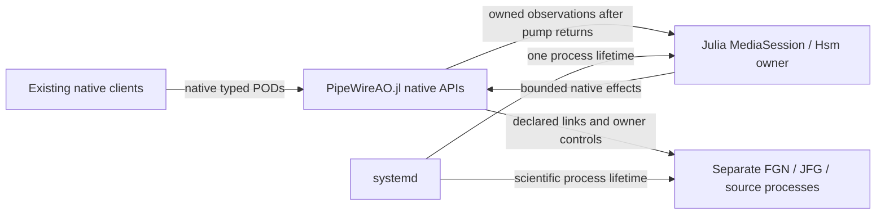

# Julia session policy migration

## Baseline and accepted boundary

User decision, 2026-11-04: replace the Lua session policy, use Hsm.jl where
appropriate, retain one session authority, and commit verified changesets.
The source baseline is `a0e47d2d84aac27d2ccaf8bdc3e5fc9f5a45d278` on the
dedicated `codex/julia-session-policy-20261104` branch. The worktree was clean.
RTC-ARCH-024/026 and the stable RTC-DEV identities remain authoritative.

The user subsequently selected removal of both Lua and libwireplumber, using
PipeWireAO.jl directly. One Julia session owner remains in the RTC process.
The generated launcher enters Julia with `exec`, preserving its PID and
systemd lifetime. PipeWireAO supplies public discovery, proxy, Link, native POD
and loop APIs. The retired DeploymentRunner is not restored.

Terminology follows upstream [media-session](https://gitlab.freedesktop.org/pipewire/media-session),
inspected at `7376c167f1ad20b3968d7a5d6c395a8b698d31d8`: `sm_media_session`,
object, node, port, client, link, find object, create links and remove links.
The Julia module is `MediaSession` in `src/media_session/MediaSession.jl`.
Julia casing, dispatch and mutation suffixes apply; C `sm_` prefixes do not.
Existing RTC lifecycle and wire terms retain their precise meanings.

This diagram shows the authority and callback boundary, not frame scheduling:

Scientific processing remains on its existing PipeWire data threads. The policy
is cold control; Julia compilation and GC consume request deadlines and are not
qualified for strict RT. No priority, affinity, live service or installed
application changes are part of implementation validation.

## Interfaces and ownership

`MediaSession` names the session-management responsibility. Its Machine
uses Hsm hierarchy for Configuring, admitted Ready/Running, transient operations,
fault compensation and shutdown. Public mutation functions dispatch typed
events. Stable wire lifecycle IDs remain 1–5; transient states add no wire IDs.
The owner uses a sticky Julia task on one OS thread and one cached clock sample
per cycle. Absolute native receipt/deadline checks use fresh monotonic time.

PipeWireAO's public loop pump runs on its opening OS thread. Existing native
callbacks enter Julia on that same thread and stage bounded owned observations;
they never dispatch the application Hsm or perform blocking/scientific work.
The owner applies observations after the pump returns. Event count and retained
bytes are bounded; overflow is sticky and fails admission closed while permitting
cleanup. Native destruction accounts for pending callbacks. No borrowed native
pointer escapes a callback. This cold-control boundary makes no zero-allocation
or GC-independent callback claim.

Effects run outside Hsm dispatch as coroutines on the same owner thread.
Completion carries session, operation epoch, effect serial, kind and target.
Retirement fences the epoch before cancellation; late replies cannot advance
another transition. Scientific mutations are submitted once. Fault compensation
has a separate five-second budget and holds sources before consumers/links.

Configuration remains standard relaxed SPA-JSON. The authoritative generator
stores policy arguments under `pipewireao.session`; WirePlumber profiles,
components and Lua plugins are removed. Export stages the generated Julia
launcher and package; installed launchers select their pinned Julia/project paths.
Existing sealed applications are not rewritten.

## Requirement closure and delivery gates

Each row is initially planned / evidence missing. Completion requires the normal,
boundary, rejection, timeout, cancellation and cleanup cases named below.
The claimed surface is Linux non-actuating private-core development sessions;
no existing hardware, GPU, sustained cadence or strict deadline claim transfers.

| Requirement | Allocation and verification closure |
| --- | --- |
| RTC-DEV-003 | Exact node/port/client/core/Link identities, negotiated formats; creation failure at each step; pending activation retirement, sync and absence fence; unrelated objects preserved |
| RTC-DEV-004 | Stable lifecycle IDs, prepare/warmup/admit, start/stop/reset; unload from every managed leaf including Configuring/Fault and pending work; unknown cleanup stays Fault |
| RTC-DEV-009/012 | One state writer and in-flight effect; session/epoch/kind/target correlation; invalid groups, duplicates and late callbacks; stop/quit/loss fences pending work |
| RTC-DEV-010/013 | Existing multi-graph/groups/passive boundaries, external ownership and exact full port schemas; no graph parser/scheduler or external node ownership added |
| RTC-DEV-021/025 | Exact owner readiness and resource-admission controller; held startup, graph-before-source Run, source-before-graph Hold; cursor/reset proofs, ordered shutdown and emergency cleanup |
| RTC-DEV-022/030 | Same native envelope and limits, receipt-based deadlines, competing/stale/busy/malformed callers, retained terminal/rejection; typed scalar/parameter queries/updates and correction guards |
| RTC-DEV-022 journal | Requested durability before mutation, completed durability before publication; pre/post-dispatch failure and expiry/controller-loss races; no replay or inferred rollback |

Two observed Lua behaviors are implementation gaps, not compatibility promises:
Quit currently rejects Configuring/Fault, and pending public work rejects Quit.
The migration implements RTC-DEV-004 cancellation/unload instead of preserving
those restrictions. Other scientific ordering, protocol fields, first-fault
retention and unknown-outcome rules remain unchanged.

## Commit sequence and verification

1. Commit this boundary/closure plan and implementation-language wording updates.
2. Extend public PipeWireAO loop stepping and parameter-enumeration correlation,
   preserving existing callers, and verify against an isolated native core.
3. Add the pure Hsm session machine with gated effect tests for normal sequences,
   all-managed-state Quit, cancellation, stale replies, failure and expiry.
4. Add the native effect/ingress adapter, source/correction/property semantics and
   journal ordering. Connect the executable and authoritative generators together;
   remove production Lua loading and dependencies. Test fresh export/load and
   native control against a private core and external graph process.
5. Obtain independent review, run relevant native/core/private integration gates,
   record exact results and residual qualification limits, and commit closure.

Each implemented slice is committed when its checks pass. Intermediate commits
must not promote the replacement as ready before the integration gate closes.
The roadmap owns current status; dated evidence will be indexed separately.

The initial libwireplumber bridge experiment passed six native/sanitizer cases
and is preserved separately at `codex/libwireplumber-bridge-evaluation-20261104`,
commit `24ad2e9`. It is excluded from the selected implementation.
