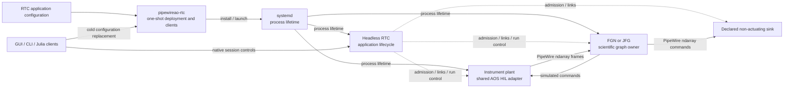
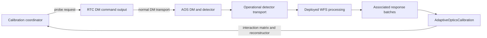

# PipeWireAO development RTC architecture

Status: active development and non-actuating deployment baseline; implementation underway

Review date: 2026-10-01

## Decision

The first executable `pipewireao-rtc` product is a small headless runner for one
non-actuating FGN/PipeWireAO graph. It loads one standard PipeWire
configuration, realizes a source → graph → sink topology, applies initial
properties and ndarray parameters, exposes a small lifecycle, and leaves the
result visible to ordinary PipeWire clients.

This is decision **RTC-ARCH-011**: use the small, non-actuating development
runner as the only active product baseline. This decision supersedes
RTC-ARCH-010 as the active delivery posture without reusing or changing that
identifier. The former full-RTC decisions and requirements are retained in the
[inactive design archive](archive/full-rtc/README.md). They are not selected by
this baseline.

The purpose is to prove the useful middle ground originally sought for
PipeWireAO: a scientific processing graph that is easier to construct than a
large observatory RTC, but more typed and composable than hand-written shared
memory processes.

The next active direction treats that runner as a small RTC workstation, or
RTCW.

This is decision **RTC-ARCH-013**: extend the development session to contain
multiple existing `fgn-native` filter-graph instances and explicit ordinary
PipeWire links between them. Graph authoring remains in the maintained
PipeWireAO `filter.graph` configuration. The runner MUST NOT parse filter-graph
internals, invent a second session graph language, or schedule frame processing
itself.

One session-level Statig lifecycle initially owns every required endpoint,
filter-graph instance, and link. Configuration is successful only when the
whole declared session is ready; session start, stop, retry, and unload apply
to the session as a unit. PipeWire remains responsible for scheduling and can
execute independent graph components concurrently.

This is decision **RTC-ARCH-014**: add selective run control for declared
execution groups without creating independent graph ownership lifecycles.
The session lifecycle remains the sole owner of configuration, realization,
required-object failure, retry, and cleanup. While the session is `RUNNING`,
the same serialized dispatcher may stop and restart a configured execution
group through typed effects. Stopping a group preserves its realized objects,
links, and algorithm state; reset, bypass, replacement, and unload are
different operations and are not implied.

An execution group names session boundary nodes, not operations inside a
PipeWireAO `filter.graph`. Separately controllable groups cannot be connected
directly in this increment. A shared upstream node remains session-managed,
and each link from it into a group must use declared standard PipeWire passive
link behavior so that a stopped branch cannot make the shared node or another
branch stop progressing. This adds control-plane granularity only: PipeWire
and FGN continue to own scheduling, buffers, and frame processing.

This is decision **RTC-ARCH-015**: compose externally implemented processing
and HIL applications through ordinary PipeWire nodes. The RTC configuration
identifies those nodes and their public ports; it does not identify or
interpret the package, language, process, or internal graph that implements
them. A launcher outside the RTC starts each external application on the
selected private core before the RTC realizes its links.

The first reference application is a transport-neutral AdaptiveOpticsSim plant
through a separate `AdaptiveOpticsSimPipeWireHIL.jl` package. The application
owns one complete WFS-frame source node and one non-actuating
correction-command sink node. AdaptiveOpticsSim MUST NOT depend on or contain
PipeWireAO code. The RTC runner owns the FGN graphs and the declared links
to those external nodes; it does not load Julia, execute the simulation, or
take ownership of the application nodes.

The adapter keeps the feedback coupling inside its application boundary so the
PipeWire topology remains acyclic. For sequence `n`, it publishes one complete
simulated WFS frame, accepts exactly one complete command with the same
sequence, and applies that command to simulated frame `n + 1`. This is a
non-actuating HIL reference system and does not introduce physical correction
authority.

This is decision **RTC-ARCH-016**: make the RTC processing-node implementation
substitutable at the ordinary PipeWire boundary. A declared processing role MAY
be realized by a runner-owned `fgn-native` filter graph or by an externally
owned `JuliaFilterGraph.jl` graph published through `FilterGraphPipeWire`. The
session contract names identical scientific ports, shapes, schemas, properties,
parameters, and links; it does not select behavior by implementation language
or package identity.

Object ownership and run-control authority are separate. An external
application creates and destroys its processing node. The RTC MAY request
owner-mediated run control only when the configuration explicitly grants that
authority; unload removes RTC-owned links but leaves the external node alive.
This uses the existing serialized lifecycle and execution-group effects. It
does not add a Julia process manager, a second graph parser, or a second
lifecycle.

This is decision **RTC-ARCH-018**: use an owner-mediated, versioned PipeWireAO
run-control contract for processing nodes. The RTC sends a tokened requested
state through the node's public `SPA_PARAM_Props` surface. The graph host calls
the owner-local `pw_filter_set_active()` operation and publishes the same token,
the result, and observed actual state. The RTC never calls a daemon-private
activation function and does not treat delivery of a request as completion.
Runner-owned and externally owned graph hosts implement the same contract.

This is decision **RTC-ARCH-017**: integrate the REVOLT Classic simulated plant
through the same external HIL boundary. `REVOLTClassicSim.jl` remains
transport-neutral. A separate `REVOLTClassicSimPipeWireHIL.jl` package maps
its prepared 352-by-352 Shack–Hartmann frame and 277-element HSDM277 command
boundary to ordinary PipeWire nodes. The RTC may place either the maintained
`fgn-native` controller or an equivalent `JuliaFilterGraph.jl` processing node
between those endpoints without knowing how the plant or controller is
implemented.

## Accepted workstation integration boundary

On 2026-10-21 the user selected **RTC-ARCH-026**: the headless RTC application
owns session lifecycle, admission and declared application connections.
This supersedes RTC-ARCH-025's assignment to the WirePlumber daemon, without
restoring the retired Rust Statig or Julia DeploymentRunner coordinators.
The [headless design](HEADLESS_RTC_DESIGN.md) defines the implementation and gates.

| Component | Selected responsibility |
| --- | --- |
| Headless RTC application | Own lifecycle, exact admission, explicit application links, source-first stop, reset/update sequencing, deadlines, required-loss handling, cleanup and fresh readmission. Reuse libwireplumber hooks, discovery and public WpLink APIs. |
| Upstream WirePlumber, with separately configured site/device policy where needed | Manage configured devices, access and shared routing; do not coordinate RTC application lifecycle or create its declared application links. |
| systemd | Start, stop, reap and supervise processes and apply configured service resource policy. |
| PipeWireAO | Negotiate and transport NDArray buffers, schedule published nodes, expose native controls and host FGN. |
| FGN/JFG | Prepare and execute scientific graphs, manage workspaces/workers, and apply owner-local controls and adoption. |
| AOS and its HIL adapter | Own instrument physics, model time and frame/command causality, and publish declared sources and sinks. |
| AOC and Julia calibration clients | Own calibration algorithms/estimates and coordinate acquisition through deployed endpoints. |
| Julia deployment tools and GUI/CLI | Export/install/preflight or request and observe bounded native operations as clients; do not duplicate live lifecycle ownership. |

The headless executable uses public libwireplumber APIs as an ordinary
application. Its minimal configuration excludes desktop auto-connect policy,
manager-socket preference and the WirePlumber daemon identity. Selective
`ObjectManager` features observe declared identities and Links without
subscribing to unrelated scientific Node Props. Scientific owners retain
internal graphs and workers. Startup alone does not authorize source release.

## Active scope

The former implementation began with the Rust Statig runner described below.
The paragraphs and milestones through this historical scope record the
original implementation baseline; they are not current provider allocations.
Current ownership follows
[RTC-ARCH-026](HEADLESS_RTC_DESIGN.md); the existing implementation and
its receipts remain evidence for their recorded scope, not qualification of
that replacement. The following baseline and increments describe the former
implementation, not current ownership:

- one simulated or recorded complete-frame source;
- one `fgn-native` execution composite;
- one simulated, discard, or otherwise non-actuating sink;
- one small Rust runner with a Statig hierarchical lifecycle and diagnostics;
- initial scalar properties and ndarray parameters;
- ordinary read-only PipeWire inspection; and
- numerical and state-equivalence tests against the maintained direct or fused
  Algorithm reference.

After that fixture, the active RTCW composition increment adds only:

- a serial chain of two declared `fgn-native` filter-graph instances;
- one declared source forked to two filter-graph instances, each with its own
  non-actuating sink;
- two independent declared source → graph → sink paths in one session;
- declared execution groups for whole-chain, independent-path, and fork-branch
  start and stop control;
- exact PipeWire links from the same standard configuration; and
- optional scientific inspection through standard PipeWire introspection and
  suitable bounded non-gating observation surfaces.

The next reference-system increment adds one externally owned AdaptiveOpticsSim
WFS source, one externally owned simulated command sink, and one or more
processing graphs between them. The first fixture uses a runner-owned FGN
graph; the following substitution fixture uses an externally owned
`JuliaFilterGraph.jl` node with the same public contract. The integration
package, not AdaptiveOpticsSim, owns PipeWire stream and acquisition-metadata
mapping.
These minimal-fixture endpoint counts do not limit an AOS application's sources
or sinks.

The first maintained fixture is the minimal complete-frame source → graph →
discard path. The AdaptiveOpticsSim HIL reference follows the RTCW composition
fixtures. REVOLT Classic, with its 277-actuator command vector and explicit
SHWFS subaperture origins, follows that reference-system increment.

The following are not part of the active baseline:

- physical cameras or deformable mirrors;
- permission to enter a correction-authorized state;
- operational instrument authority, safe-state arbitration, or multi-process
  fencing;
- scientific stream recording, full instrument-state audit, or run reconstruction;
- row-block, region-block, fixed-worker, or multi-batch scheduling;
- runner-hosted Julia graph execution;
- remote control, a web gateway, or WebRTC preview;
- host-wide scheduling changes, NUMA policy, or strict-island qualification; and
- operational, safety, deadline, tail-latency, or target-host qualification
  claims.

These exclusions are deliberate. A later project may select one capability
from the archive, revise it against current interfaces, and add it without
changing scientist-authored algorithms.

## Headless artifact catalog and configuration journal

Selected by the user on 2026-10-20. Headless configuration tooling owns a
Git repository of immutable artifact bytes and manifests, plus a local SQLite
catalog and update journal. GUI, CLI and Julia calibration scripts are clients.
Artifact registration does not apply a value or select a startup default.
Scientific compatibility remains a declared owner contract.

Git blobs identify original FITS bytes and manifests; retained Git refs preserve
registered commits and their objects. SQLite holds searchable metadata and
correlated operation events. Git publication precedes SQLite references; the two
stores are not one atomic transaction. Git maintenance, FITS decoding and database
I/O remain outside scientific frame processing.

The headless RTC remains the sole session admission/lifecycle authority. Its optional
journal module asynchronously records native property/parameter requests before
effects, then records the reported completion before publication. Newly generated
sessions require the journal; existing sealed sessions retain their previous
configuration and have no retroactive history. A failed pre-effect durable write
refuses the request. An uncertain or interrupted effect remains unknown, without
automatic retry or inferred rollback. Requested, submitted and active are distinct.

The headless management interface supports artifact registration, catalog reads,
exact retrieval and paginated history. It does not introduce another live-control
protocol, execute calibration acquisition or expose a browser gateway. The native
GUI uses a local helper off its UI thread; shared panels remain WASM-buildable.

## System boundary

### WirePlumber and application tooling

Current runtime integration uses upstream WirePlumber; the ordinary Git fork
is a contribution vehicle for upstream patches. Build and package integration lives in the sibling
[PipeWireAO package guide](../../wireplumber/packaging/pipewireao/README.md).
Site/device policy is configured separately through stock WirePlumber
configuration. No AO-specific device policy is currently defined or qualified.

The headless RTC is the application lifecycle owner: it admits declared
endpoints, owns application Links, serializes transitions and detects cohort
failure. It uses libwireplumber's public discovery, hooks and WpLink APIs.
Upstream WirePlumber may manage separately configured site/device policy. Julia
tools define application configuration, calibration bindings and one-shot deployment/control
commands. systemd owns process lifetime; AOS/JFG/FGN execute scientific work.
The GUI observes these owners and submits operator requests.

Selected on 2026-10-21, cold simulator settings management is a narrow
application-replacement operation. Plants declare immutable defaults and JSON
Schema metadata for their startup settings. A separate headless management
interface describes that saved configuration and accepts a candidate for a
systemd-owned, finite one-shot deployment job. The job prepares the candidate
using the pinned application environment before requesting any old-session
effect. It then uses the existing native RTC Quit/Status/Start controls
and ordinary installation/admission path. Management messages carry candidate
configuration and deployment receipts; they do not proxy live Start, Stop,
Reset, properties, parameters or authoritative status. The artifact/catalog
management interface above is unchanged.

The GUI renders the declared settings in the simulator panel's Settings area.
It does not write configuration files, prepare science, stop owners or manage
links. A cold replacement resets scientific/controller state and reloads saved
startup configuration; preserving unsaved runtime changes through a checkpoint
remains deferred. The old saved application and operation receipts remain
available for explicit recovery. GUI exit ends observation of an accepted job,
without cancelling it or authorizing a retry.

| Component | Active responsibility |
| --- | --- |
| `pipewireao-rtc` | Own live admission, application links, lifecycle/update ordering and cleanup. The package also supplies configuration, one-shot deployment/control tools and scientific-owner entry points. |
| Upstream WirePlumber (optional; separately configured site/device policy) | Manage devices, access and shared routing according to the installed site configuration. No AO-specific policy is currently defined or qualified. |
| systemd | Own process lifetime and configured resource policy. |
| PipeWireAO | Own ndarray transport, format negotiation, scheduling, FGN hosting, property and parameter publication, and standard PipeWire introspection. |
| Scientific Algorithm packages | Own ordinary typed implementations and declarations of ports, shapes, schemas, scalar properties, ndarray parameters, and construction values. |
| Source | Produce complete frames for simulation or deterministic replay. |
| Sink | Consume graph output without addressing or controlling physical hardware. |
| Observer | Inspect standard PipeWire objects and, where a suitable boundary exists, scientific samples. It is optional and never owns runner lifecycle or graph progress. |
| AdaptiveOpticsSim | Own the simulated atmosphere, optics, WFS, deformable mirror, science diagnostics, model time, and frame-to-command causality without a PipeWire dependency. |
| `AdaptiveOpticsSimPipeWireHIL.jl` | Map one prepared AdaptiveOpticsSim HIL boundary to an externally owned PipeWire source and non-actuating sink using public PipeWireAO interfaces. |
| `JuliaFilterGraph.jl` and `FilterGraphPipeWire` | Optionally own and publish one prepared RTC processing graph as an ordinary external PipeWire node. |
| Instrument directory | Own scientific prescriptions, ordered device geometry, pupil registration, AOS YAML graphs and calibration artifacts; shared RTC code prepares them through AOS and the HIL adapter. Classic is the first migrated instrument. |

The headless RTC is the live application control plane for this session. It does not process
frame data or replace PipeWire scheduling. PipeWireAO and scientific executors
remain the data plane. The Julia deployment clients are finite operator tools.

## Configuration boundary

The active configuration is standard PipeWire relaxed SPA-JSON, compatible
with existing PipeWireAO tools and the current graph generator. The initial
implementation does not introduce TOML, YAML, a deployment database, a
runner-private topology schema, or a multi-file operational bundle.

The minimum configuration identifies one complete-frame session rate, one
source, one canonical FGN graph, one sink, initial properties, ndarray
parameters, and optional observation ports. A repeated data port may declare
an exact rational rate; omission inherits the session rate, and both ends of an
ordinary link must have rationally equivalent effective rates. Sparse parameter
ports do not carry a repeated-frame rate. The only admitted rate-transition
object is the ordinary `api.ndarray.latest-hold` SPA node. It converts one
explicit slow input rate to one explicit fast output rate while PipeWire remains
the scheduler; the runner does not add a timer, FIFO, or scheduling layer. The
RTCW extension uses the same standard configuration to identify additional
source, graph, sink, link, and execution-group objects. An
execution group contains only declared session node names and does not copy or
interpret a `filter.graph` body. Each `filter.graph` body is passed to the
maintained PipeWireAO module; it is not decoded or regenerated by an
RTC-specific filter-graph parser. Paths and launch-time selections are
resolved before streaming. Construction and topology changes are handled by
stopping and reloading the development session.

For a configured sparse ndarray parameter, the runner realizes one ordinary
PipeWire output stream with the local development-only
`pipewireao.runtime-parameter` factory identity. The configuration declares
its exact output contract, graph input, link, and initial payload reference.
The runner owns only that source and link; it does not inspect the delegated
`filter.graph` body to discover an internal parameter route. PipeWireAO and
the graph host remain responsible for worker handoff and frame-boundary
adoption.

Scalar updates use the graph's standard `SPA_PARAM_Props` surface. A request
submitted while stopped remains distinct from requested or active generation
evidence; the runner reports submission and observes the host generations
after processing resumes. Ndarray parameter publication follows the same
rule through the declared Parameter Port. Processing-state reset is a
separate owner-mediated request accepted only while stopped.

An external node is selected by declared external ownership and exact node
name, port name, direction, element type, shape, and schema. Discovery may
locate that already-running declared object; it MUST NOT substitute another
node or create an undeclared critical link. The runner owns links that it
creates to the node but does not own or destroy the node. It does not require
implementation-identifying properties.

An external processing declaration additionally states whether session run
control is granted. When granted, the runner uses the versioned owner-mediated
PipeWireAO run-control parameter and waits for its token-matched completion.
When not granted, the external application retains run control and the node
cannot belong to an RTC-controlled execution group. Ownership never transfers
in either case.

This same boundary applies when `JuliaFilterGraph.jl` and its
`FilterGraphPipeWire` adapter publish a prepared Julia graph as one PipeWire
node. The RTCW sees public ports, formats, schemas, and links—not Julia
algorithms or the graph host. The owner-mediated public run-control contract
provides durable lifecycle and selective control without transferring object
ownership to the RTC. External endpoint discovery alone does not grant that
control authority.

The development safety boundary is the complete launched composition on an
isolated private core. Factory allowlists still govern objects created by the
runner. An external declaration does not prove that an arbitrary node is
non-actuating and does not admit physical endpoints on the user's normal
PipeWire core.

Each graph remains one canonical PipeWireAO model. A script, maintained
generator, or future GUI may construct the standard configuration, but none
introduces another graph executor or private transport.

The deprecated product name is not part of the RTC domain model. Runner-local
configuration uses `pipewireao.fgn-native`, and implementation types use FGN
terminology. Existing `org.calculon...` schema strings and legacy Rust artifact
paths remain unchanged compatibility boundaries until a separate versioned
schema and package migration defines their replacements.

## Scientist boundary

A scientist supplies an ordinary typed Algorithm and declaration:

- scientific port names, element types, shapes, and schemas;
- scalar runtime properties;
- large ndarray parameters such as reconstructors, masks, references, and
  subaperture origins; and
- construction values that genuinely affect the portable algorithm.

The adapter and host supply PipeWire ports, SPA callbacks, raw-pointer checks,
error translation, property publication, parameter adoption, buffer handling,
and worker machinery. Adding an algorithm must not require a central plugin
registry edit or a hand-written SPA plugin. The same scientific implementation
must remain directly testable with ordinary arrays and usable by another graph
executor such as AdaptiveOpticsSim.

## Implementation language and placement

Under RTC-ARCH-026, RTC-owned Lua implements the session policy through
libwireplumber, C supplies
native PipeWire control boundaries, and Julia supplies deployment tools and
scientific owners. systemd supervises the processes. These implementation
languages are not part of the scientist-facing ABI; scientific Algorithms
remain in their owning implementation language.

Historical decision **RTC-ARCH-012** selected the former runner lifecycle with
Statig's blocking state-machine API and a single serialized dispatcher from
the first increment. The public lifecycle remains the domain model in
RTC-DEV-004; Statig types stay private. State handlers produce typed effects,
potentially blocking configuration and PipeWire work executes outside the
handlers, and results return as typed completion events. This establishes the
same lifecycle mechanism that later operational work can extend without
selecting any archived physical-device, correction-authority, supervision, or
recovery behavior. RTC-ARCH-025 supersedes this implementation allocation;
the identifier and original rationale remain reserved.

The selected deployment uses separate PipeWire, headless RTC and scientific
owner processes. Device profiles may additionally use upstream WirePlumber with
separately configured site/device policy. It does not require one process per
graph operation.

## Laboratory deployment profile

This is decision **RTC-ARCH-019**: add an opt-in laboratory deployment profile
for repeatable latency experiments. A companion launcher in this repository
places and starts the selected PipeWireAO daemon, RTC runner, pixel source,
processing owner, and command observer. It does not execute Graph operations
or create a second frame scheduler. The ordinary development profile remains
valid without this launcher.

The launcher applies process envelopes before frame ingress. PipeWireAO owns
its data-loop affinity, RT priority, idle policy, and memory locking through
its existing configuration properties. An external Julia Graph owner pins its
own Julia threads through its existing ThreadPinning integration. FGN owns
the placement of any executor workers it creates. The launcher verifies the
resulting thread map and scheduling policy; it does not infer worker roles from
thread names or silently treat a process affinity mask as per-thread pinning.

The profile must record the effective policy and the complete pixel-to-command
delivery result. Failure to apply a required policy prevents a latency run
from starting. A completed replay with missing or repeated commands is a
failed run, even if its completed-command latency is low. This is a research
comparison profile, not physical correction authority, a hard real-time
guarantee, or an unattended service. It does not change C-state, CPU latency
request, huge-page, or host RT-runtime settings by default.

## Selected deployment package

This is decision **RTC-ARCH-020**: promote a non-actuating deployment package
that starts different existing RTC graphs through the same foreground command
and systemd user unit. This deliberately extends the former service and Julia
process-management exclusions. It does not select the archived physical RTC
architecture. AdaptiveOpticsSim and AdaptiveOpticsSimPipeWireHIL deployment
graphs follow completion of this increment.

Under RTC-ARCH-026, the headless RTC retains the sole live application policy.
One-shot Julia tools prepare configuration and systemd-owned processes,
verify resources, and request native admission. systemd supervises the private
core, headless RTC and scientific owners. Scientific packages export standard PipeWire graph
configurations and typed calibration artifacts. A deployment description may
declare process arguments, environment, readiness and placement; it must not
describe or reinterpret scientific operations. Runtime execution must not
depend on benchmark scripts, temporary evidence directories or git worktrees.

Startup loads the stopped session, prepares and warms owners without consuming
recorded science input, verifies effective thread placement and requested
resource rights, then explicitly starts the session. An external source must
provide its own hold/release interface; graph READY alone cannot gate it.
Required-dependency loss fails the whole deployment and revokes ingress. An
explicit restart rebuilds and revalidates all owned processes; no mutation or
RUNNING state is replayed automatically.

The private native PipeWire control endpoint and console share one typed command executor.
Reader/preparation/writer work stays outside the sole owner. Requests, clients,
queues, parameter bytes and reply sizes have finite bounds. Replies distinguish
submission, requested generation and observed active generation. The headless RTC
coordinates asynchronous effects with finite deadlines; its Lua policy must
not block on process, filesystem or scientific work. Health and stop must not
claim a bound shorter than the effects they depend on. A client timeout or
disconnect has an unknown mutation outcome until generations are observed.

Systemd manages deployment processes, not scientific workers. User units cannot
grant missing user-manager groups or raise inherited hard limits. Preflight
reports actual access, limits and affinity; the graph libraries configure their
own workers. Maintained host layouts exclude CPUs 0 and 1. No launcher changes
host power states, IRQ policy, RT runtime allowance or unrelated services.

## Selected AOS/HIL deployment

This is decision **RTC-ARCH-021**: extend the installed non-actuating deployment
with an externally owned AdaptiveOpticsSim plant through
AdaptiveOpticsSimPipeWireHIL. The maintained complete-frame Classic and Copper
science topology remains unchanged, including extrapolation, limits and clipping
feedback. Detector backgrounds, Classic sensing references and Copper's PDM
flat follow the simulated plant as specified by RTC-DEV-027. A simulator backend
is selected independently of the RTC graph owner.
CPU, CUDA and AMDGPU select explicit AOS execution targets; an unavailable
selected device fails preparation rather than falling back to CPU.

In the selected workstation/WirePlumber integration, AOS HIL is an optional
instrument provider that becomes a required session participant when selected.
An instance may provide multiple sensor/diagnostic sources and command sinks on
the selected PipeWireAO core. The session declares endpoint roles, exact owner
identities, per-endpoint contracts and required/optional status. The RTC
admits the required endpoint set and coordinates native acquisition and
lifecycle controls; simulator or required endpoint loss revokes admission.
The compatibility pilot includes the existing HIL path with
both CPU FGN and CPU JFG, not only a recorded source and discard sink. This is
a migration obligation, not a claim that headless RTC HIL qualification is complete.

AOS retains shared plant state, model-time advancement and declared sensor/command
coherence. Optional observation endpoints do not gate required simulation progress.
The current adapter's one-source/one-sink complete-frame exchange remains the
selected fixture; general multiple-endpoint adapter behavior and timing require
separate implementation/qualification.

For this fixture, the simulator alone owns model time, seeded optical/detector
state and one frame/command exchange. AOS stages completed GPU products to host
before the transport callback and copies an accepted command back to its exact execution
target. PipeWire callbacks do not execute optics or GPU synchronization. The
transport adapter declares UInt16 ADC encoding and a fixed conversion from the
RTC's micrometre OPD command to the plant's metre OPD command. HSDM277 order is
preserved. These transfers and encoding changes are explicit, not zero-copy.

An optional source-owner declaration selects a prepared application with a
bounded, acknowledged pause/resume/reset interface. The RTC releases
that source only after stopped-session admission and acknowledged RTC start.
The source completes its outstanding command before acknowledging pause; stop
and reset then reach the graph owner. The native session endpoint admits
client requests to the single Lua session policy; scientific commands use
the existing owner endpoints. It adds no data scheduler or second scientific parser.
Unconfirmed source control fails the owned deployment; mutations are not retried.

Simulation pacing and model time are distinct. The installed plant graph uses the
selected model period and its declared exposure. Missed pacing periods are
reported, never hidden by bursts or skipped model/command sequences. A finite
qualification batch retains its bounded output and remains held until reset or
shutdown. Simulated offsets are separate from recorded-input calibration: an
independent detector owner acquires dark ADC frames, Classic's RTC estimator
measures the simulated optical flat, and Copper's zero-command model defines
its PDM flat. No recorded camera pedestal or mirror offset is inserted into the
plant to accommodate a recorded calibration. The remaining measured
reconstructors and projections make this a hybrid calibration. The provisional
instrument influence models and hybrid calibration do not imply scientific
closed-loop convergence; that needs a separately validated interaction
calibration and plant oracle.

## HEART simulation bridge

This is decision **RTC-ARCH-022**: compose an unchanged external HEART RTC
with the installed AOS plant through the maintained SPA Standard WFS sink and
Standard DM source. An explicit `external-rtc` session owns only the PipeWire
links between external simulation and bridge endpoints. It has no FGN/JFG
processing graph or scientific substitute for HEART. The private core owns the
SPA bridge nodes; a supervised application owns HEART's native process and
control client. Simulation algorithms and GPU execution remain outside native
callbacks. The initial profile is non-actuating and finite, completion-paced.

HEART retains its ordinary progressive stdWfs receiver. The SPA sink packetizes
complete simulated ADC frames; optional packet pacing models transport readout,
not progressive optical detector generation. Received DM arrays require an
explicit actuator-order and OPD/displacement convention. Wire micrometres are
converted once by the SPA source; the simulation boundary receives metres.
HEART calibration offsets come from the simulated plant under RTC-DEV-027.
Measured matrices remain hybrid calibration. Configuration preparation and
external lifecycle integration do not authorize changes to HEART source.

## Instrument calibration through deployed endpoints

This is decision **RTC-ARCH-023**: AOS calibration uses the operational
instrument procedure. The calibration coordinator requests a DM figure through
the deployed RTC command path, acquires detector frames through the configured
source/transport, and collects the deployed WFS estimator's measurements.
AOS supplies the simulated detector and DM endpoints; its internal optical
fields, known influence functions and direct command-buffer writes are not
inputs to the operational calibration calculation. Physical endpoints may
later replace the simulated endpoints without changing probe generation,
response association or matrix estimation. This decision authorizes the
non-actuating simulation workflow, not physical device operation.

The proposed acquisition path is:

The coordinator owns preparation, settling/averaging rules, frame association
and artifact provenance outside frame callbacks. AdaptiveOpticsCalibration
owns probe-basis construction and response-to-matrix mathematics. Existing
scientific algorithms and graph owners own command emission and WFS processing;
the RTC runner remains the lifecycle/control plane. AOS retains its normal
configured detector noise and ADC behavior. Ideal noiseless physics remains
an explicitly separate diagnostic oracle.

Each RTC is calibrated with the same declared procedure and instrument
conditions. A shared numerical artifact is adopted only after measurement
contracts and responses agree at declared tolerances; calibration does not
force unequal estimators to produce identical arrays. CPU/CUDA/AMDGPU choice
changes the simulated endpoint implementation, not the calibration algorithm.
Acquisition can run slower than the instrument rate while retaining the
selected exposure, model-time and settling semantics. Such a run does not
qualify wall cadence or physical mirror dynamics. The current lockstep HIL
adapter requires a frame before its matching correction command; it does not
yet provide held-acquisition probe adoption. The next increment must establish
that endpoint behavior and exposure association before claiming operational
calibration support. RTC-DEV-029 selects this calibration-specific acquisition
contract; ordinary lockstep sessions and the RTC-DEV-027 offset fixture remain
unchanged.

The first selected operational session performs initial calibration before the
ordinary correction graph starts. It contains two ordinary graphs: the exact
deployed pixel/WFS frontend, and the deployed PDM constraint chain accepting
prepared absolute probe figures. The correction graph and its command producer
are excluded from this session. This establishes integration hold by topology
without changing controller coefficients or adding a scientific algorithm.

The complete-frame topology also declares a raw acquisition observer link
between the external simulated detector source and an external collector. This
extends RTC-DEV-028's former restriction of direct source-to-sink links to
`external-rtc`: complete-frame links between two application-owned external
endpoints are admitted alongside the required processing graphs. All existing
port compatibility, rate, group, passive-link and producer checks still apply.
Factory-owned direct links and row-block admission retain their restrictions.
The collector receives actual transported ADC values without adding an echo
algorithm to the scientific graph or changing PipeWire scheduling.
Absolute figures already include the reference; no additional system-flat stage
is applied. Preserving a running controller's state during calibration remains
a separate gate.

The selected automatic Classic campaign uses fresh initial-calibration sessions
for dark acquisition, lamp training, frozen-parameter qualification and zonal
interaction acquisition. Dark and lamp are startup selections; normal detector
noise, conversion and ADC behavior remain enabled. Backgrounds and references
are calculated from actual transported samples using public scientific-package
operations. Training uses an explicit zero WFS reference and the declared ROI
candidate universe. Eligibility is derived from a declared validity, flux and
ADC policy, without targeting a particular count of selected ROIs. Qualification
uses separately declared detector samples and cannot change the frozen mask.

Each stage restores the declared DM reference, releases ownership and stops
through the public launcher before reduction or the next stage. New standard
graph startup artifacts establish each parameter snapshot. A submitted live
parameter update is not used as evidence of adoption. Stage results remain
candidates; successful acquisition does not establish matrix precision,
reconstructor acceptance, closed-loop correction or instrument cadence.

For finite dark/training evidence, the calibration owner may write bounded
immutable raw and WFS payloads to an explicitly selected local staging directory
outside callbacks. The completion channel returns a manifest descriptor and
digest after publication completes. This is a temporary calibration evidence
transfer, not an RTC recording service or graph configuration format. The
campaign owns the files through verification and reduction. Exposure association,
capacity, deadlines and interrupted-stage disposition are specified in
RTC-DEV-029; interaction response quality requirements remain unchanged.

The owner observes both the actual demanded figure with constraint feedback and
the simulator's correlated adoption before generating exposures. Probe tokens
advance independently of exposure identities. Publication of a detector buffer
does not establish WFS completion: the owner must consume all required WFS
outputs, including validity where provided, before acknowledging that exposure
and admitting another. HEART uses the SPA stdWfs/stdDM UDP bridge; FGN/JFG use
native PipeWire ndarray ports. The RTC lifecycle owner executes neither WFS
processing nor detector simulation.

## Native live control transport

This is decision **RTC-ARCH-024**: replace local live JSON requests and replies
with standard PipeWire Node parameters and events on the existing private core.
This applies to supervisor/operator control, the Rust lifecycle runner,
calibration and correction owners, the calibration action endpoint, and the
supervised HEART wrapper. The completed simulator source path retains its
prepared native SPA run/reset/query contract. Persisted configuration, recipes,
immutable captures and reports retain their current formats.

Existing owners and their serialized dispatchers remain authoritative. Cold
owners may publish an inactive Filter with no ports or process callback; it
owns no scientific graph, frame queue or scheduling policy. A callback stages
bounded owned data. The existing owner performs the operation outside that
callback and publishes its typed completion afterward. Scientists continue to
write ordinary transport-neutral algorithms and properties.

The migration is dependency ordered under RTC-DEV-030. The
[design](NATIVE_CONTROL_MIGRATION_DESIGN.md),
[control inventory](LIVE_CONTROL_INVENTORY.md),
[mechanism proof](NATIVE_CONTROL_FILTER_PROOF.md) and
[independent review](NATIVE_CONTROL_MIGRATION_REVIEW.md) distinguish selected
behavior from implementation evidence. Native serialization does not itself
establish application, finite owner execution, restoration or real-time
qualification. Existing JSON interfaces remain explicitly unmigrated until
their corresponding native gates pass; they are not a native fallback.

## Shared instrument definition

Device descriptions define intrinsic actuator geometry and physical command
order. Scientific instrument packages combine the explicitly supplied description
with instrument pupil registration, units and model response independently of
RTC deployment configuration. The RTC
application selects that definition and its calibration, and publishes the
resolved operational description for clients. Simulators consume their normal
scientific APIs; the integration adapter checks compatibility before execution.
GUI operator-view files select sources/components and presentation, rather than
carrying copies of instrument or calibration arrays.

The first implementation uses existing read-only properties on the freshly
verified native public session endpoint. `pipewireao.rtc.session.instrument`
contains one bounded JSON document (maximum 256 KiB), and the companion
`pipewireao.rtc.session.instrument.sha256` identifies its exact bytes. These are
ordinary NodeInfo properties, not mutable Props controls or a new command API.
The sealed deployment's optional `instrument` field names the contained asset.
It is immutable for the session incarnation; changing/removing it invalidates
client scientific bindings and drafts until a fresh selection and resolution.

Schema version 2 declares `id`, `calibration_identity`, `scientific_identity`,
`deformable_mirrors` and `wavefront_sensors`. Component keys identify owner-defined
instrument components, not GUI panel IDs. DM declarations carry source-grid
`layout` in explicit `command_positions` order, `units`, `command_scale_m`,
amplitude `limiter` bounds and `shape_control` declarations. Optional
`pupil_coordinates` use the scientific model's normalized pupil radius convention;
they are distinct from source-grid Zernike/Fourier coordinates. WFS `layout`
declares detector/subaperture extents and zero-based `[row,column]` origins.
Published source-grid geometry does not imply measured optical registration.

A mirror's `shape_control` contains only `bases`, an ordered array of at most
16 instrument-defined bases. Each basis has exactly `id`, `name`, `units`,
`coefficient_limit`, `normalization`, `provenance`, and `definition`. Basis IDs
are unique per mirror. Names use at most 128 UTF-8 bytes and provenance uses at
most 4096 UTF-8 bytes. Coefficients use the mirror's command units; basis samples
are dimensionless. Each basis owns its positive coefficient limit.

The tagged `definition.kind` is `zernike`, `fourier`, or `sampled`:

- Zernike definitions carry command-ordered Float64 `positions` and up to
  64 named `{n,m}` modes with radial order 0–12. Positive `m` uses cosine;
  negative `m` uses sine. `sampled_peak` divides Float32 polynomial samples by
  their maximum absolute sample.
- Fourier definitions carry command-ordered Float32 `positions`, up to
  256 unique integer `frequencies` `[kx,ky]`, and `axis_units`. The source-axis
  spatial sinusoid uses `2π(kx x + ky y)`; `sampled_rms` gives the sine and cosine
  quadratures separate unit sampled RMS before coefficient-weighted addition.
- Sampled definitions carry up to 64 named command-sized Float32 `values`
  vectors and the source file's lowercase, 64-digit `artifact_sha256`.
  `supplied` preserves supplied values without normalization. Nonfinite,
  overflowing and identically zero modes are rejected.

Builtin descriptors preserve scientific conventions without adding numerical
basis evaluation to the RTC. Consumers validate sampled degeneracy when they
prepare builtin modes. The existing 256 KiB publication limit and structural
limits still apply; bounds reject oversized definitions without truncation.
The schema 1 publication's fixed Zernike/Fourier fields are removed.

RTC-owned `rtc/mirror-controls.yaml` declares `shape_control.bases` using
shared package-owned definitions selected with `template: zernike` or
`template: fourier`. The application retains `id`, `name`, command `units` and
`coefficient_limit`, and may override `definition.modes` or
`definition.max_frequency`. Package `data/bases/` owns normalization and scientific
provenance; resolved definitions retain the same seven publication fields.
Inline sampled/custom definitions remain supported. The physical instrument
contains no control bases. Zernike source definitions declare `kind` and
`modes`; Fourier source definitions declare `kind` and `max_frequency`. The RTC
derives both coordinate arrays from the selected mirror source grid. Fourier
frequencies remain strictly below the source-axis Nyquist frequency, excluding
the zero sine quadrature at Nyquist. A singleton axis has coordinate zero and no
nonzero frequencies. Sampled
source definitions declare `kind`, `artifact`, `command_order`, and `names`.
`artifact` uses the existing FITS `{path,hdu,axes,type,shape}` contract with
explicit logical axes: rows are commands and columns are modes. Mandatory
`command_order: "mirror"` asserts that artifact rows already follow the mirror's
physical command order. The RTC performs no order inference or remapping.
Custom basis content hashes contribute to the RTC publication identity.
Simulation graph/artifact hashes contribute separately to the simulation
prescription identity. Both are checked before execution; changing a control
basis does not change the simulated plant prescription.

Classic separates physical, simulation, RTC and mirror-control authoring:

| Owner | Source | Responsibility |
| --- | --- | --- |
| Physical instrument | `instrument.yaml` | Telescope, mirror reference, pupil registration, WFS geometry and acquisition requirements |
| Simulation | `simulation/definition.yaml` and optical graph YAML | Atmosphere, source photometry, detector response, sampling, numerical profiles and graph bindings |
| RTC | `rtc/configuration.yaml` | Physical instrument reference, controller dimensions, calibration identity and publication destination |
| RTC mirror controls | `rtc/mirror-controls.yaml` | Mirror command limits, analytic basis descriptors and custom sampled basis artifacts |
| RTC deployment | `rtc/application.yaml`, `rtc/modes.yaml` | Owners, native configuration and simulation/hardware connections |
| GUI | `gui/operator-views.yaml` | Panel/source presentation and selected published basis IDs |

Physical instrument and RTC authoring use bounded, single-document YAML, with
string mapping keys and duplicate-key rejection. Native PipeWire configuration
remains SPA-JSON, and published instrument/device metadata remains JSON.
Shared mirror descriptions are authored in YAML and validated before JSON
serialization at the device publication boundary. Valid native JSON inputs remain
supported for package/device transport, with their exact bytes preserved.

Shared package `data/simulation/components/` contains reference-only templates
for existing AOS node types and mirror profiles. A simulation names optical
components, selects physical mirror/sensor/source references and declares
instrument-specific schemas and detector response. Its production/calibration
YAML files use the ordinary AOS node, input, output and link schema. Preparation
expands component references, mirror parameters, zero inputs and HIL endpoints;
AOS remains the only optical graph compiler/executor. Canonical geometry and
acquisition values cannot be replaced by component config overrides. Calibration
may override explicitly supplied detector-response values. Mirror graph overrides
are rejected; mirror component/profile declarations own their settings.

Application/mode selection, simulator process settings, analysis settings,
calibration recipes and FITS bindings are authored in YAML. An application's
`runtime-configurations` explicitly maps YAML `source` to native runtime `path`
and `format` (`json` or `spa-json`). Export validates those entries before writing
fresh generated files in its copied application. Source and existing runtime
files cannot be overwritten. Native graphs, queues, session templates and device
adapter files retain SPA-JSON. Published metadata retains JSON. Strict JSON
outputs have no comment header; the deployment manifest records their identity.

Named portable profile YAML declares mode, device owners, calibration and
endpoint bindings. A separate host YAML declares `scheduling.processes`,
environment, analysis CPUs and simulator execution overrides. Scheduling process
entries use the existing native placement fields. `cpus` and `leader-cpu` are
required; `rt-priority`, `locked-bytes` and `threads` default to `0`, `0` and `[]`.
Optional `scheduling.defaults` supplies common values for those three fields,
with explicit process fields taking precedence. The existing placement validator
checks each effective contract before template expansion.

Each process declares native `data-loops` by their existing PipeWire loop names
and optional framework `workers` by role. All assigned CPUs must belong to that
process's CPU envelope. The builder writes each process's affinity and priority
into its own native context. Application owners explicitly select `kind: jfg`
or `kind: aos`; shared launcher adapters derive Julia thread counts and worker
arguments. JFG's ordered `workers.julia` starts with the process leader CPU.
AOS's `workers.pipewire` places its PipeWire loop; optional
`workers.observation` places diagnostics separately from its source thread.
Application role names and executable strings do not select adapters.

Native `placement` is derived for runtime verification. Host authors do not
provide a binding map or CPU/priority argument aliases. Ordinary endpoint
arguments can remain in top-level `bindings`. Simulator `pacing_rate_hz` is the
requested exchange cadence, separate from its physical model sample rate; zero
means unpaced execution. Model period, exposure and per-exchange stepping are
unchanged by this scheduling derivation.

`locked-bytes` remains a minimum observed locked-memory requirement in bytes,
not an allocation or an mlock request. `threads` remains a list of observed
thread requirements (CPU affinity, scheduler policy, priority, exact count and
optional exact name), not a thread-creation instruction. An empty list imposes
no particular thread matches; process-wide affinity/scheduling checks still apply.
Conflicting values and host attempts to change portable device/mode/calibration
choices are rejected. No runtime scheduler, admission or native contract changes.
These deployment profiles are separate from numerical mirror profile selections.

Package `data/simulation/` supplies shared startup-settings schemas. A simulation
selects `settings_schema: {template: atmosphere, title: ..., description: ...}`;
scientific values remain in `defaults`. Optional `properties` declare application
extensions, and inline schemas remain available for other model components.
Shared profile enum values derive from the simulation's declared profiles.
Schemas resolve before validation, GUI description and prescription hashing.

The RTC's optional `controller` declaration has authoritative `command_count`
and ordered `hidden_modes` labels. These derive `controller_command_count` and
`hidden_mode_count`. An empty list resolves to zero; the selected algorithm's
own dimension constraints still apply (the current closed-loop correction
constructor requires at least one hidden coordinate). Other dimensions may be
integer counts or existing JSON Pointer references to controller/instrument data.
Classic's closed-loop state length references its command count in the graph;
state length is not assumed for arbitrary controller algorithms. Parameter FITS
files must match declared graph contracts and never establish expected sizes.
Cold loaders retain separate raw authoring and resolved views. Calibration writes
raw declarations, preserving basis templates and dimension references, and rejects
inconsistent hidden projections/allocation dimensions before writing files.
`actuator_pitch_m` in a mirror description is intrinsic mechanical centre-to-centre
spacing in metres, paired with `actuator_pitch_provenance`. It does not rescale
optical geometry. Instrument `pupil_registration.actuator_pitch_pupil_radius`
is dimensionless spacing divided by the registered pupil radius; Classic retains
0.125. The existing AOS node configuration key `actuator_pitch` is an adopted
simulator API boundary and receives this normalized value. Source model strings
and SDK connection IDs do not establish unit metrology or production sequence.

`load` reads only physical data. `load_simulation` reads simulation YAML plus its
physical instrument; `load_rtc` reads the RTC configuration, physical instrument
and control YAML. Each descriptor's `instrument` path is relative to its own
file; all remaining graph, calibration, control and output paths are relative to
the physical instrument directory. Shared cold preparation invokes existing AOS
factories/compiler; AOS has no RTC configuration reader. The version 3 PipeWire
simulator wrapper selects the YAML definition with `plant.definition` and the RTC
configuration explicitly with `rtc_configuration`. The older version 2 route
remains for instruments that select a package and `plant.settings.mirror_description`.

The RTC can generate its schema 2 publication with no simulation files present.
The wrapper's `instrument` and `calibration_identity` values derive from the RTC
configuration. Its generated `prescription_identity` separately binds the
selected simulation definition, structural settings, physical input, graphs and
scientific artifacts. Native publication and wrapper formats remain JSON/SPA-JSON;
the source configuration split adds no per-instrument implementation.

Instrument source may reference a mirror description under a sibling `mirrors/`
directory using `../mirrors/…`. This exception is limited to mirror descriptions;
other assets retain their application-relative boundary. Export copies the exact
shared description bytes into the application's `mirrors/` directory, rewrites
the declaration to the local path, and includes the file in the deployment seal.
The generated application has no source-repository dependency. Device geometry
and command order remain separate from instrument pupil registration.

The physical declaration may supply a common `telescope` prescription and WFS
`optical_prescription`. Classic's latter prescription states lenslet geometry
explicitly, independently of its selected active-subaperture mask. Its current
Shack-Hartmann simulator requires square detector/subaperture sampling and exact
lenslet coverage; unsupported combinations reject declaration preparation.
Mirror command counts and grid dimensions come from the shared mirror description.
The cold declaration context also provides exact `description_json` file bytes
for the mirror's existing NodeInfo property and a WFS `video_frame_size` string
in native width-by-height order. These serialize existing device interfaces;
they do not infer camera configuration or physical command conversion.
An optional sensor `acquisition` object declares ROI origin in `[row,column]`
order and exposure in seconds. The simulation definition owns its linear
post-readout gain and source photometry. The
existing detector shape is the ROI extent. Cold references derive exposure
nanoseconds for the simulator and microseconds when explicitly selected by a
hardware control binding. Hardware gain units remain device-specific; neither
dB nor an analogue/ADU conversion is inferred from the simulation multiplier.
The simulator models an ROI-local array, not a crop of a larger synthetic sensor;
physical ROI offsets require matching registration/calibration.

The eGrabber adapter's optional initial-control list applies ordinary named SPA
Props one feature at a time before format and buffer negotiation. The entire
bounded scalar list is parsed before camera creation. Writes are ordered and
non-atomic; a failed write prevents node creation from succeeding without
promising restoration of prior physical device settings. Runtime single-feature
Props requests remain one feature per call. Device-specific writability, ranges and layout
validation stay with the existing GenICam control path.
AOS source graphs and profile configurations use the same plain JSON Pointer
syntax with `/instrument` for physical geometry, `/simulation` for numerical
configuration and `/settings` for selected simulation settings. Cold preparation resolves these references before calling existing AOS
factories; AOS does not parse RTC files. Initial zero bindings and simulator
boundary dimensions use the same context. Selected settings still take precedence
over node defaults. Generated simulator configuration carries a source notice.

Instrument source keeps its controller graph, parameter bindings, session and
queue fragments under `rtc/`, optional analysis under `analysis/`, GUI views
under `gui/`, and calibration recipe/inputs/artifacts/records under `calibration/`.
`InstrumentExport.prepare` copies this source into fresh output, applies an
explicit host deployment profile, renders shared core/client templates, generates
the publication and seals the deployment catalog. Source contains neither a
sealed runtime deployment nor a generated publication. Registered dependency
validation is unchanged: output without a matching sealed registered Manifest
is usable only for offline preparation, not installation. The exporter owns no
processes, links or live controls.

Authoring `rtc/application.conf` may additionally declare `graph-configurations`,
an array of `{path}` entries. This field is consumed by the exporter and is not
native deployment/runtime configuration. A node's `config` may use an object
containing only `$ref` with a plain JSON Pointer, for example
`{ "$ref": "/instrument/wavefront_sensors/shwfs/layout/detector_shape" }`.
References select typed values, not interpolated text or evaluated expressions;
JSON Pointer array indices are zero-based.

The reference context contains the resolved `instrument` geometry plus the
RTC configuration's `dimensions` at `/rtc/dimensions`: named, positive integer
counts and lengths. Controller, active/full VDM and hidden-state dimensions are
explicitly declared there. Mirror entries additionally expose `actuator_count`,
computed from physical command positions, and sensor entries expose
`subaperture_count`, computed from validated ordered origins. These derived
context fields and dimensions do not extend publication schema 2. Equality
with a physical actuator count does not establish shared coordinates.

`parameters.conf` maps `port` to FITS `path`, with optional `hdu` and `axes`.
It contains no shape or element type. Prepared typed parameter ports supply
both. All port names, supported types, positive/bounded shapes, axis ranks and
the aggregate retained-memory budget are checked before any FITS file is read.
Each artifact is then loaded using the port's expected type and shape, after
its declared axis permutation. Missing files, incompatible sizes, invalid
conversions and nonfinite values fail preparation before an executable graph
is returned. An artifact cannot redefine an instrument dimension. Cold
calibration reads reuse this same graph/loader path rather than inferring shapes
from file contents, and close prepared graph execution owners after the read.

Export resolves references after mode/calibration selection and instrument
publication, before sealing the fresh output. Selecting another calibration
changes the file bindings; it does not change expected graph dimensions.
Changing those dimensions requires changing the RTC configuration and
rebuilding, with compatible calibration artifacts. The existing calibration
resize helper updates declared controller dimensions and publication identity
alongside its graph and artifact updates, while leaving binding metadata intact.
Missing references, invalid indices and duplicate graph paths reject export.
No node-name inference or new Algorithm/transport parser is introduced. Emitted
graphs contain concrete ordinary SPA-JSON and a generated-file comment header.
Edit instrument source and rebuild; generated output is not authority.

Composed session and core configuration can use the same explicit references.
After graph materialization, session export provides
`/graphs/<node.name>/{inputs,parameters,outputs}/<port>/{shape,element-type,element-count}`.
These contracts come from the prepared scientific graph's public boundary
formats, with no FITS binding or control-loop execution. The graph's dimensions
have already been resolved from the instrument. Wire type names use the existing
PipeWire ndarray enum, including distinct `BOOL8` and `U8` representations.
The scientific providers remain optional and are loaded only when the session
requests their contracts.

Exporter-only `configuration-files` entries select application-relative `path`
and `format` (`yaml` or `spa-json`). They resolve against the same context after
mode composition and graph preparation. Classic uses this for GUI parameter
shapes and calibration estimator dimensions; GUI schemas, units and layout stay
explicit. `element-count` is the checked product of a prepared port's shape.
WFS `pixel_to_image` is `[1/columns,1/rows]`, explicitly selected for native
pixel-unit slopes rather than inferred for other scientific slope units.
All documents resolve before any are written, and generated files carry notices.
Calibration validates its estimator dimensions against prepared ports and uses
the prepared optical prescription for obstruction. Resizing refreshes parameter
metadata through graph/parameter identities and declared session links, preserving
scientific schemas and physical command order.

For physical endpoints, the instrument remains the expected scientific contract:
detector sampling, physical actuator order, units and pupil registration. Device
adapters own capability discovery and expose ordinary PipeWire formats, controls
and device descriptions. The hardware mode selects explicit endpoints and owners;
admission validates them against the declared controller contracts. Camera ROI,
pixel format and exposure must be supported by the selected source; actuator
limits and command-unit conversion must be supported by the selected sink.
Equal array sizes alone do not establish device compatibility. Physical-device
admission and calibration qualification remain separate from these offline checks.

Optional simulator optical contracts are under
`/simulator/{focal-image,residual-wavefront,wavefront-rms}`. The observation owner
derives them from cold, typed node definitions using the selected instrument
settings and the same sampling rules as its prepared products. Simulator metadata
export does not prepare atmosphere screens, telescope state, images or GPU resources.
Actual observation preparation checks its product dimensions against the
descriptor before publishing them.

Session source explicitly maps each endpoint to its required structural
contract. Schemas, parameter flags, layout, rates, endpoint identity and routing
remain explicit: sharing a shape/type does not make commanded and applied data
the same quantity. Queue modules continue ordinary ndarray negotiation and
retain their existing buffering, copying, overflow and loop policies. No queue
or instrument-specific contract inference is introduced. All references are
resolved after mode composition and selected settings, before ordinary native
session validation and sealing; generated files carry their source header.

The authoring declaration and generated `instrument.json` publication have
distinct paths. Both preparation and publication use the same resolved settings
and physical command order. Identity includes structural settings, graph content,
mirror/WFS descriptions and selected calibration payloads. Atmosphere-only
startup changes keep the structural identity stable and use the existing cold
replacement path. The GUI continues to read the RTC publication.

The ALPAO adapter and simulated command sink/applied-command source publish the
same bounded description through the custom `device.mirror.description` property
using existing NodeInfo interfaces. This is static metadata, not a new control
protocol or a promise of interchangeable command units: physical ASDK commands
remain normalized, while the selected simulator boundary uses explicitly declared
OPD units and scale. The existing one-mirror boundary validates the description
against the selected instrument before admission. The description carries no
pupil registration, influence functions, conversion factor or stroke claim.

`scientific_identity` is the SHA-256 of the deterministic scientific definition
serialized by the integration adapter. The AOS adapter checks it against the
selected declaration or package, calibration, channel dimensions and command
scale before execution. Its initial instrument-aware boundary supports one DM
and one WFS; further instruments need explicit channel contracts. The RTC still
owns control/update validation; publication does not create physical authority,
new parameter atomicity or a second artifact/journal store. Missing/incompatible
definitions make client views unavailable rather than supplying guessed geometry.

## Authoritative lower contracts

This repository does not duplicate the data-plane contracts:

- [ndarray filter graph](https://github.com/DarrylGamroth/PipeWireAO/blob/master/doc/dox/internals/filter-graph-ndarray.md)
  owns the plugin ABI, graph validation, execution, properties, parameters,
  and FGN worker behavior;
- the Rust FGN implementation's scalar-property contract owns portable
  property semantics; and
- Algorithm declarations own scientific ports, schemas, shapes, and
  reference behavior.

The deployment increment selects existing full-frame and row-block transport
and execution interfaces. Their ownership remains entirely with PipeWireAO and
the scientific graph owners.

## Claim boundary

Completing this baseline proves only that an identified development
configuration can construct, run, inspect, and stop its non-actuating graphs,
selectively pause and resume declared execution groups, and match accepted
outputs to the maintained reference within declared tolerances. It does not
prove physical-device interoperability, closed-loop safety, durable
reconstruction, hard real-time behavior, or production readiness.

The latest/hold configuration and lifecycle plumbing is an implemented
development capability. A focused private-core fixture demonstrates a
configured Dummy Driver, source Position cadence, no-buffer slow cycles, held
Acquisition provenance, sustained native/Julia command processing, stop/restart, and
ownership-safe cleanup. It is not a qualified multirate RTC path until live
driver association and hold Position cadence, READY reset, selective-group
recovery, cross-process pool replacement, steady-state allocation, and
latency-distribution evidence are complete.

### Instrument application modes

Instrument preparation may select a mode declared in `rtc/modes.conf`. Mode
fragments compose ordinary application, session and core objects: mappings merge,
arrays append, and scalar mode values replace common values. The shared
controller graph and instrument declaration remain unchanged. No live mode
switch or alternate session authority is introduced.

Device owners use the existing native bootstrap/source-control contracts and
explicit process placement. A mode can require explicit devices and calibration;
Classic hardware mode does so. Missing identities, native contracts, ownership
coverage or calibration inputs fail offline preparation. Structural validation is
shared with deployment, while installation additionally requires the registered
dependency closure. Configured hardware support does not establish adapter or
physical-loop qualification. Application mode selection adds no device plugin.
