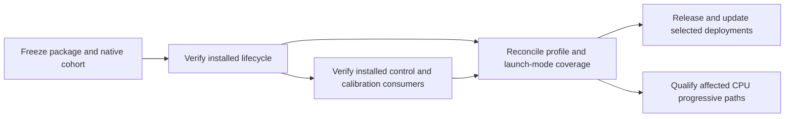

# PipeWireAO development roadmap

Updated 2026-11-25. The active scope is the non-actuating development RTC.
MediaSession owns lifecycle, exact admission and declared PipeWire Links.
systemd supervises processes. Graph and source owners keep their native
execution and publication responsibilities. Independent WirePlumber can
provide site policy. GUI and CLI tools are clients of the native controls.
[Architecture](architecture.md) ·
[Operating requirements](operations.md#requirements) · [Task index](README.md)

## Current work

### Installed session and retained graph lifecycle

The Julia operator app exports instrument definitions in a selected
registered environment and installs the resulting service. The site
can supply the Project when the instrument omits one. Installed admission
verifies the selected configuration and live identities before Ready. The
installer stages its package cache and binds strict shutdown hooks even for
a sealed historical launcher. Direct stop retains the exact systemd
invocation through exit reconciliation. Installed managed and direct Classic CPU fixtures
each admitted all 20 Links, primed while open and accepted native Quit.
[Deployment commands](../README.md#deploy-an-instrument-from-its-definitions) ·
[Installed-session evidence](reviews/20261125-installed-session/REVIEW.md#implementation-and-verification)

RTC Quit releases its graph attachments and leaves independent owners running.
For an explicit graph service stop, `f2217e8` moved PipeWire disposal onto
the graph's owning thread. In the disposable Classic CPU replay, the idle
retained graph exited with status 0 in 0.327 s after its explicit stop.
The source and core kept their identities and the camera advanced in the
same generation. The `6986033` follow-up fences connecting controllers
during shutdown. An installed graph stopped in 0.279 s before its first
Connect, and the connected-stop private-core test passed all 11 checks.
These observations apply to their respective source revisions and fixtures.
[Graph shutdown evidence](reviews/20261125-installed-session/REVIEW.md#retained-graph-service-shutdown) ·
[Service procedure](SYSTEMD_SESSION_STARTUP.md#keep-controller-graph-services-running-across-an-rtc-restart)

### Delivery order

Freeze the exact package and native cohort before extending installed claims.
Reconcile retained evidence and run the smallest missing check for each
affected clause. Reuse scientific results only within their source, input and
configuration scope.

1. **Verify installed lifecycle on the intended release cohort.** Check
   a clean registry-only export and install, the bound interpreter and
   cache, native Ready, a fresh attachment after graceful and abrupt RTC
   exit, and explicit retained-graph stop. Confirm withdrawal of RTC-owned
   Links and scoped companion exit while the independent provider and core
   keep running. PipeWireAO 4.0.10 ships the capture-loan withdrawal fix and
   the discard SPA factory. An installed CPU CAL2 session verified LLOWFS and
   SCC publication through native Quit and reattachment with the integrators
   open. [Bundled queue and CAL2 lifecycle evidence](validation/cal2-bundled-queue-20261125/README.md) ·
   [RTC-DEV-021](operations.md#rtc-dev-021--admission-and-coherent-lifecycle) ·
   [CAL2 capture buffer evidence](validation/cal2-ready-and-buffer-lifetime-20261124/README.md)
2. **Verify affected native consumers.** Cover short Collect/Capture,
   restoration and release, live parameter and artifact adoption, and
   selected GUI observation and operator controls on the installed boundary.
   Keep calibration candidates distinct from accepted products. Keep science
   comparisons on frozen inputs, including known failed gates such as
   ordinary native Copper streaming CCR-017.
   [Native local controls](operations.md#rtc-dev-030--native-local-live-controls) ·
   [Calibration completion](CALIBRATION_COMPLETION_PLAN.md) ·
   [Native parameter evidence](validation/rtc-ndarray-integration-20261123/README.md)
3. **Reconcile application and release coverage.** Retain separate coverage
   for Classic/Copper × FGN/JFG/unchanged HEART in foreground and user-service
   operation. Record each omitted profile or untested acceptance clause.
   For the installed complete-frame CPU path, use each instrument's own
   priming evidence. GPI2 recovery and fitted dual SPIDERS have scoped
   restart results. The fitted dual SPIDERS test used a FilterGraphPipeWire
   companion backport. Qualify the matching registered dependency before
   changing its pinned deployment. Review package trees, native artifacts
   and source inventory before adopting a new instrument release.
   [Qualification map](NATIVE_FINAL_QUALIFICATION_PLAN.md#acceptance-map) ·
   [Instrument-specific evidence](validation/direct-session-launch-20261124/instruments.md)
4. **Continue CPU progressive qualification after functional installed
   checks.** Separate setup and first-use cost, foreign callback allocation,
   frame delivery, host cadence and end-to-end latency. For GPI2, keep
   source rejections and deadline misses in the offered-load evidence.
   The existing 500 µs traced replay characterizes the shared development
   workstation. Target-host timing remains a separate gate.
   [GPI2 traced replay](validation/gpi2-traced-replay-20261122/README.md) ·
   [Deployment resources and placement](operations.md#rtc-dev-019--verified-process-and-thread-placement)

## Deferred capabilities

- Physical camera service, physical DM authority and operational lifecycle
  require named devices, an agreed authority contract and separate
  qualification. Target-host qualification additionally requires a named
  topology, load, deadline and host.
- Durable recording and reconstruction, remote operation and WebAssembly
  require a selected operational use case. Native local control remains
  the active scope.
- CUDA/HIP RTC executors, accelerator acquisition and row-block retained
  graph services retain their own qualification gates. The CUDA simulator
  and complete-frame CPU RTC evidence covers only those recorded roles.

The [inactive full-RTC design](archive/full-rtc/README.md) records earlier
designs for deferred capabilities. Promote a selected capability against
current interfaces and its own acceptance criteria.

## Historical records

The [evidence index](EVIDENCE_INDEX.md) links the dated reviews, methods and
receipts. The full previous roadmap, including the original dependency
sequence, requirement delivery map and dated increments, is available with
`git show e69c39a:docs/roadmap.md`.
The [published revision `5a1e471`](https://github.com/DarrylGamroth/pipewireao-rtc/blob/5a1e471fc9c67cfaa2de153ffc480af1fdb7a7ea/docs/roadmap.md)
contains the earlier dated sections. The original RTC-ARCH and RTC-DEV
identities and acceptance clauses remain in their governing documents.
