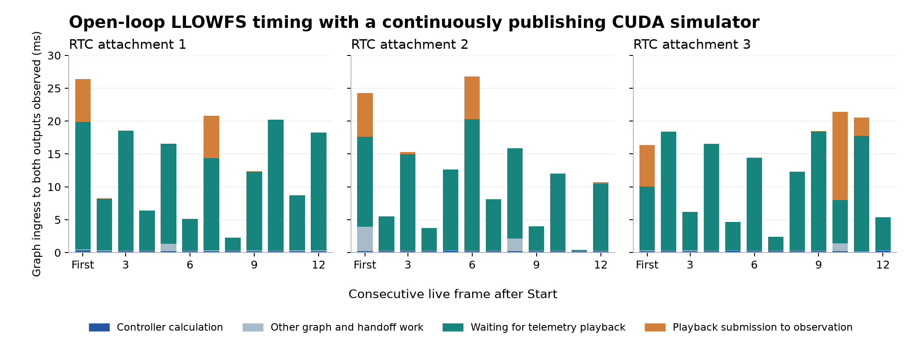

# CAL2 LLOWFS frame latency and CUDA simulator attachment

Across three RTC restarts, the first LLOWFS controller calculation took
0.231–0.313 ms. The external observer saw both the measured residual and the
held zero offset 16.337–26.389 ms after graph ingress. Most of that time
elapsed after the graph had produced its outputs. The endpoints here measure
open-loop telemetry. Timing an actuator command would require a separate
measurement at its consumer.

## Original CPU-simulator observation

The [original restart experiment](../cal2-link-negotiation-sysimage-20261124/README.md)
timed a fresh camera exposure from entry to the LLOWFS graph until an external
observer saw its modal residual and physical offset. The earlier 11–28 ms range
pooled both Julia image configurations. Restricting the original evidence to
the standard Julia distribution gives the following results. Both graph
processes were already running. Each RTC attachment began held, then Start
allowed the graphs to process live inputs with correction open.

| Standard Julia, CPU simulator | Frames | Graph entry to observation of both outputs |
| --- | ---: | --- |
| First live frame after each Start | 2 | 20.986 and 27.860 ms |
| Following frames in the longer attachment | 9 | 1.517–28.055 ms, median 12.046 ms |

The first, short attachment ended after its first LLOWFS frame. The longer
attachment supplied nine subsequent comparisons. The [CPU observations](cpu-observations.csv)
join native camera publication, graph ingress and the observer's two metadata
callbacks by acquisition domain, generation, sequence and model timestamp.
Only publications between Start acknowledgement and the Quit request enter
the comparison. Every residual was finite and nonzero and every physical offset
was zero. The graph-entry to complete-output measurement ends at the later
callback. The JSON writer runs after the timestamps.

In the two standard-Julia restarts, 30.281 and 31.005 seconds elapsed from
Start acknowledgement until the camera published the relevant exposure.
Delivery to the graph took another 150 and 117 µs. These exposure waits
explain almost all of the 30.302 and 31.033 seconds previously reported to
first usable LLOWFS output. The CUDA experiment below uses a different
wall-clock pupil cadence, so the change in camera wait does not isolate GPU
acceleration.

The two observed outputs each traverse a native telemetry queue.
During these measurements the private core assigned the playback nodes
and their observer streams to the telemetry driver, configured at 1,024
samples per 48,000 Hz cycle (21.333 ms). The original observation did
not timestamp queue capture, playback or execution of the controller.

## Three RTC attachments to one continuously publishing CUDA provider

The private core and simulator stayed running while three fresh standard
Julia 1.13.3 RTC processes attached, reached held Ready, started open-loop
processing and quit. The installed RTC used revision `a4cacb81b0` and the
Julia distribution image. Both CAL2 controller graph processes also persisted.
Only the optical simulator ran on the RTX 3080. The LLOWFS controller used
its normal CPU graph. Each attachment used a fresh external telemetry observer.
The test feeder scheduled a new pupil every 0.5 s of wall time, advancing
2 ms of model time per pupil. The observed LLOWFS camera intervals for the
reported frames were 501–505 ms. This is a functional restart experiment.

The test selected the first 12 consecutive complete open-loop measurements
per attachment. Each required a finite nonzero residual and zero physical offset
for the same acquisition. Every time below follows the output that the observer
saw last for that particular acquisition. The 33 following-frame medians
are pooled across the three runs. The aggregate row is measured per acquisition
before taking its median.

| Interval | First, attach 1 | First, attach 2 | First, attach 3 | Following 33, median |
| --- | ---: | ---: | ---: | ---: |
| Graph ingress to both outputs observed | 26.389 ms | 24.291 ms | 16.337 ms | 12.324 ms |
| Scientific controller graph call | 0.313 ms | 0.242 ms | 0.231 ms | 0.220 ms |
| Graph stages output to telemetry queue capture | 0.097 ms | 3.628 ms | 0.094 ms | 0.055 ms |
| Admitted to telemetry queue until playback begins transferring the buffer | 19.426 ms | 13.720 ms | 9.658 ms | 11.697 ms |
| Queue transfer call | 2.8 µs | 2.5 µs | 3.0 µs | 2.3 µs |
| Playback submit to Julia observer process callback entry | 6.477 ms | 6.651 ms | 6.316 ms | 0.020 ms |
| Julia observer entry to recorded result | 8.5 µs | 9.0 µs | 8.5 µs | 15.6 µs |



The dominant following-frame interval was waiting for the telemetry playback
cycle. Residence ranged from 0.102 to 19.974 ms. Its first three playback
cycle periods were 21.337, 21.341 and 21.356 ms, consistent with the configured
1,024/48,000 s quantum. The copy itself took microseconds. The controller call
ranged from 0.162 to 0.303 ms on the subsequent frames. Three later frames
also spent over 6 ms between playback submission and the Julia observer
callback. The complete observed interval ranged from 0.434 to 26.814 ms
across the 33 later frames.

The graph-staging to queue-capture interval includes the remaining Julia graph
callback, native output submission and downstream scheduling. The deployed
graph SDK retained its stock binary and the trace measures the combined
interval. The controller call was directly timed. A diagnostic build of the
existing queue module timestamped capture, ring admission, playback-cycle
entry, transfer and successful buffer submission. All 24 queue tests passed.
[Queue probes and build](queue-probes.tar.gz) ·
[Installed measurements, per-frame timestamps and reproduction commands](installed-cal2-cuda-attachments.tar.gz)

## Why the first observer callback takes milliseconds

Three additional attachments timestamped the two LLOWFS streams inside
the external observer. Both streams share its PipeWire thread loop. For
each first live frame, PipeWire submitted the residual first and the offset
about 20 µs later. The native observer began receiving the residual within
23 µs. It served the offset later. Counting both waits as independent
transport delays would charge the same time twice.

| First live frame | Attach 4 | Attach 5 | Attach 6 |
| --- | ---: | ---: | ---: |
| Residual playback submit to observer's native receive | 22 µs | 22 µs | 21 µs |
| Native listener invocation to first Julia wrapper timestamp for residual | 7.606 ms | 7.771 ms | — |
| Full first residual listener call, measured in C | — | — | 6.446 ms |
| Offset playback submit to observer's native receive | 12.136 ms | 11.340 ms | 13.183 ms |
| Full residual listener return to native offset receive | — | — | 6.730 ms |
| Graph ingress to observation of both outputs | 26.576 ms | 28.669 ms | 32.270 ms |

Attachments 4 and 5 added timestamps to the observer's native library and
Julia binding. The binding's callback lock took about 0.1 µs on both first
residuals. On the next 11 residuals per attachment, median native-listener
to Julia-wrapper entry was 0.87 and 0.71 µs. The instrumented observer logged a
package-cache warning on attachment 4 and finished loading before the timed
RTC attach. The controller, RTC, simulator and private core kept the binaries
from the first three attachments throughout the diagnostic runs.

Attachment 6 used the stock Julia binding and timed native listener entry
and return. Its first residual listener occupied the shared loop for
6.446 ms. The next 6.730 ms elapsed between that return and native receipt
of the offset. The five observed streams did not receive another frame in
that interval. The trace leaves that interval unattributed between dispatch
and thread scheduling. It also measures elapsed time across the first
Julia call without distinguishing compilation, runtime initialization and
descheduling. Across the next 11 residuals, playback submission to native
receipt took a median 15.5 µs. The diagnostic attachments used the same
source and graph processes. Their different observer timings are reported
separately from the first three attachments.
[Observer measurements, event traces and operator verification](installed-cal2-cuda-observer.tar.gz) ·
[Observer probe source, build and replay checks](observer-native-repro.tar.gz)

## Attaching and detaching

| Attachment | Attach request to held Ready | Start request to first usable LLOWFS frame | Start acknowledgement to that frame | Detach request to service stopped | Native Quit submission to Offline |
| --- | ---: | ---: | ---: | ---: | ---: |
| 1 | 7.584 s | 0.576 s | 0.264 s | 4.988 s | 1.041 s |
| 2 | 6.228 s | 0.699 s | 0.366 s | 4.637 s | 0.486 s |
| 3 | 6.730 s | 0.599 s | 0.292 s | 4.791 s | 0.500 s |

Each attachment proved the ten declared Links and rejected premature closure
of both controllers. All three produced a valid open SCC exposure pair. The
retained simulator, camera identities and graph process IDs persisted through
the three ordinary Quits. The independent receiver saw all 184 LLOWFS and 36
SCC publications up to the validation cutoff, including LLOWFS 177–184 and SCC
36 during the final detached interval. The stop request includes starting the
management client, submitting native Quit, draining the RTC, process exit
and service cleanup. Measured native Quit submission to process exit was
1.230, 0.679 and 0.707 s.

The first usable frame requires a fresh camera exposure after Start. From
Start acknowledgement to camera publication the waits were 238, 342 and
276 ms. From camera publication to graph entry the waits were 138, 111 and
103 µs. Those timings use the host monotonic clock shared by the camera
publisher, graph, queues and observer. The controlled 0.5 s wall-clock pupil
interval sets the timescale for waiting for a new exposure in this experiment.

An additional run exercised the exact operator commands against the retained
fixture. `attach` returned held Ready in 6.049 s. `start` launched a fresh
Julia command client and returned Running in 2.595 s. Its first complete
LLOWFS observation arrived 2.547 s after starting that command. The three
earlier timings start at the native request in an already-connected client.
The operator check verified both integrators open, LLOWFS exposure 1354
and valid SCC pair 272, then detached in 4.309 s. Both independent cameras
continued publishing afterward.

On the development host, the fixture owner can use the following commands
while the retained user services are active. The status command includes the
independent receiver's sequence and gap counts. After this test the RTC was
detached. The simulator, feeder, independent receiver and both graph owners
were left running. The fixture uses transient user services and its staged
dependencies under `/var/tmp`.

```sh
cal2=/var/tmp/rtc-cal2-cuda.jhjhtFE9/cal2-ops.sh
"$cal2" status
"$cal2" attach   # Return after held Ready.
"$cal2" start    # Release the graphs for open-loop processing.
"$cal2" detach   # Native Quit and service cleanup. The cameras keep publishing.
```

During initial fixture setup the feeder's five-minute wait expired while the
CUDA provider was still compiling. Starting the feeder after its pupil endpoint
appeared allowed the independent source to publish. All timed RTC requests
began after the independent receiver had observed live exposures.
