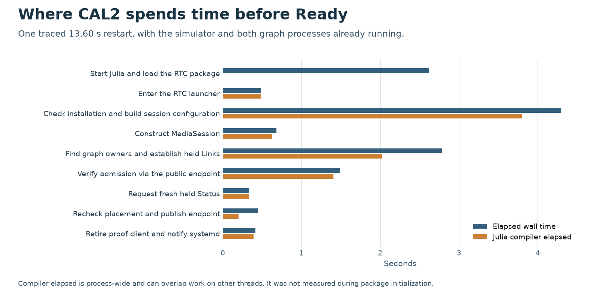

# CAL2 RTC startup CPU and camera buffer ownership

The sealed CAL2 restart reached held Ready in **8.037 s** with the existing
simulator and graph processes. The two camera paths passed live open-loop
priming, signed first correction after explicit Close and publication after
Quit. The native queue returned its outstanding capture loan at withdrawal.
Most identified pre-Ready CPU was Julia compilation. Moving configuration
rendering into the package image saved **0.97 s** in isolation. The two
matched pairs gave different whole-service timing gains.

## Where the earlier RTC CPU samples fall

The earlier [direct-launch trial](../direct-session-launch-20261124/README.md)
sampled Linux main-thread scheduler counters approximately every 200 ms. The
journal also records when MediaSession begins preparing control dispatch. The
samples on either side of that event bound the split of CPU time on each
activation. The earlier interval includes process startup, package loading,
installed-owner preparation and part of MediaSession construction. The later
interval includes native graph admission and publication of Ready. The control
dispatch preparation call inside the logged interval took only microseconds.

| Service activation | Main-thread CPU through the start of dispatch preparation | Remaining sampled CPU before Ready | Total sampled CPU |
| --- | ---: | ---: | ---: |
| Before forced stop | 10.097–10.295 s | 6.591–6.789 s | 16.886 s |
| Optical replacement | 6.790–6.992 s | 4.076–4.279 s | 11.068 s |
| Graceful recovery | 4.456–4.655 s | 2.998–3.197 s | 7.653 s |

These ranges use consecutive scheduler samples and the last recorded counter
before Ready. Journal delivery can lag the underlying operation. The table
locates CPU consumption in the older runs. Function-level attribution needs
compiler counters or stack samples in a fresh process.
[Original journal and scheduler samples](../direct-session-launch-20261124/cal2-event-retry.tar.gz)

## Where CPU went on a fresh installed CAL2 start

With the simulator publishing and the graph processes already running, a
baseline start reached native Ready in 12.105 s. Its main thread consumed
9.642 s of CPU and spent 0.237 s runnable but waiting for a CPU. In a
second start, 1,069 of 1,725 main-thread user-space samples (62%) landed
inside LLVM or Julia’s code generator.

A separate diagnostic start reached Ready in 13.597 s. The chart shows where
time went. The two largest stages were building the invocation (4.296 s)
and binding and connecting the graph owners (2.784 s). The final native
round trip took 4.7 ms and checking the held Link identities took 0.9 ms.
The traced shutdown's helper inherited the diagnostic environment and
timed out. The two normal baseline starts acknowledged Quit.
[Detailed phases, timing definitions and raw CPU profile](../installed-rtc-cpu-20261124/README.md)

The shared RTC package now compiles the invocation renderer and its SPA-JSON
writers when its package image is built. Eight alternating fresh-process
trials of the complete CAL2 configuration reduced median render/decode
from 1.668 to 0.700 s wall and from 1.640 to 0.677 s CPU. Each result
matched the retained configuration after replacing the intentionally
private socket path. The image grew by about 0.47 MiB. This experiment
isolates the renderer. The installed restart observations below include
the rest of the service.

## Cost of checking installed files

In three fresh processes, Julia 1.13.3 loaded the staged CAL2 application
with its existing package image and one default thread. The checks below used
the actual installed digest and files on CPUs 4–5. Each process executed the
activation check followed by the retained-graph check, then repeated them.
These isolated measurements are outside the installed restart samples.

| Check | First call, median elapsed | Julia compilation within that call | Second call, median elapsed |
| --- | ---: | ---: | ---: |
| Activation descriptor and current file identities | 196 ms | 188 ms | 30 ms |
| Persistent graph asset inventory | 38 ms | 31 ms | 6 ms |

The retained CAL2 export had 465 entries in each inventory, with 463 paths
in common. Each check reads the small inventory and checks current file
identities. Graph owners hash scientific inputs when the graphs start.
The times support retaining the file checks on restart. The archive contains
the exact Julia selectors and raw elapsed, main-thread CPU, compilation and
allocation counts. [Inventory measurements](inventory-measurements.tar.gz)

## Who holds the LLOWFS camera buffer

The installed CAL2 graph also offers the LLOWFS image to an optional
consumer via `cal2-llowfs-image-queue-input`. The copy-mode queue takes a
camera buffer so it can supply the latest frame. When no consumer has
negotiated a playback buffer, one capture loan can still be outstanding.
The stock queue discarded the slot pointer during capture-pool removal
before its deferred cleanup could return the loan. Removing the RTC Links
therefore left a camera loan unreturned. Both LLOWFS and SCC have a direct camera
image queue in the matched native topology. The persistent delivery gap in
the earlier recording was on LLOWFS.

The fix belongs to the queue module. At "first buffer removed" it returns
outstanding capture loans on the capture data loop while those buffers
still belong to the stream, if this is a copy queue with no playback
buffers. Each return records the native capture node, pool generation and
slot. The normal per-frame callback stays the same. Lease mode keeps its
existing lifetime contract because a consumer may still read a buffer
after the input withdraws.

The installed `PipeWireAOQueue_jll 0.1.0+0` release source and the native
queue baseline `01df204` have identical queue implementation blobs. The
same one-loan callback test fails at the missing return on stock and passes
on native queue commit `8434b55078e0`, with both never-attached and
previously detached playback. The test also delivers the subsequent native
format-removal notification and checks the loan was returned exactly once.
The private-core integration test at queue commit `e227bd920658` also
publishes one frame, removes the capture Link normally, observes exactly
one native withdrawal return, relinks and accepts a new publication. It
passes with never-attached and formerly attached playback. For these two
cases the fixture disables idle pause so the native withdrawal callback
owns the return. Separate checks cover copy format recreation and retention
and replacement in lease mode. Capture-first withdrawal with a playback
pool or an active copy read is outside this fix. [Queue lifecycle test results](queue-lifecycle-tests.tar.gz)

## Installed CAL2 with an already-publishing simulator

On the released queue and baseline RTC `bc90853`, the ordinary service
reached held Ready in 11.797 s. Start was followed by a live open-loop
LLOWFS measurement 30.628 s after acknowledgement. At shutdown the optional
image queue had observed five publications and four replacements, with zero
deliveries, completions or allocated playback buffers. The capture pool went
from three buffers to zero. The independent camera tap Link stayed active
while the queue input and RTC graph Links retired. The graph processes
retained their identities.

In this single fresh stock epoch, all 29 LLOWFS and five SCC staged exposures
were queued and observed at the camera tap, including LLOWFS 24–29 and SCC 5
after Quit. The producer temporarily encountered a busy LLOWFS buffer twice.
Its event-driven retry queued the frames 73.224 ms and 0.048 ms later.
The persistent failure recorded in the earlier multi-activation experiment
did not recur in this single stock activation. [Stock CAL2 observations](ordinary-cal2-stock.tar.gz)

With the same baseline RTC and the single fixed queue module, CAL2 reached
held Ready in 10.241 s. On ordinary native Quit the core recorded LLOWFS
capture node 55, generation 1, slot 0 returning during removal of its
three-buffer pool. At the optional image queue, pending went from one
to zero and withdrawal returns from zero to one. Its four publications
and three replacements left exactly the one frame returned at withdrawal.
The SCC image queue, node 63, returned slot 1 of its first generation in
the same shutdown. The permanent independent taps and graph processes
survived. All 16 LLOWFS and three SCC staged exposures reached both the
native producer and the independent tap, including LLOWFS 11–16 and SCC 3
after Quit. The first open-loop LLOWFS measurement took 30.600 s from
Start acknowledgement. Both the released-queue and fixed-queue starts
used the same 32 s wall-clock pupil pacing. These starts establish the
capture-loan behavior, not the speedup from the RTC package image.
[Fixed queue CAL2 observations](ordinary-cal2-narrow.tar.gz)

### Matched RTC process starts

Four fresh service starts used the same running private core, HIL source,
graph processes, placement and fixed queue module. The order was baseline,
candidate, candidate, baseline. Each start required ten fresh Links and
native held Ready. The baseline used the installed RTC package image.
The candidate used the new image via an environment override for this
comparison. The mapped images were checked per process. No compiler trace
or CPU sampler ran during these four starts.

| Start request to confirmed Ready | Baseline RTC | RTC with renderer precompiled |
| --- | ---: | ---: |
| First occurrence | 10.592 s | 9.144 s |
| Second occurrence | 9.389 s | 9.440 s |
| Mean of these two starts | 9.990 s | 9.292 s |

The observed mean difference was 0.698 s. The first pair improved by
1.447 s and the reverse pair was 0.051 s slower. In chronological order,
the last main-thread CPU samples before Ready were 8.245, 7.952, 8.090
and 8.141 s. Runnable CPU delay was 0.169–0.218 s. The lower nonrunning
time of the first candidate start contributed most of that pair's wall
difference. A repeatable whole-service speedup is unresolved.
The eight fresh-process renderer trials give a separate estimate of its
first-use cost. Each of the four service activations acknowledged native
Quit and dropped its previous session authority before replacement.

### Restart of the sealed candidate

The separately installed candidate selected the new RTC tree directly in
its Manifest. With the fixed native queue and an already-publishing source,
the initial RTC reached held Ready in 12.346 s. It rejected early Close,
then primed on actual open-loop LLOWFS acquisition 28 and SCC pair ending
at acquisition 7, with zero correction on both. It acknowledged native
Quit. At withdrawal the LLOWFS and SCC image queues returned their pending
slots from pool generation 6. LLOWFS acquisition 36 reached the independent
tap before replacement.

The replacement service reached confirmed Ready in **8.037 s**. The RTC
process changed from PID 1939369 to 1942865 while the compiler images,
native core, camera provider, independent tap and both graph processes
retained their identities. These are functional restarts of an installed application.
Another optical workload shared some graph/source CPUs in this run. The
four-start comparison above used the cooperative timing reservation.

| Sealed service | Confirmed Ready from request | First usable LLOWFS from native Start acknowledgement | First usable SCC pair from native Start acknowledgement |
| --- | ---: | ---: | ---: |
| Initial activation | 12.346 s | 30.296 s (frame 28) | 252.738 s (pair ending at frame 7) |
| Graceful replacement | 8.037 s | 30.952 s (frame 41) | 319.019 s (pair ending at frame 10) |

The first usable result is the observed open-loop graph offset matched to
its source exposure, with the residual and SCC pair status also checked.
The test waited in Ready to witness both live, held camera streams before
sending Start. The Start acknowledgement arrived 116.938 s after Ready
on the replacement. This test interval and the 32 s pupil cadence
(about 160 s per SCC exposure) are separate from RTC startup. Both
integrators produced zero offset on their first usable open-loop inputs.
On replacement, the first usable SCC residual arrived 319.010 s after Start
acknowledgement, the pair-status record at 319.016 s and its matching zero
offset at 319.019 s. The table uses the last of the required records.

| First correction after explicit Close | LLOWFS | SCC |
| --- | ---: | ---: |
| Camera acquisition | 51 | 11 (completed pair) |
| Close request to acknowledgement | 0.107 s | 0.127 s |
| Close acknowledgement to signed offset | 31.316 s | 159.740 s |
| Maximum absolute error across 2,304 channels | 3.157 × 10⁻¹⁶ m | 4.789 × 10⁻¹⁷ m |
| Numerical acceptance tolerance | 8.800 × 10⁻¹⁵ m | 1.430 × 10⁻¹⁵ m |

The replacement acknowledged normal Quit. LLOWFS node 55 returned pool
generation 7 slot 0, and SCC node 63 returned pool generation 7 slot 1.
The post-Quit continuity gate used source staging, successful native
publication and a separate consumer's actual callback and drain receipt,
joined by stream identity, acquisition generation, sequence and PTS.

Every staged LLOWFS acquisition 1–61 and SCC acquisition 1–12 reached
the native queue, independent callback and drain through the preselected
cutoff. The final 183.080 s after Quit included LLOWFS 56–61 and SCC 12.
LLOWFS 62 also drained during settlement after the cutoff. No rejected
stage, overwrite, retry or missing acquisition was observed in this
bounded fixed-module run. The two permanent camera tap Links remained
active after session-owned Links and graph endpoints retired. The fixture
then stopped its own services and verified removal of its socket and
temporary service files.

The archive retains both service lifecycles, graph and native receipts,
numerical comparisons, fixture sources and shutdown checks. For the large
core debug log it retains the native withdrawal lines. The full raw archive
had SHA256 `6b0f87aa4438037d548d51fb96a2888a53817988d5998416d20d263348806ead`.
The test used the released native 4.0.8 SDK with the queue module built
from `8434b55078e0`, SHA256
`5163978b5eb04cac9e01b89c61c01d9b64a36c76eb63f2a233933df9cd578688`.
The rest of the native libraries were the stock artifacts. Shipping the
change to existing instruments requires a new queue JLL and an updated
application pin. [Sealed restart receipts](sealed-restart-receipts.tar.gz)

## Package regression checks

The full RTC core suite passed 11,822 assertions in 553 testsets on the
`b2c2f1f` RTC code with Julia 1.13.3, its resolved PipeWireAO JLL prefix
and CPU affinity 0, 1, 14 and 15. It ran in the RTC package environment
with the command in the repository instructions. The native queue checks
ran separately on CPUs 0 and 1 against the release-matched 4.0.8 SDK.
All ten local queue selectors passed, including the full native live selector.
[RTC test output](rtc-core-tests.log.gz) · [Native queue checks](queue-lifecycle-tests.tar.gz)

## Remaining startup architecture

The installed service already enters one MediaSession and binds fresh native
authority to retained graph processes. Each attachment holds correction open.
The live endpoint, incarnation, negotiated format, placement and held-state
checks belong on each activation. These facts can change while the RTC is
stopped. Static topology, package compatibility, method compilation and
calibration preparation can be verified when building or installing the
application.

The current controller stages native registry and Link events. During
admission it resolves all declared endpoints, orders Links from sinks back
toward sources, then creates and awaits negotiation of each Link in turn.
The effect checks its deadline and sleeps for 1 ms between unsuccessful
condition checks. Batching independent Links by dependency, with the same
identity, negotiation and retirement checks for every member, is the
outstanding scheduling change for large topologies. The measured ten-Link
interval lasted 0.822 s with 0.501 s of compilation. It provides no basis
for attributing the earlier 7–17 CPU seconds to polling.

The launcher still writes an invocation-specific SPA-JSON file and reads it
back before MediaSession opens the public endpoint. A further reduction
could install the validated static part once and bind only live PIDs,
incarnations, endpoints and placement in the direct launch path. The
deployment contract must still detect a changed install, preserve the native
configuration entry point and confirm that the public native Status endpoint
works. Once its code was warm, the current render and native decode took
26–30 ms. Removing this interchange has limited measured benefit compared
with eliminating its remaining first-use compilation. The next package-image
targets are registry binding and proof-client
connect/close, where the diagnostic trace identified first-use code.

Independent processes publish native PipeWire objects, systemd controls
their lifetime and one MediaSession owns admission. The protocol allows
these processes to use different implementation languages. A cold start of the full instrument still has to
load graph code and calibration and start its sources. Retained graph
owners are an opt-in for eligible complete-frame CPU graphs. Row-block,
accelerator and physical owners require their own qualification.

A subsecond service target needs its own matched benchmark. Importing the
current Julia package alone took 1.105–1.225 s in a fresh process with the
filesystem cache warm. An application-specific system image could reduce
that floor. A native implementation of the same MediaSession admission
contract is another measurable option that leaves the independent Julia
science graphs and PipeWire transport in place. The historical HEART
117–169 ms Ready acknowledgement used a small fixture, a different timing
origin and had no WFS frames yet. It does not establish a like-for-like
CAL2 target. [Timing scope of the HEART comparison](../independent-source-20261123/startup.md)

[MediaSession Link creation](../../../src/media_session/objects.jl) ·
[Effect waiting](../../../src/media_session/transport.jl) ·
[PipeWire application architecture review](../../reviews/20261124-pipewire-application-startup/REVIEW.md)
