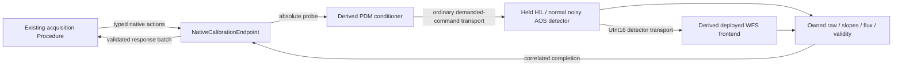

# Native initial calibration — 2026-10-27

Work starts from clean RTC `864281b` and instrument `439181b`, in the dedicated
`codex/calibration-owner-20261027` worktree. Existing registered 0.2.21 build,
bundle/staging evidence and selected calibration files remain unchanged.

Implement the initial, non-actuating CPU session selected by RTC-ARCH-023 and
RTC-DEV-029. The regular built graph remains the single authored authority.
Cold projections retain its exact pixel/WFS frontend and PDM conditioner;
the ordinary correction producer is absent. Absolute physical probe figures
already contain completion/reference. Do not add the flat or offsets twice.
This is distinct from preserving a running controller during recalibration.

The owner/control/data relationship is:

One owner task applies actions. Native/stream callbacks only stage bounded data
and notify it. Native admission has one pending ticket and one retained exact
controller; replay does not repeat effects. Deadlines are finite absolute
monotonic bounds, with one-shot timers used only to wake/check deadlines.
No arbitrary sleeps establish adoption, settling or completion. The existing HIL
adapter may retain its transport-progress mechanism; it does not prove WFS success.

Implementation order and acceptance:

1. Derive/validate cold graphs from explicit existing endpoints; retain exact
   configurations, typed port contracts, FITS bindings and source hashes. Reject
   unknown/ambiguous cuts and missing dependencies. No runtime graph traversal.
2. Serve the existing native action profile outside callbacks. Enforce one run,
   increasing request serials and legal action phases. Prove actual control-task
   dispatch, stale-request rejection and terminal acknowledgement on a private core.
3. Connect the derived graphs, normal noisy CPU plant, held-probe endpoints and
   bounded collectors. Adoption uses public `pipewire_probe_values` only after
   confirmed matching receipt/adoption. Require all raw/WFS observations to carry
   the armed complete exposure identity. Reject stale, duplicate, missing or
   invalid evidence; do not infer success from publication or parameter submission.
4. Drive the existing Procedure and online consumer through the real endpoints.
   First qualify a short signed-probe prefix, cancellation, deadlines, consumer
   failure and fenced restoration/release. A prefix is never an activatable bundle.
5. Only a complete accepted basis may feed existing AOC estimation, bundle
   publication, fresh staging/rebuild and finite correction validation. Dark/lamp
   eligibility and full-basis numerical acceptance remain explicit separate gates.

Unknown adoption, owner loss or restoration outcome faults and fences the
non-actuating endpoints; no automatic retry, rebind or ordinary-loop resumption.
Known aborts restore the declared reference and release exactly once. Bounded
response snapshots belong to the consumer; partial results never replace active
calibration. Resource ownership and closure must be checked on success and fault.

Names follow existing authorities: `NativeCalibrationEndpoint` is named by
RTC-DEV-029; Hold/Adopt/Settle/Collect/Capture/Restore/Release and result names are
the existing native profile. `calibration_graph` is cold configuration derivation
under InstrumentCalibration. No new wire names, scientific quantities or
execution authority are introduced.

No GPU, installed session, desktop core, physical actuation, new noise/gain policy,
GPI2 camera-unit conversion, recording service or RTC scheduler is authorized.
GPI2 held named-command coherence and multi-WFS association remain later gates.
Private CPU functionality does not qualify cadence, latency or physical devices.
