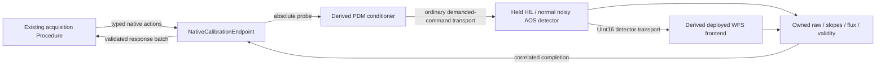

# Native initial calibration — 2026-10-27

Work starts from clean RTC `864281b` and instrument `439181b`, in the dedicated
`codex/calibration-owner-20261027` worktree. Existing registered 0.2.21 build,
bundle/staging evidence and selected calibration files remain unchanged.

Implement the initial, non-actuating CPU session selected by RTC-ARCH-023 and
RTC-DEV-029. The regular built graph remains the single authored authority.
Cold projections retain its exact pixel/WFS frontend and PDM conditioner;
the ordinary correction producer is absent. Absolute physical probe figures
already contain completion/reference. Do not add the flat or offsets twice.
This is distinct from preserving a running controller during recalibration.

The owner/control/data relationship is:

One owner task applies actions. Native/stream callbacks only stage bounded data
and notify it. Native admission has one pending ticket and one retained exact
controller; replay does not repeat effects. Deadlines are finite absolute
monotonic bounds, with one-shot timers used only to wake/check deadlines.
No arbitrary sleeps establish adoption, settling or completion. The existing HIL
adapter may retain its transport-progress mechanism; it does not prove WFS success.

Publication has three distinct boundaries: source buffer queueing, the native
source cycle ending, and correlated completion at every raw/WFS sink. The shared
HIL adapter exposes `frame_publication_cycle_sequence` in its existing status.
The owner waits for that witness before one downstream native progress request;
only captured full identities establish collection success. Direct triggering
after queueing was rejected by a private-core ordering experiment. This progress
request adds no model exposure or settling rule.

Implementation order and acceptance:

1. Derive/validate cold graphs from explicit existing endpoints; retain exact
   configurations, typed port contracts, FITS bindings and source hashes. Reject
   unknown/ambiguous cuts and missing dependencies. No runtime graph traversal.
2. Serve the existing native action profile outside callbacks. Enforce one run,
   increasing request serials and legal action phases. Prove actual control-task
   dispatch, stale-request rejection and terminal acknowledgement on a private core.
3. Connect the derived graphs, normal noisy CPU plant, held-probe endpoints and
   bounded collectors. Adoption uses public `pipewire_probe_values` only after
   confirmed matching receipt/adoption. Require all raw/WFS observations to carry
   the armed complete exposure identity. Reject stale, duplicate, missing or
   invalid evidence; do not infer success from publication or parameter submission.
4. Drive the existing Procedure and online consumer through the real endpoints.
   First qualify a short signed-probe prefix, cancellation, deadlines, consumer
   failure and fenced restoration/release. A prefix is never an activatable bundle.
5. Only a complete accepted basis may feed existing AOC estimation, bundle
   publication, fresh staging/rebuild and finite correction validation. Dark/lamp
   eligibility and full-basis numerical acceptance remain explicit separate gates.

The intended operating approach is daytime baseline calibration with an internal
source, followed by on-sky response/registration checks and controller or optical
gain adjustment. A bright target is an alternative source with its own
atmospheric rejection/averaging procedure, not equivalent to a stationary source.
Both use the same asynchronous interfaces; source conditions, optical-path
coverage and acceptance belong in procedure configuration. The next positive
Classic gate needs an explicit stationary-source simulation setting with
atmospheric disturbances disabled, normal detector noise/ADC retained, and
illumination eligibility verified. No source level, gain or threshold is chosen
by this integration increment; the existing 25 Hz filter is unchanged.

### Internal-source follow-up

Start from clean RTC `8977d4d` and instrument `bcbd339`, on dedicated
`codex/internal-source-calibration-20261027` worktrees. The user selected the
existing source level initially: R-band magnitude 2, 800 nm, on axis. This is a
stationary point-source-equivalent simulation, not a calibrated lamp-injection
model. Detector noise/ADC, exposure, RTC graph, filter and frozen artifacts are
preserved. No GPU or installed session is used.

1. Measure flat and a short signed-probe prefix on a copied, built CPU
   application whose optical path excludes atmosphere and retains normal
   detector configuration. Keep original evidence and authoring unchanged.
2. Add an explicitly declared `internal-source` optical graph selection to
   shared cold preparation, using existing component references and explicit
   zero uncompensated OPD input. The regular RTC graph remains authoritative.
   Reject absent selections and detector-behavior changes before acquisition.
3. Check illumination/validity from transported samples before claiming an
   accepted interaction calibration. If the frozen mask fails, preserve that
   failure and implement the separately declared training/qualification stages;
   do not change brightness, thresholds or mask to force a positive result.
4. Only accepted signed response pairs may feed online interaction reduction.
   A prefix qualifies integration only; full-basis numerical acceptance and
   candidate promotion remain separate gates.

Identifier preflight: `internal-source` denotes the user-selected stationary
illumination path (domain; RTC-ARCH-023 and user operating decision).
`simulation_graph` selects a declared AOS graph key for cold initial-session
preparation (configuration boundary; existing simulation `graphs` authority),
distinct from the regular RTC graph and the ideal `calibration` graph.
No new source brightness, quality threshold, coordinate mapping or wire term is
introduced. The existing owner/transport diagram above is unchanged.

The stationary-source experiment completed eleven transported exposures, with
zero accepted under the frozen mask. Eight edge ROIs failed the existing flux
threshold in different frames. Bounded Capture is therefore the next prerequisite
for dark/lamp training: one serialized owner writes owned ADC/WFS samples,
publishes an immutable manifest only after every payload succeeds, and returns
the existing native descriptor. Capacity rejection must precede acquisition;
post-admission failure must retain the existing unknown-outcome fault fence.
The campaign verifies and reduces each bounded stage after reference restoration,
release and shutdown. Capture does not authorize interaction acceptance.

Capture settings bind both retained graph projections using the source snapshot's
original hash, selected HDU, normalized axes, prepared-array hash, type and shape.
The prepared array and its provenance must come from the same immutable snapshot.
Stage/illumination and detector/source settings remain explicit. `CaptureStore`
and `read_capture` implement the RTC-DEV-029 finite evidence boundary; they are
not a general recording service. Copper and a full automatic campaign remain
unimplemented until separately qualified. An observed intermittent Collect
timeout requires passive slot-state evidence before changing transport.

Unknown adoption, owner loss or restoration outcome faults and fences the
non-actuating endpoints; no automatic retry, rebind or ordinary-loop resumption.
Known aborts restore the declared reference and release exactly once. Bounded
response snapshots belong to the consumer; partial results never replace active
calibration. Resource ownership and closure must be checked on success and fault.

Names follow existing authorities: `NativeCalibrationEndpoint` is named by
RTC-DEV-029; Hold/Adopt/Settle/Collect/Capture/Restore/Release and result names are
the existing native profile. `calibration_graph` is cold configuration derivation
under InstrumentCalibration. No new wire names, scientific quantities or
execution authority are introduced.

No GPU, installed session, desktop core, physical actuation, new noise/gain policy,
GPI2 camera-unit conversion, recording service or RTC scheduler is authorized.
GPI2 held named-command coherence and multi-WFS association remain later gates.
Private CPU functionality does not qualify cadence, latency or physical devices.
