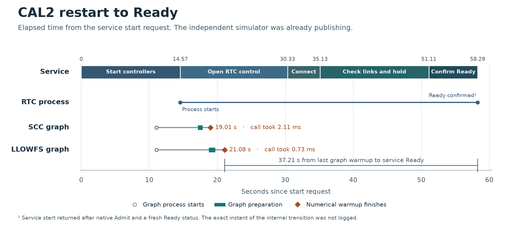
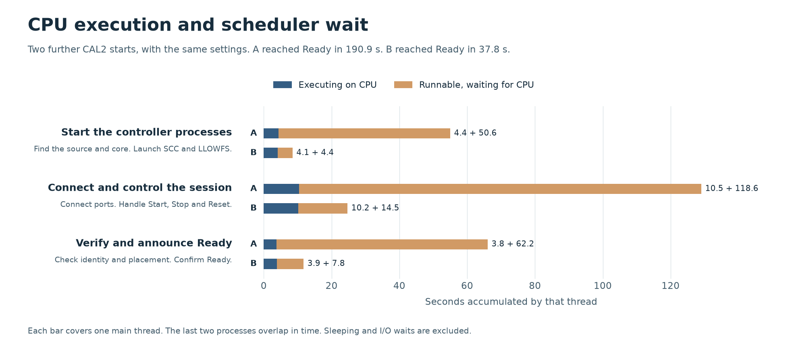

# What happens before CAL2 is Ready?

In this 58.287 s activation, the private PipeWire core, simulator and camera
observers were already running. Time zero is the request to start the RTC
service. Ready is the point at which that request returned after the RTC had
confirmed its state. Start is a subsequent operator command to enable processing.

The [zoomable event trace](cal2-timeline.trace.json) opens in Perfetto or another
Chrome Trace Event viewer. Each graph slice includes the duration the application
measured inside the call. The slice edges use journal receipt times.

## What the three process names mean

| Name in the measurements | What it does in this instrument | When it runs |
| --- | --- | --- |
| **Preparation helper** (`prepare`) | Reads the CAL2 deployment, identifies the existing private core and simulator, starts the SCC and LLOWFS controller processes, and writes their process identities and the configuration for this RTC launch. | A one-time systemd command. It exits before the RTC main process starts. |
| **RTC coordinator** (`MediaSession`) | Finds the declared camera and controller ports, creates the PipeWire Links between them, keeps the controllers held until admission, and handles Start, Stop and Reset. The separate SCC and LLOWFS processes perform the image calculations. | The main RTC process. It stays alive during observing. |
| **Publication helper** (`publish`) | Connects to that particular RTC, waits for its connected and held state, verifies actual CPU and thread placement and process identities, sends Admit and asks for fresh Status. It writes the discovery record that tools use to find the ready session. Camera frames come from the independent source throughout. | A one-time systemd command that runs alongside the coordinator. Its successful return completes service startup. |

The repeated 190.9 s and 37.8 s labels on the earlier CPU chart identified
the **total startup time for two different launches**. In the chart below,
A and B identify those same launches on every row. The numbers at the end
of each bar give that thread's CPU execution and runnable wait, in seconds.

## Service phases

The top lane partitions the operator's wait. The rows below it show processes
working concurrently. The phase names below describe intervals between logged
events. A wait can include CPU execution, time waiting to be scheduled and
time waiting for another process.

| Phase and time from request | Elapsed | What happens | Why it matters |
| --- | ---: | --- | --- |
| Start the controllers, 0–14.57 s | 14.57 s | The systemd preparation helper validates the deployment, identifies the running core and source, starts the SCC and LLOWFS controller services, and writes the configuration for this RTC invocation. The RTC main process starts at the end of this interval. | A replacement RTC needs the identities of the processes and endpoints that exist now. Stale identifiers could attach it to the wrong instance. |
| Open RTC control, 14.57–30.33 s | 15.77 s | The RTC constructs its MediaSession, opens its PipeWire connection and prepares its command handlers. A second systemd helper starts, checks the launch record and RTC process, and reaches its first logged endpoint wait. Both processes run during this interval. | The RTC needs a control endpoint that can receive a request and give a correlated reply. A new process ID alone cannot establish that. |
| Connect, 30.33–35.13 s | 4.79 s | The helper connects to the control endpoint belonging to the expected RTC process and instance. It then starts querying the session's preparation state. | Commands and status must come from this incarnation, especially when the previous RTC used the same node name. |
| Check that the Links exist and graphs are held, 35.13–51.11 s | 15.99 s | The helper polls the native `Warmup` operation. MediaSession coordinates its graph owners, discovers endpoints, establishes the declared Links and confirms the execution groups are held. The positive reply still reports `Configuring`. The independent camera source keeps publishing. | A process can exist and a graph can execute locally while the wrong ports are linked or a controller is already running. This gate establishes the intended, connected, held session. |
| Confirm and announce Ready, 51.11–58.29 s | 7.17 s | The helper rechecks the process identities and actual placement, sends `Admit`, requires a fresh native `Status` confirming `Ready`, then publishes the discovery record. The service start request returns. | The operator can address this particular RTC and trust that its live session passed admission. `Ready` permits a later `Start`. |

The trace records when the helper observes milestones. Owner preparation and
Link establishment can begin before the helper starts polling. The last 7.17 s
covers several operations, including admission and confirmation. The journal
has no timestamp for each individual operation within that interval.
[Phase boundaries and invocation records](README.md#cal2-rtc-replacement-with-the-simulator-already-publishing)
· [RTC startup state machine](../../../src/media_session/machine.jl)
· [Publication helper](../../../src/deployment/session_cli.jl)

## Graph preparation and numerical warmup

Installation builds package images for the declared graph workloads. On
service restart, each graph owner loads its package image, constructs its
configured graph, binds the FITS calibration arrays and prepares the execution
objects. Any Julia methods still needed for these concrete argument types
can compile at this point. The following timings are nested inside the service
timeline. The controllers ran in parallel.

| Controller | Graph preparation | Julia compilation within preparation | Numerical warmup call | Warmup finished at |
| --- | ---: | ---: | ---: | ---: |
| SCC | 0.709 s | 0.608 s | 2.112 ms | 19.006 s |
| LLOWFS | 0.941 s | 0.843 s | 0.733 ms | 21.082 s |

Numerical warmup is a short trial of the prepared controller before its node
is connected to live data. LLOWFS uses two synthetic frames. SCC receives a
fringed, unfringed, fringed sequence with trigger metadata so that it can
exercise the path that needs a pair of exposures. Both configurations require
the `physical-offset` output on the successful samples. The graph checks the
outcome, restores its initial state and discards the synthetic results.

This moves first-use work off the first live frame and can detect a graph that
loads successfully but fails to deliver its required output. Neither numerical
warmup call recorded any Julia compilation in this run. The larger 21.082 s
number is a timestamp on the service clock. From that point, another 37.205 s
elapsed before service Ready. For ordinary Stop and Start on the same prepared
session, the existing graph processes and their prepared code persist.
[Graph owner preparation](../../../ext/PipeWireAORTCGraphExt.jl)
· [Installed graph package images](../../../src/deployment/graph_startup.jl)

The simulator has a separate optical warmup when its own service starts. In
an earlier CAL2 experiment that step took 382.7 s with ordinary propagation
and 45.0 s with fixed-pupil reuse. It finished before time zero in the
RTC-only trace above. [Simulator timing and optical comparison](../cal2-fixed-pupil-20261122/README.md#full-sealed-service-on-rtc-devel)

## Time executing and time waiting for a CPU

The 58.287 s run has event timestamps. Two separate launches also recorded
the Linux scheduler counters for the main thread of each process on the
shared host. The ordinary 190.895 s and 37.840 s launches used the same
application, CPU assignments and independently running simulator.

The RTC coordinator used 10.47 and 10.16 CPU-seconds in the two launches.
The same thread spent 118.59 and 14.53 s runnable while waiting for a CPU.
Preparation precedes the RTC process. Together those two threads account for
about 150.3 s of the 153.1 s difference in wall time. The publication helper
runs alongside the RTC, so its wait overlaps. These counters do not break the
original 58.287 s run down by function. [Measurements and raw counters](startup.md#installed-rtc-launches-and-cpu-scheduling)

The [figure generator](startup-figure-source.tar.gz) reads the two evidence
archives in this directory. To regenerate both PNGs and the event trace, run
`python3 figures.py /path/to/independent-source-20261123` with Matplotlib
3.11.2 and NumPy installed.
