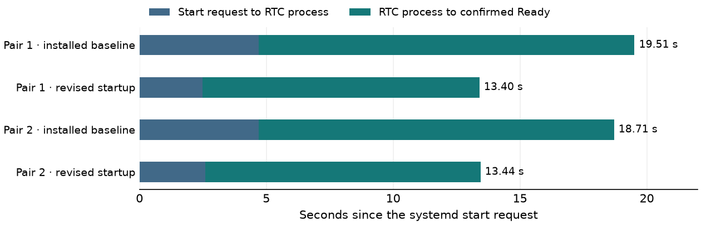

# RTC startup and first live correction

Two restarts of CAL2 reached confirmed Ready in 13.40 and 13.44 seconds. The immediately preceding baseline restarts took 19.51 and 18.71 seconds. The independent simulator was already publishing both cameras. All four runs verified the current RTC identity, placement, ten newly created PipeWire Links, native admission, a fresh Ready response and both loops Open. Native Start enabled processing and the systemd stop path completed Quit. These are warm-package-image observations from two pairs on a shared CPU host. [Per-run measurements](cal2-restarts.csv)

| Measured interval | Baseline, two runs | Revised, two runs |
| --- | ---: | ---: |
| Service request to RTC process start | 4.70, 4.71 s | 2.49, 2.59 s |
| RTC process start to confirmed Ready | 14.82, 14.00 s | 10.91, 10.85 s |
| CPU time used by the RTC main thread | 8.95, 8.42 s | 5.19, 5.11 s |
| CPU time used by the admission and discovery helper | 3.81, 3.61 s | 3.70, 3.74 s |

The first interval includes the one-shot Julia process that reads the installed deployment and starts the declared owners. Generating its launcher with minimal compilation for that command saved about two seconds. The second interval includes starting MediaSession, discovering owners, connecting Links, verifying placement, admitting the session and observing Ready. The helper and RTC run concurrently on the same leader CPU. Adding their CPU times to these intervals would double-count work.

On the baseline RTC a through-Ready Julia compiler trace recorded 971 ms for the first warmup-status dispatch and 952 ms for admission. Separate effect task specializations for owner discovery and Link creation took 354 and 658 ms. The revised control path shares a ticket and cancellation handle across lifecycle origins, and its package image covers the two measured entry points. Common command preparation, including the example Quit and vector/matrix edit workloads in MediaSession, runs during package image generation. This control-plane work does not execute an optical algorithm. The remaining time includes a separate Julia process for publishing discovery and confirming admission. A fresh process importing PipeWireAORTC alone took 1.05–1.08 s with its package image available.

The reference HEART loopback run used a 4 × 4 WFS and two actuators. Its Ready acknowledgement had occurred by 159–169 ms after the first internal RTC log entry. That clock excludes some process startup and has a different endpoint and workload. CAL2 remains seconds away from that scale. The original 58.29 s CAL2 observation also used a different build and host load. [HEART measurement boundaries](../independent-source-20261123/startup.md#heart-reference)

## What can enable correction

Ready allows inspection and retains held execution. Start admits live exposures with correction open. Each controller must then produce its declared usable measurement from the currently bound source before the operator can close it. An early close is refused and requires a new request. Installation and tests may use synthetic samples to exercise a graph. Managed operational graph owners process incoming data, and a managed captured GPU graph requiring a zero-input execution is rejected before device preparation. A GPU simulator can publish live exposures independently. [Startup and graph-owner scope](../../SYSTEMD_SESSION_STARTUP.md)

The CAL2 functional run observed early close rejection for each controller. LLOWFS exposure 54 produced a finite modal residual and zero physical offset while open. SCC exposure 11 started the chopped pair and exposure 12 produced the first usable residual, also with zero offset. Each branch was then explicitly closed. The expected signed correction applied the installed gain and FITS modal projection to the live residual for the same acquisition. [Signed numerical comparison](cal2-corrections.json)

| Controller | First correction after close | Peak absolute correction | Largest error over 2,304 channels |
| --- | ---: | ---: | ---: |
| LLOWFS | Exposure 61 | 4.614 nm | 3.16 × 10⁻¹⁶ m |
| SCC | Exposure 13 | 0.749 nm | 4.79 × 10⁻¹⁷ m |

Both reopened and acknowledged the new generation. Stop returned Ready, systemd Quit completed and all session Links disappeared. The original simulator then published LLOWFS exposure 66 and SCC exposure 14. It kept the same camera identities and advancing model clocks. This independent CPU optical simulator supplies real stream acquisitions to the RTC. No physical camera or mirror participated.

## Instrument startup settings

The Julia algorithm source at `8a5140f` and the Rust native source at `2f6fec9` start their AO integrators open when `closed` is omitted. Open preserves the committed state or calibrated bias. Updating gain or pole preserves the current closure setting. The SCC composite exposes `closed` as property 2 alongside its existing gain and pole. A usable frame can satisfy a priming requirement. An operator must still request closure.

| Instrument selection | Evidence required before the operator can close |
| --- | --- |
| GPI2 | Finite normalized pyramid reconstruction pixels with positive total signal. The single correction integrator serves the tip-tilt mirror, woofer and tweeter. |
| CAL2 | Each controller publishes its own valid modal residual. SCC requires a usable alternating pair. |
| REVOLT Classic | Finite slopes and same-acquisition Boolean validity from the Shack–Hartmann sensor, with a valid lenslet in the calibrated active set. |
| SPIDERS | A usable SCC modal residual. Dual-camera mode independently requires the LLOWFS modal residual and its matching validity. |

The installed GPI2 CPU science build reached Ready in 49.15 s. Its single integrator reported Open at generation 0 with priming false. The first live detector acquisition had generation 1 and sequence 1. The observer subsequently reported primed while still Open. The first 97-channel static woofer offset edit and its restore arrived byte-for-byte at sequences 10 and 13. These are explicit operator offsets. An explicit close was applied at property generation 1 and reopen at generation 2. The subscriber observed commands with acquisition identity 19 after confirming closure. Sequence 19 was the first sample observed after the adoption barrier at 18. Relative to open sequence 14, both tip-tilt channels, all 97 woofer channels and 1,716 of 2,304 tweeter channels changed. Quit completed in 8.875 s. The observer could not establish the exact adoption frame. [GPI2 measurements](gpi2-open.json) · [Native receipts](gpi2-open-receipts.tar.zst)

The coordinator-only GPI2 build also passed normal shutdown, direct Quit after required woofer Link loss and systemd stop after the same fault. Both fault trials withdrew all 31 declared Links and acknowledged source revocation. [Shutdown results](gpi2-shutdown.json)

The Classic graph observer accepted all 32 archived detector exposures in a replay with assigned acquisition metadata. They contained 179–183 valid active lenslets out of 184. The loop stayed open and invalidation cleared the priming state. This establishes the existing reconstruction pipeline's measurement criterion on that capture. A site-specific flux or image-quality threshold requires separate qualification. The SPIDERS composition observer was exercised with independent camera arrivals and output availability on the CPU. [Startup settings and operator sequence](../../SYSTEMD_SESSION_STARTUP.md#first-live-correction)

## Reproduction and failed trials

The baseline was the installed CAL2 candidate at RTC `5e7c087`, with Julia 1.13.3, PipeWireAO.jl 0.9.6, the native 4.0.8 SDK and the existing 0.5.11 graph owners. The revised run used the settled shared-effect RTC source, a preparation-only launcher flag, and the same installed publishing helper, optical owners and CPU placement. The private RTC service selected the candidate from a dependency overlay while keeping the installed launcher argv. The receipt includes the actual executable, package image, unit files, timings and native observations. This is a local development measurement.

The preliminary ticket change reached Ready in 15.85 s but timed out before submitting controller removal during its first Quit. Its shutdown failure excludes it from the accepted comparison. A separate 165.50 s activation rebuilt a package image after its input source changed. The live loader recorded the rejected cache. That run documents the cost of shipping an invalid image. A prototype adding only helper method precompilation produced no repeatable improvement. Timing package builds ran outside the accepted pairs.

The reproduction archive contains the service harness, sampled scheduler counters, compiler trace, native control receipts, source identities, output observers and paired runs. SHA-256 is `286f43fd99a908e81819f80b6d95668b4be7b9ceb3d64ac6f1286b33088295b3`. [CAL2 evidence and commands](cal2-ready-evidence.tar.gz)

## Software checks

The Julia algorithm suite passed 130,106 assertions. FilterGraphs passed 21,176 and FilterGraphPipeWire passed 3,027 on CPU. Tests that exercise the closed recurrence now request closure explicitly. The Rust FGN host test read the open property default from a loaded bundle, then submitted a native close. Both Rust workspace configurations passed. The full Julia/Rust source-inventory parity check has a different pinned source cohort, so these tests establish default behavior and native submission within the tested builds.

The full RTC core suite passed all 536 testsets. The RTC cold install, sealed-launcher compatibility and relocation selector passed 299 checks in a private validation registry. Optional graph tests reject managed CUDA and AMDGPU capture before a synthetic execution and cover live priming. No GPU controller hardware ran in these checks.

The GPI2 export passed all 31 checks for the optional live pupil-intensity view, including the configuration that omits it. The Classic profile selector passed all 52 checks, including the authored simulator pacing of 10 Hz for CPU, 50 Hz for CUDA and 500 Hz for AMDGPU. The instrument branch containing all four startup configurations and these profile checks is `codex/instrument-live-open-startup` at `44fcfb6`.
