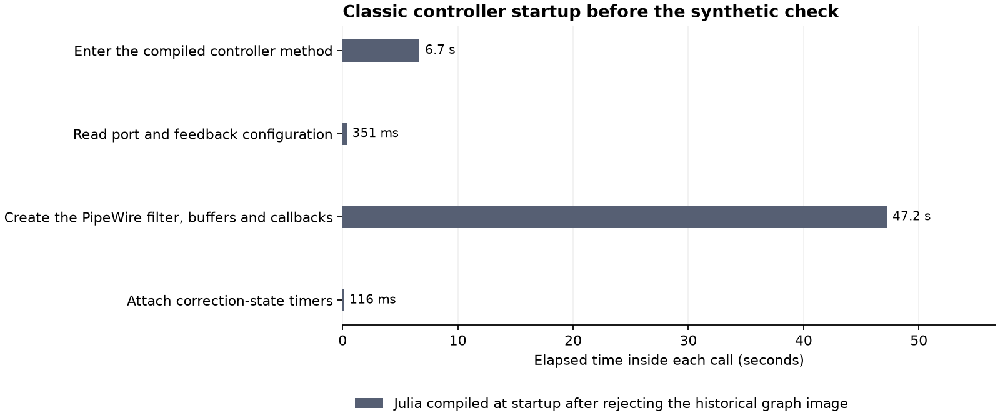

# RTC shutdown, native parameter edits and instrument startup

The installed GPI2 shutdown checks ran on RTC `fba98e2` before the merge of the complete native NDArray branch `fadea7a`. The combined instrument services used `5e7c087`, the commit that enforces the native command size limit after accounting for the forwarding controller's identity. These are locally pinned RTC source trees with the existing 0.7.29 version field. The instrument runs used private software fixtures on the shared CPU host `rtc-devel`, PipeWireAO.jl 0.9.6, PipeWireAO_jll 4.0.8+0 and FilterGraphPipeWire 0.5.11. A Submitted reply confirms the parameter owner accepted the edit. A separate subscriber checks the actual values on the graph output.

## GPI2 shutdown after required Link loss

Both trials started an installed GPI2 CPU application on a private PipeWire core and removed its required woofer Link during acquisition. The RTC retained that fault, withdrew all 31 declared Links and stopped the controller group. The simulator acknowledged Revoke with separate sequence numbers for the last exposure and the last correction it adopted. Those numbers stayed fixed on reinspection. [Shutdown receipts](gpi2-quit.json)

| Shutdown request | Last acquired / adopted | Terminal evidence |
| --- | --- | --- |
| Client sends Quit to the RTC | 18 / 17 | The native reply reported Offline after 4.326 s. The original RTC exited before any external stop request. |
| Operator stops the systemd service | 40 / 39 | The installed stop command received native Offline with 25.432 s left on its deadline. |

Both services exited successfully. The original owners, socket and discovery record were gone. A separate private-core trial withheld the parameter owner's acknowledgement at the five-second deadline. The client reported the outcome as unknown, and the journal retained the original Link fault and the exact missing owner. A regression with two failed graph Hold requests verified that both reply and journal identify the first failed graph. [Missing acknowledgement receipt](missing-quit-ack.json)

## Native DM edits from the Julia control client

On the combined service, GPI2 applied the first 97-channel woofer offset. An independent subscriber saw all edited Float32 values at sequence 5. The public Julia client then threw `unhandled native runner result parameter_ndarray` while converting the successful reply to its public response. SPIDERS dual independently reproduced the client exception. The common response formatter now handles NDArray submissions. The same golden completion reproduced the exception before the change and passed afterwards.

With the original GPI2 service and the corrected client `6ddc12a`, the first edit returned Submitted in 922.5 ms and the restore in 528.3 ms. The independent output matched all 97 values on both writes at sequences 6 and 9. The detector and all three mirror-command streams shared consecutive acquisition identities. The RTC accepted Stop and Quit, and every original process retired. The client Manifest changed only the RTC package tree. [GPI2 edit and restore](gpi2-edits.json)

A fresh GPI2 application built with the corrected service and client reached Ready in 50.519 s. The first edit took 741.0 ms and the restore took 450.9 ms, with identical downstream results. The graph constructor took 19.2 ms with its matching package image loaded. Native Stop held the streams quiet and the installed Quit command completed cleanup in 8.218 s. [Matched-build GPI2 measurements](gpi2-edits.json)

## CAL2 with the simulator already publishing

The private core and both camera streams were running when the timer started. Both RTC activations admitted ten Links and reached Ready with correction open. The operator's Start enabled processing. Each controller refused closure until its own first usable live residual. LLOWFS needed one exposure and SCC needed two exposures in opposite chopper states. Both physical offsets stayed zero while open. [Native and numerical results](cal2.json)

| Elapsed time on the shared CPU host | Combined build | Prior install-qualified CAL2 build |
| --- | ---: | ---: |
| Service start to Ready on first activation | 37.387 s | 22.665 s |
| Replacement RTC start to Ready | 23.569 s | 22.016 s |
| Start acknowledgement to first LLOWFS residual | 29.165 s | 20.291 s |
| Start acknowledgement to first SCC residual | 240.479 s | 205.104 s |

These residual latencies include waiting for exposures from the CPU optical simulator. In the two new Ready windows, the simulator used 0.981 and 0.997 CPUs on average. During the first window, host cores 2, 3, 6 and 7 were active 92.1%, 98.0%, 99.2% and 94.5% of the time. The runs establish lifecycle and scientific behavior under those conditions. [Prior measurement boundaries](../cal2-live-prime-20261123/README.md)

| First correction after acknowledged closure | Acquisition | Time from close acknowledgement | Channels compared | Peak absolute correction | Largest error vs. FITS projection |
| --- | ---: | ---: | ---: | ---: | ---: |
| LLOWFS | 21 | 26.056 s | 2,304 | 4.614 nm | 3.16 × 10⁻¹⁶ m |
| SCC | 5 | 133.620 s | 2,304 | 0.749 nm | 4.79 × 10⁻¹⁷ m |

The expected first correction uses the installed projection and the signed live modal residual with the configured gain of −0.05. Both complete output vectors also matched the previous CAL2 run bit for bit. The first RTC accepted Stop in 0.689 s and Quit completed cleanup in 9.287 s. During the 115.257 s before the replacement start, LLOWFS published exposures 26–30 and SCC published exposure 6. The replacement established ten new Link serials, opened both loops, entered Running and accepted direct Quit in 8.734 s including cleanup. The original camera identities and model clocks persisted through both exits. [CAL2 measurements](cal2.json)

## Where Classic spent the startup time

On the previous Classic CPU run, 96.694 s elapsed between completing the numerical graph and starting the synthetic check. On the combined RTC, the corresponding interval was 54.620 s. Both intervals precede the first synthetic frame. In the new run Julia rejected the historical named graph image. The native maps confirmed that the process loaded the combined RTC and ran the graph from source. Its first mirror command carried acquisition sequence 1 and arrived at the observer 77.307 ms after the native Start acknowledgement. The harness observed Ready at 125.516 s and Running at 133.805 s from service start. [Classic trace and functional results](classic.json) · [Historical run](../../reviews/20261123-rtc-startup-worktrees/REVIEW.md)

| Work between numerical graph preparation and the first synthetic frame | Elapsed | Julia compilation counter | Process CPU | Calling thread runnable wait |
| --- | ---: | ---: | ---: | ---: |
| Enter the method for this concrete graph and runtime configuration | 6.671 s | 6.671 s | 6.106 s | 0.601 s |
| Configure ports, metadata, clocks and feedback | 0.351 s | 0.350 s | 0.320 s | 0.033 s |
| Construct the disconnected PipeWire filter, buffers and callbacks | 47.228 s | 47.219 s | 43.032 s | 4.441 s |
| Check the correction observer and attach its timers | 0.116 s | 0.116 s | 0.106 s | 0.010 s |

The four calls account for 54.366 s. The 0.254 s difference includes the boundaries between calls and journal timestamps. Constructing the filter occupied 86% of the interval. The synthetic graph check itself took a further 6.255 s. Julia reports elapsed time spent compiling, Linux counts CPU time across process threads, and runnable wait measures one thread. These counters overlap. The older trace has no corresponding per-call counters, so its 96.694 s cannot be partitioned retrospectively. [Phase definitions and opt-in tracing](../../SYSTEMD_SESSION_STARTUP.md)

**The rebuilt Classic graph image exposed a separate installation problem.** The ordinary install generated a 37.9 MB native graph image. Its loader grew to approximately 30 GiB across RAM and swap and was stopped. In a bounded follow-up, Julia 1.13.4 had all 151 exact dependency builds loaded and mapped the correct graph image. The captured stack showed Julia comparing specialized method types recursively during image restoration. The specific method and type remain unknown. The tested installation completed the remaining optical and systemd steps with their normal helpers. Its working service trial used the historical-image fallback. A successful default start that restores the rebuilt Classic image remains unverified. [Loader inputs and limits](classic-loader-receipt.json) · [Native stack](classic-loader-stack.txt)

The first browser edit received a correlated Submitted reply in 173.0 ms. The restore took 45.6 ms. On both operations, the downstream Float32 vector matched every one of the 277 submitted values. The restored vector also matched the baseline bit for bit. An invalid 276-element edit was rejected without changing the generation. Native Stop reached Ready and the installed service stop received Offline. [Browser and lifecycle receipts](classic.json)

A separate Classic activation submitted and restored the 212 × 376 reconstructor through a native MemFd stream. The independent parameter-output subscriber received all 318,848 bytes on each change. The graph's requested and active generations advanced together from 0 to 1 and then 2. On restore, both the full matrix and its 212-element first column matched the original byte for byte. [Streamed matrix receipt](classic-matrix.json)

## SPIDERS

The fitted-dual CPU profile reached Ready in 34.662 s. With the original service and the corrected public client, its first 468-channel shape offset returned Submitted in 500.1 ms and the restore in 187.1 ms. From the start of each call, independent readback took 21.413 s and 19.260 s respectively on the CPU simulation. Every edited and restored Float32 value matched. A later simulator-applied frame carried a fresh reference timestamp. Native Stop returned Ready, two quiet seconds followed and Quit completed cleanup in 7.921 s. [Fitted-dual receipt](spiders.json)

The fitted-single CPU profile reached Ready in 28.616 s and published five consecutive finite 468-channel demand frames (sequences 2–6). The observer saw two quiet seconds after native Stop. Systemd received the Quit acknowledgement and finished cleanup in 7.085 s. With its installed graph image, constructing the PipeWire node took 15.0 ms. [Fitted-single receipt](spiders-single.json)

## Copper

Copper has an archived calibrated controller graph and no maintained full application profile. Its local graph owner reached Prepared, answered native Quit and exited. The archived configuration was translated for the current graph interface and all 11 calibration blobs retained their recorded digests. Constructing the graph node took 62.340 s, with 62.330 s in the Julia compilation counter. Julia 1.13.3 emitted a world-age warning when the optional graph package was loaded, also observed on the pre-merge build. Camera acquisition, DM output and full service Ready were outside this check. [Controller graph and calibration evidence](copper.json)

## Package and native protocol verification

The full RTC suite passed on the Quit build (527 testsets), after NDArray integration (534), and with the corrected public client (534 testsets, 11,539 assertions). The concurrency test checks every snapshot it observes while its writer is active, so its assertion count varies with scheduling. The public-client regression used the same saved native completion before and after the fix. The focused NDArray suite passed all 66 assertions after the fix. [Suite revisions and log digests](suites.json)

On the combined build the Julia private-core checks passed, the C management socket passed 171 assertions, and a Rust sender delivered 32,768 bytes to a Julia receiver with identical SHA-256 digests. The inline request check reserves the bytes needed to forward the original controller identity. For the tested one-character graph and parameter names, 3,966 Float32 elements fit and 3,967 are rejected before submission. Larger payloads use the stream transport. [Interop checks](interop.json)
