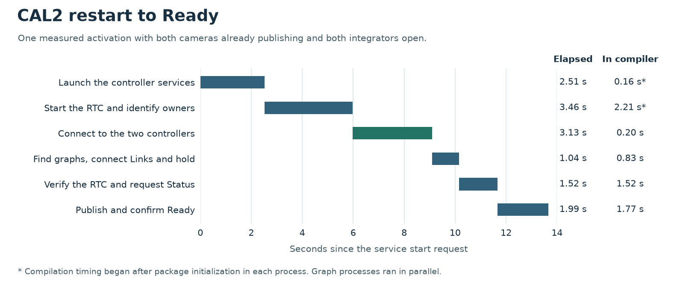

# Where CAL2 spends time during an RTC restart

## Time before Ready

The two optical restarts below used RTC `9ba551e`, Julia 1.13.3, populated package images and an independent CPU simulator already publishing both cameras. Elapsed times use the host monotonic clock. The timer ends when systemd returns from a successful start after receiving the RTC's Ready notification. [Trial conditions and receipts](README.md)

| Measurement | Restart 1 | Restart 2 |
| --- | ---: | ---: |
| Service request to RTC process start | 2.988 s | 2.788 s |
| RTC process start to service start return | 11.810 s | 12.110 s |
| **Total** | **14.798 s** | **14.899 s** |
| Preparation main thread on CPU | 1.670 s | 1.644 s |
| RTC main thread on CPU | 8.253 s | 8.340 s |
| RTC main thread runnable, waiting for a CPU | 0.128 s | 0.112 s |

The CPU rows are Linux scheduler counters from the last thread sample before the milestone. They cover the thread's lifetime to that sample. Other threads, work in graph services and blocked time require separate accounting. The control-dispatch preparation message appeared 2.74–2.76 s after RTC process start. The operation inside that message took 32–33 µs. Both controller processes skipped numerical warmup.

## Inside the RTC start request

A fresh CAL2 restart on RTC `5a63139` reached Ready in **13.508 s**. A second build added timestamps and Julia compilation counters to the same startup path and took **13.659 s**. With individual compiler signatures also recorded it took **13.857 s**. All three used prebuilt packages. The two controller services started afresh on each restart, while the same private core and independent camera source kept running. Each measurement ended at Ready with the integrators open.

| Operation on the service timeline | Elapsed | What happened |
| --- | ---: | --- |
| Launch the controller services | 2.51 s | The preparation process loaded the deployment, attached to the existing core and source, started both graph processes together and passed their current identities and configuration to the RTC. |
| Start the RTC and identify owners | 3.46 s | Julia started and loaded the RTC package in 1.12 s. MediaSession built the local PipeWire session and identified the declared control endpoints. Julia recorded 2.21 s of compilation after package initialization in this interval. |
| Connect to the two controllers | 3.13 s | MediaSession waited for the two graph owners to answer their bootstrap requests. The RTC used 0.42 CPU seconds. Both graph processes were still preparing during this interval. |
| Find graphs, connect Links and hold | 1.04 s | MediaSession located the graph objects, established the ten declared Links and confirmed the graphs were held. Compilation accounted for 0.83 s. |
| Verify the RTC and request Status | 1.52 s | A separate native client inside the RTC connected to the public endpoint and requested current Status. The Julia compilation counter advanced by 1.52 s. |
| Publish and confirm Ready | 1.99 s | The RTC checked live CPU placement, wrote the session record, published discovery, closed the verification client, checked the held Links again and notified systemd. Julia recorded 1.77 s of compilation. |

Julia recorded **6.52 s** of compilation in the RTC process between package initialization and Ready notification. The separate short-lived preparation process recorded a further **0.16 s** after its package initialized. These counters cover compiler work anywhere in the respective process and can overlap other work. The controller processes have their own clocks and compilation counters.

Closing the temporary verification client makes PipeWire report an object removal. The largest first-use compilation in the signature trace was **892 ms** for the RTC handler for that event. The independent phases-only run measured **2.3 ms** inside the final PipeWire synchronization call, **0.45 ms** in the final held-Link check and **0.14 ms** inside the systemd notification. Those operations offer little benefit from a shorter polling interval.

The graph services had two distinct startup costs. In the instrumented run, preparing and entering the installed graph took 0.49 + 0.70 s for LLOWFS and 0.66 + 0.90 s for SCC, with the two processes running concurrently. In a separate fresh-process test on CPU 0, loading each graph's installed package and dependencies alone took **1.74–1.77 s** across four launches. Julia reported less than 1% compilation time inside those imports. An isolated import of the lighter RTC package on CPU 14 took 0.90–0.91 s. These import probes exercised package loading only. Neither ran an optical frame.

## Moving five control operations into the package image

The shared RTC image now precompiles how MediaSession handles a PipeWire object removal, an incoming request and a Link update, how it dispatches a Status request, and how the placement check inspects a process. Each installation can compile these operations once. Admission still reads the current native objects, requests fresh Status, inspects live placement and confirms the exact Links on each activation.

| Alternating untraced restarts | Previous build | New build | Reduction |
| --- | ---: | ---: | ---: |
| Service request to Ready, first pair | 13.508 s | 12.303 s | 1.205 s |
| Service request to Ready, second pair | 13.401 s | 12.106 s | 1.295 s |
| RTC main-thread CPU, first pair | 7.639 s | 6.301 s | 1.338 s |
| RTC main-thread CPU, second pair | 7.632 s | 6.382 s | 1.250 s |

Only the RTC main process used the candidate package image during the experiment. The mapped graph images, including their RTC bootstrap dependency, had identical paths, inodes and hashes in all four restarts. The candidate image was built before timing. All four activations verified the same source and core, ten fresh Links, native Ready, both integrators Open and native Quit. They stopped at Ready without issuing Start. First-frame timing comes from the earlier optical runs below. Other instruments use the same MediaSession code and require their own timing measurements.

The RTC cache grew by 1,828,686 bytes (1.74 MiB), including its Julia cache header. Two preliminary runs were excluded. A mixed-case temporary unit name failed validation before admission. A separate recorder error occurred after Ready and before independent verification completed. The archive retains both failures, full timestamp and compiler traces, image identities, the tested patch, import measurements, figure script and teardown checks. Archive SHA-256 is `b1426cc867af979b0df3f1b08d146240f2f5b674e5008e15516cebb7ffb67e9f`. [Startup profile receipts](startup-profile-receipts.tar.gz)

All **2,254 assertions** passed on the measured candidate image in the six focused suites for the state machine, ingress, effects, objects, transport and controls. An initial test invocation inherited a long temporary path which exceeded the Unix socket length available to its private core. Repeating the same six suites with `TMPDIR=/tmp` exercised the private-core Link and withdrawal checks successfully.

The remaining work with a measured cost is in the two controller processes as well as the RTC. A useful next experiment would cover the measured graph-entry specializations in each instrument's installed graph image and repeat these restarts. The separate graph load measurements also put a floor on what moving more compilations alone can save. Shortening the operator's restart by retaining already-loaded controllers would change service ownership and would require verifying fresh identity, open correction and fault recovery across replacement.

## Time from Ready to a usable measurement

Ready confirms that an operator can inspect the current session, with the graphs held and both integrators open. Native Start admits incoming exposures. LLOWFS can publish a residual from one valid exposure. SCC requires two suitable, alternating chop states. Restart time relative to the next qualifying exposure therefore matters. [Per-run optical measurements](restarts.csv)

| Live stream | Simulated exposure duration | Wall time between observed exposures, median (range) | Ready to first residual, two restarts |
| --- | ---: | ---: | ---: |
| LLOWFS | 2 ms | 22.79 s (20.03–30.40 s) | 20.16, 22.95 s |
| SCC | 10 ms | 116.18 s (101.58–131.72 s) | 194.04, 147.62 s |

The cadence measurements use the 59 successive LLOWFS and 11 successive SCC intervals wholly between the first service start request and the last Quit of the recorded restart series. The input observer recorded every sequence in these intervals. During the two waits from Ready to the first SCC residual, the simulator process accumulated 192.97 CPU seconds in 192.69 sampled wall seconds and 146.71 CPU seconds in 146.53 sampled wall seconds. These measurements describe this optical simulation on its assigned CPUs. A physical detector requires its own measurement. [Camera, scheduler and optical receipts](cal2-receipts.tar.gz)
