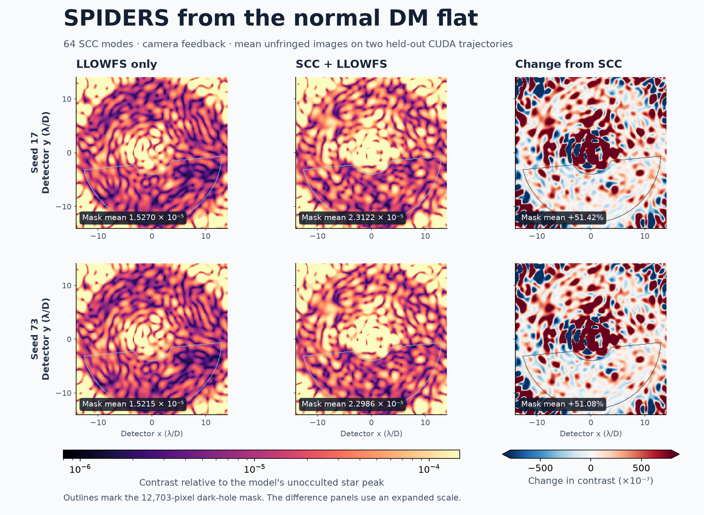

# SPIDERS camera-driven dark-hole acquisition

This experiment starts from the ordinary DM flat. The source and command
graph use their standard zero incremental command. The 468-element
simulator-optimized shape used in the
[earlier tracking experiment](../spiders-scc-error-20261117/README.md)
is absent from the graph and its parameters. LLOWFS provides low-order
feedback in both epochs. Closing SCC enables its additional high-order
correction through the same shared DM command path.

## Result

The tested SCC configuration failed the camera-driven acquisition
criterion. With both loops enabled, mean unfringed contrast increased
by about 51% on each held-out trajectory. It increased in all eight
late blocks. The retained camera frames and controller residuals give
the following paired results.

| Seed | Matched exposures | LLOWFS only | SCC and LLOWFS | Contrast change | Chopped pixel RMS change | Active modal RMS change |
| --- | ---: | ---: | ---: | ---: | ---: | ---: |
| 17 | 2,035 | 1.52715 × 10⁻⁵ | 2.31221 × 10⁻⁵ | +51.41% | −10.84% | −82.72% |
| 73 | 2,030 | 1.52144 × 10⁻⁵ | 2.29834 × 10⁻⁵ | +51.06% | −10.84% | −83.37% |

Closing SCC almost eliminated the mean active modal residual. Its temporal
standard deviation increased by 36–38%. The loop reduced
the signal it was calibrated to control while the science camera region
brightened. The data establish a mismatch between the residual and
unfringed contrast for this acquisition candidate. They do not identify an
individual optical term as the cause. The gain sweep was gated on an
improvement on both seeds, so it did not run.

[Full comparison](comparison.txt) ·
[Seed 17 transport](17/transport.json) · [Seed 73 transport](73/transport.json)

## SCC calibration at the normal flat

The 64 SCC directions and two nuisance tip/tilt directions use the
[declared probe recipe](optical-recipe.yaml). The existing shared optical
calibration tool recorded full- and half-poke camera responses on CUDA
at 5 and 2.5 nm. The calibrated F/U measurement uses the existing
detector and ordinary-flat optical model. The acceptance check retained
rank 66. [Probe calibration](probe-calibration.json)

A direct transplant of the earlier SPIDERS spot conditioning selected
an average 37.24% of per-direction response power at its measured detector
orientation. The response at the perpendicular orientation was 1.53%.
With the legacy smallest-singular-value damping rule, the proposed
regularized inverse had unstable linearized modes when applied to the
actual unmasked probe data. The maximum magnitude of the eigenvalues of
`I − 0.05 R D` was 1532.77. This variant was rejected before live closure.
[Rejected condition check](spot-conditioning.json)

The live candidate uses the full measured interaction matrix with
Tikhonov damping. The legacy index rule uses the smallest singular value
for this 66-column matrix, giving λ = 182270.73. The SCC output zeros its
two nuisance rows. The linearized factor at the same gain is 0.96972.
This is a local test of the measured response.
[Full response condition check](response-conditioning.json)

## Reference-beam calibration

The signal entering the SCC reconstructor is a rolling fringed-minus-unfringed
camera image. The reference arm adds light as well as the interference term.
For a coherent pair with science field E and reference field R, the
difference is `|R|² + 2 Re(E conj(R))`. The original SPIDERS GUI has an
SCC main blocker for isolating the reference beam. This experiment uses
the fitted model's corresponding pinhole-only output and the same camera
detector response to prepare that exposure with the DM at its normal flat.
The live branch subtracts the selected-pixel values of the blocked-camera
exposure from the chopped pair. No DM command is derived from that exposure.
Its mean over the dark-hole mask is 0.00113475 electrons per pixel per
modeled exposure. [Reference image](reference-only-image.fits)

The reference image is fixed, while the two inputs of the live chopped
difference are consecutive exposures. Changes in the main beam between
exposures and changes in reference-beam intensity from its calibration
value can therefore enter the residual along with the interference.
The earlier local SPIDERS `sccservice/scripts/generate-scc-im.jl`
(`847d800873cdf1e0b207f85e4ade68c3e088d64dbfb21e779937b96e24b6d525`)
bandpasses the probe images in Fourier space before constructing the
inverse. The rejected in-image spot masks and the fitted model's
reference-beam exposure address different parts of that measurement.

## Paired private-core test

Each held-out seed runs in its own private PipeWire core with standalone CUDA
HIL on the RTX 3080. The compiled controller runs on the CPU. The application
uses Julia 1.13.3, RTC 0.7.23 with recovery patch `7222557`, PipeWireAO 0.9.3
and its 4.0.4+0 artifact, AdaptiveOpticsSim 0.3.26,
AdaptiveOpticsSimPipeWireHIL 0.5.9, AdaptiveOpticsCalibration 0.17.4,
FilterGraphs 0.10.3, FilterGraphAlgorithms 0.12.5, FilterGraphPipeWire 0.5.6,
CUDA 6.5.1 and KernelAbstractions 0.10.7. The instrument tools are from
`58ecd8ac`.

Both epochs begin with the SCC and LLOWFS corrections open and a zero
incremental DM command in the configuration. The observer records available
initial command telemetry and confirms both switches are open. It requests
LLOWFS closure for the baseline, then opens LLOWFS and restarts source and
controller before requesting SCC and LLOWFS closure for the second epoch.
Native property adoption must match the requested generation. Gain is −0.05
and pole is 1 for each loop.

The observer captures native modal and chopped-pixel residuals and takes
mean unfringed camera intensity over the same 12,703-pixel mask as the
previous tracking tests. It retains matched acquisitions 2,049–4,096, with
10 ms model exposures. Reproducing a decrease on both held-out seeds
and across the four late blocks is the qualification criterion. The
image panels show shared unfringed exposures with a common contrast
scale and a separate signed difference scale. Contrast uses the model's
[unocculted star peak](../spiders-factorial-20261117/photometry.toml)
of 18.27743 electrons per pixel per modeled exposure. The four blocks
are adjacent within each trajectory and measure persistence over time.

Run `julia --project=<verified-application-environment> summarize.jl .`
from this directory to recompute the statistics from the paired traces
and FITS cubes. The CSV columns labeled `open` contain LLOWFS-only
measurements with SCC open.

## Command observation and shutdown

The native controls confirmed the requested property generations for both
closure sequences. The array observer wrote all three paired data outputs
after its sequence, timestamp, phase and completeness checks. Its separate
positive mirror-demand check failed on both cores after those outputs had
been written. The two initial spot checks also saw no fresh demand packet.
The scalar rows and image planes are available for analysis, with no
independent measurement of the change in physical DM demand.

The follow-up using a synchronous command receiver failed observer-link
format negotiation before acquisition. An earlier preflight also exited
before capturing either epoch because its observer waited for a flat
demand packet. All six private sessions acknowledged native Quit and
completed cleanup. The retained paired experiment is the only comparison
with both optical epochs.
