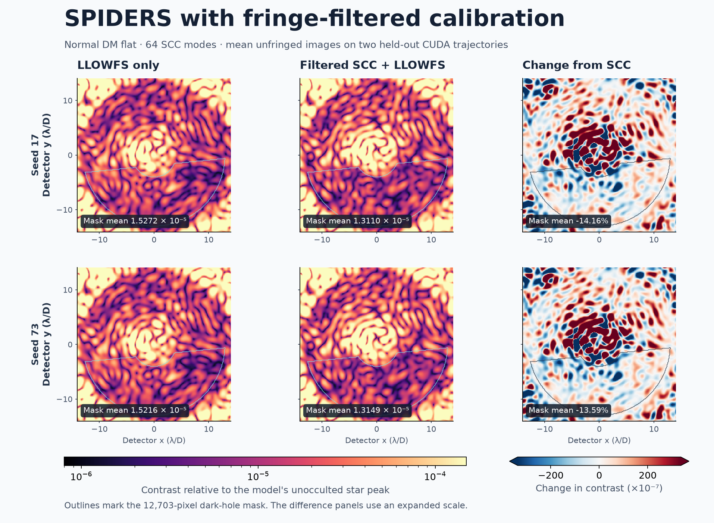

# SPIDERS fringe filtering

The lab checkout in `~/spiders-working` supplies two related calibrations.
The CRED2 frame sorter publishes the most recent fringed exposure minus
the most recent unfringed exposure on Aeron stream 5003. The SCC service
subscribes to 5003, subtracts its selected reference pixels and applies
the matrix. The normal launcher invokes `generate-scc-im.jl`. Its
640 × 512 recipe uses an apodized image mask and Fourier radii 89–190.
The saved main-camera January calibration has a 416 × 380 crop, so the
launcher script alone does not identify its exact generation settings.

The fitted HIL optical model represents the iFTS port. The lab's separate
`archiver-calibrated-scc-2-ifts.jl` used the iFTS camera on stream 1016
for its push/pull responses, while also recording the chopped CRED2
stream. The iFTS generator passes radii 29–60 on a 256 × 200 DFT,
inverse-transforms to the detector plane, masks the two probe spots and
selects the half dark hole. It regularizes the inverse and writes a zero
reference image. A filtered calibration acting on the simulator's chopped
camera signal combines the iFTS geometry with the SCC service measurement.

## Lab artifact replay

For all 650 saved iFTS modes, the reconstructed filtered image matches
the stored spot-masked product at every nonzero output pixel, with maximum
relative error zero. This checks the Fourier filter independently of how
spot centers were selected. The saved reference is exactly zero and the
final lab mask selects 8,456 pixels. Run `lab-filter.jl /mnt/datadrive/DATA/SCC-IFTS`
in the optical package environment. [Numerical results](lab-filter.json)

## Transfer to the fitted camera

We replayed the 66 positive/negative probe directions on CUDA around the
ordinary DM flat at both calibration amplitudes. Selecting the RTC pixels
from the full 221 × 221 derivatives reproduced all 132 archived columns
exactly. The two nuisance directions belong to LLOWFS. The fitted
reconstructor uses the other 64 directions for SCC.

We mapped the iFTS annulus using the detector dimensions and 7.13 lab
and 7.86 fitted pixels per λ/D. The band retained 78.14% of the
mean-subtracted flat chopped image power and 2.34% of the unfringed
image power. Applying the two hard spot masks reduced the measured rank
to 58 under the calibration cutoff. We used the band alone to test
all 64 modes. The live graph applies the inverse to the selected raw
F−U pixels with the zero lab reference.

At gain magnitude 0.05, the linearized update on the measured raw
probes has spectral radius 0.9751. Central differences along the first
camera-generated correction predict a 2.11% reduction in unfringed
intensity at the static normal flat for both diagnostic poke amplitudes.
[Conditioning](acquisition-conditioning.json) · [Directional check](first-step.json)

Run `push-pull.jl MODULE APPLICATION ASSETS OUTPUT` to regenerate the
full camera derivatives from the calibration application, then
`reconstruct.jl APPLICATION ASSETS OUTPUT` to build the matrix and
reference. Re-run the first command with an additional `first-step`
argument for the directional check. MODULE is the shared instrument
tools' OpticalCalibration.jl. ASSETS is the normal-flat SCC artifact
directory from the preceding acquisition experiment.

## Closed-loop acquisition from the normal flat

Both private PipeWire cores ran the standalone fitted CUDA simulator.
The CPU controller started with zero incremental DM command. Each seed
ran 4,096 exposures with LLOWFS active, restarted the source and
controller, then ran 4,096 with LLOWFS and filtered SCC active. Both
loops used gain −0.05 and pole 1. The simulator received the combined
DM demand. Each pair below has matching camera sequence, model timestamp
and chopping phase, and both native residual streams present. Contrast is
mean unfringed intensity over the same 12,703 selected pixels divided by
the fitted unocculted stellar peak. The late window is exposures 2,049–4,096.

| Seed | Matched unfringed exposures | LLOWFS only | Filtered SCC + LLOWFS | Change |
| --- | ---: | ---: | ---: | ---: |
| 17 | 1,013 | 1.52721 × 10⁻⁵ | 1.31105 × 10⁻⁵ | −14.15% |
| 73 | 1,012 | 1.52170 × 10⁻⁵ | 1.31502 × 10⁻⁵ | −13.58% |

All eight late blocks darkened. The correction formed from live camera
feedback with the ordinary instrument flat and no precomputed dark-hole
shape. Both cores acknowledged Quit and removed their private sockets.
The image averages use every matched unfringed frame available to the
image observer. The table also requires both residual streams.

The passive observer bound the 468-element physical DM demand at 100 Hz.
The calibration's 334-element zero is in active virtual-actuator coordinates.
Demand packets carry a different acquisition domain and generation from
the camera. The updated observer saves actual command identities and
groups demand by observation epoch. It measured 4,070 and 4,068 commands
during SCC closure, with peak absolute demands of 0.01938 and 0.01915
in native command units. The observer measures the controller output.
Its late command averages correspond to the camera time window without
an exposure-by-exposure identity match. [Seed 17](filtered-17/transport.json)
· [Seed 73](filtered-73/transport.json)

## Matched unfiltered control

The unfiltered control fits the same 64 SCC directions around the normal
flat. Each fit sets the Tikhonov parameter to the smallest retained singular
value of its own response matrix. The two fits share the zero camera
reference, detector selection, LLOWFS configuration, gains, command mapping
and seeded CUDA trajectories. Of the seven recorded input hashes for each
seed, only the reconstructor differs.

The camera's first correction at the static flat points in different
directions for the two fits (cosine similarity 0.762). Applying that one
correction to the static CPU optical model lowers unfringed intensity by
1.22% with the unfiltered fit and 2.04% with the filtered fit. The
held-out closed-loop runs below measure what happens after repeated
camera corrections. [Single-step comparison](compare-first-step.json)

For the direct comparison, `julia compare.jl .` takes the intersection of
camera and residual exposure IDs across all four epochs for each seed.
It checks chopping phase, model timestamp and input hashes. The table
uses the shared unfringed exposures. The paired modal RMS changes in the
[block results](comparison.txt) are relative to each fit's own LLOWFS-only
baseline. Different reconstructors estimate different modal amplitudes from
the same camera signal, so the unfringed photometry is the common measure.

| Seed | Shared unfringed exposures | LLOWFS only¹ | Unfiltered SCC + LLOWFS | Filtered SCC + LLOWFS |
| --- | ---: | ---: | ---: | ---: |
| 17 | 954 | 1.52764 × 10⁻⁵ | 2.15914 × 10⁻⁵ (+41.34%) | 1.31127 × 10⁻⁵ (−14.16%) |
| 73 | 964 | 1.52131 × 10⁻⁵ | 2.16743 × 10⁻⁵ (+42.47%) | 1.31497 × 10⁻⁵ (−13.56%) |

¹ The two LLOWFS-only means agree to the precision shown. Percentages use
each run's own baseline. In all eight shared blocks the unfiltered loop
brightened the region while the fringe-filtered loop darkened it. The
unfiltered modal RMS fell by 83–84% on closure even as the science image
brightened. A smaller modal residual alone does not establish a darker image.

Both filtered runs and the seed 73 unfiltered run met the 95% camera
and residual collection gates. The first seed 17 unfiltered run captured
1,944 of 2,048 fully paired exposures, two below the residual gate. Its
repeat captured 1,843. Both passed the independent camera-image gate
with 993 and 976 of 1,024 unfringed pairs. Their image means showed
+41.35% and +41.34% respectively. The table uses the first run for
seed 17. The reruns used a yielding passive observer and saved the
coverage counts before evaluating the same thresholds. All four
configurations acknowledged Quit. [Seed 17 control](raw64-17/transport.json)
· [Seed 17 repeat](raw64-17-retry/measurement.json)
· [Seed 73 control](raw64-73/transport.json)

The filtered correction darkened 7,071 and 7,100 of the 12,703 detector
pixels. Residual speckles are visible. The result establishes mean
contrast improvement in this fitted, photon-noise-disabled simulator
on two trajectories. The laboratory comparison validates the stored
calibration calculation. No physical mirror was driven.
