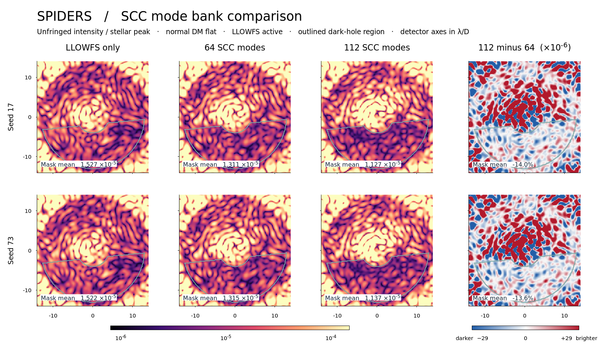

# SPIDERS fringe-filtered SCC from the normal flat

The wider bank lowered mean dark-hole contrast by another **14.05% on seed
17** and **13.55% on seed 73** relative to 64 modes. Intensities below
are relative to the unocculted stellar peak. The first column gives the
112-mode run's LLOWFS-only baseline. Both banks' baselines agree to the
precision shown.

| Trajectory | LLOWFS only | 64 SCC modes | 112 SCC modes | 112 vs. LLOWFS only | Shared unfringed exposures |
| --- | ---: | ---: | ---: | ---: | ---: |
| 17 | 1.5272 × 10⁻⁵ | 1.3111 × 10⁻⁵ | 1.1268 × 10⁻⁵ | −26.22% | 1,013 |
| 73 | 1.5217 × 10⁻⁵ | 1.3150 × 10⁻⁵ | 1.1368 × 10⁻⁵ | −25.29% | 1,012 |

All eight late blocks favored 112 modes, with an additional contrast reduction
of 13.38–14.14% relative to 64. In the mean images, 7,128 and 7,046 of
12,703 mask pixels darkened relative to 64. Residual speckles remain on both
trajectories. The runs used the fitted simulator with photon noise disabled.
[Matched exposures and block results](comparison.csv)



Both 112-mode runs captured all 2,048 late camera and residual pairs and all
1,024 paired unfringed images. The first seed 17 attempt missed the 95%
coverage gate. The repeat preallocated capture buffers and moved the pixel
projection after acquisition. The retained exposures in the first attempt
gave a 26.22% decrease from LLOWFS alone, consistent with the complete repeat.
[Excluded attempt](first-attempt.json)

The largest sampled absolute native DM demands were 0.03203 and 0.03093
under the ±0.5 limit. The observer saw active SCC and LLOWFS property
generations, acknowledged Quit and private socket removal. DM samples have
a distinct acquisition domain from camera samples. These are controller
output measurements. [Seed 17](filtered-17/transport.json) ·
[Seed 73](filtered-73/transport.json)

## Measurement

Two private PipeWire sessions ran the standalone fitted CUDA simulator with
the 112-mode controller. The [64-mode runs](../spiders-fringe-20261117/README.md)
supply the paired comparison. For each seed, the 64- and 112-mode deployment
Manifests, held-out trajectory declarations, zero DM input and SCC camera
references are byte-identical. The SCC, LLOWFS and shared-DM graph files
match after substituting 114 for 66 in joint vector dimensions. Both
branches use gain −0.05 and pole 1. The [calibration checks](calibration/README.md)
cover the filter transfer, probe amplitudes, regularization and effective
LLOWFS command path.

Each run acquired 4,096 exposures with LLOWFS alone, reopened the loop,
restarted the source and controller, then acquired 4,096 with SCC and
LLOWFS active. The wide observer checked a zero-demand packet before
each closure and a new demand generation after restart. The DM correction
came from camera feedback from the normal flat. Selection and integration
used the existing 12,703-pixel dark-hole mask.

To compare banks, we matched exposure number, model timestamp and chopping
phase in the late window (2,049–4,096). Each selected row has camera,
selected-pixel and modal residual receipts from both epochs of both banks.
Only the unfringed exposures contribute to contrast, normalized to the
[fitted unocculted stellar peak](../spiders-factorial-20261117/photometry.toml).
Four contiguous 512-exposure blocks per seed check whether the late result
persists. These blocks are repeated observations of two modeled trajectories.

## Reproduction

Use the [calibration instructions](calibration/README.md), the prior
CUDA host and per-seed authoring sources. Export and install each wide
application with its staged calibration. Copy `observe.jl` and `probe.jl`
from the 64-mode evidence into a scratch directory and apply
`observer.patch` with `patch -p1`. Run `probe.jl APPLICATION RUNTIME OUTPUT
generated/dual-calibration/dm-native-zero.fits` in the application
environment on its private core. Save the admitted session, property,
demand and stop receipts with the photometry.

From this evidence directory, the commands below regenerate the comparison
and figure in the application environment. Gnuplot 6 with pngcairo draws
the FITS images. Each image averages all available paired unfringed frames
within its own run. The numeric comparison uses only the shared frames
across banks. All three intensity panels share the same logarithmic scale.
The difference panels use the same symmetric linear scale across seeds.

```sh
julia --project="$app" banks.jl ../spiders-fringe-20261117 . > comparison.csv
julia --project="$app" images.jl ../spiders-fringe-20261117 . mode-banks.png
```
