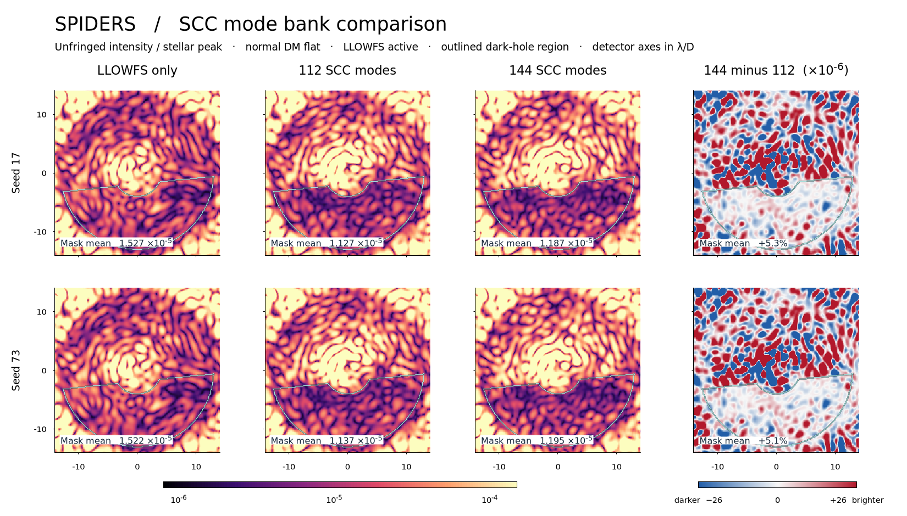

# SPIDERS lab-derived 144-mode SCC bank

**112 modes gave the deeper dark hole on both held-out CUDA trajectories.**
The 144-mode controller darkened the region relative to its LLOWFS-only
baseline, but mean unfringed contrast was 5.31% and 5.13% higher than with
112 modes. All eight late blocks favored 112, by 4.95–5.42%.

| Seed | Shared unfringed frames | LLOWFS only | 112 SCC modes | 144 SCC modes | 144 vs. LLOWFS alone |
| --- | ---: | ---: | ---: | ---: | ---: |
| 17 | 1,023 | 1.52714 × 10⁻⁵ | 1.12683 × 10⁻⁵ | 1.18670 × 10⁻⁵ | −22.29% |
| 73 | 1,021 | 1.52166 × 10⁻⁵ | 1.13674 × 10⁻⁵ | 1.19500 × 10⁻⁵ | −21.47% |



In the mean images, the 5,400 mask pixels at 9–12 λ/D, where the added modes
were targeted, also brightened on average (+3.17% and +2.98%). The
remaining 7,303 mask pixels brightened more (+7.52% and +7.35%).
Figure panels average each run's available paired unfringed frames. The
table uses only the shared exposures across both banks. This comparison
measures the two complete calibrated controllers. It does not isolate
mode selection from the bank-dependent damping scale or establish a
physical bench contrast. [Block photometry](comparison.csv) · [Regional photometry](region.csv)

Both wide runs acknowledged Quit and removed their private sockets. The
observer captured 2,046 and 2,045 of 2,048 late camera-and-residual pairs
and 1,024 and 1,021 of 1,024 unfringed image pairs. Peak sampled native
DM demands were 0.06042 and 0.06028, within the ±0.5 limit. The first two
seed-73 launches failed before admission when simulator precompilation
filled the runtime filesystem. The successful retry used the same application
after compiler caches from stopped sessions were archived.
[Seed 17](filtered-17/transport.json) · [Seed 73](filtered-73/transport.json) ·
[Startup errors](startup-errors.txt)

## Paired measurement

The [calibration record](calibration/README.md) identifies the 32 added lab
commands and the checks against their archived response images. Compared
with the [112-mode control](../spiders-fringe-banks-20261117/README.md),
the standalone CUDA simulator used the same two held-out trajectories,
noise-free detector, flux, 10 ms model exposures, optical assets, mirror
model, pixel mask and zero initial demand. The shared command limits were
±0.5. Each branch used gain −0.05 and pole 1. The same lab fringe band and
regularization rule trained both SCC inverses. The damping scale changes
with the bank's singular values.

Each private core ran 4,096 exposures with LLOWFS alone, reopened the
loop, restarted at the normal flat and ran 4,096 exposures with SCC and
LLOWFS active. The measurement uses the late window, exposures 2,049–4,096.
Camera, chopping phase and both residual identities must match within
each epoch. Sequence, model timestamp and chopping phase match across
banks and epochs. Mean unfringed intensity over 12,703 mask pixels is
divided by the modeled unocculted stellar peak. We retained the existing
95% per-run observation gates. Four consecutive 512-exposure blocks per
seed show how the effect changes across the late window.

The [lab RTC comparison](lab-rtc.md) traces the actual checkout, archive
and fitted controller. This experiment varies the command bank while
keeping the sensor and controller architecture fixed.

## Reproduction

Use the prior 112-mode applications and the CUDA host profile. Export and
install the new staged calibration for each seed. Apply `observer.patch`
to the 112-mode observer, then invoke its `probe.jl` in the application
environment with the application, private runtime directory, output,
`generated/dual-calibration/dm-native-zero.fits` and `144` as arguments.
Startup, reset, property adoption, demand and shutdown receipts accompany
the measured tables and FITS images.

From this evidence directory, the following commands reproduce the tables
and figure. The previous directory contains both the 112-mode observations
and the shared analysis scripts. Gnuplot 6 with pngcairo renders the figure.

```sh
prior=../spiders-fringe-banks-20261117
julia --project="$app" "$prior/banks.jl" "$prior" . > comparison.csv
julia --project="$app" region.jl "$prior" . > region.csv
julia --project="$app" "$prior/images.jl" "$prior" . mode-banks.png
```
