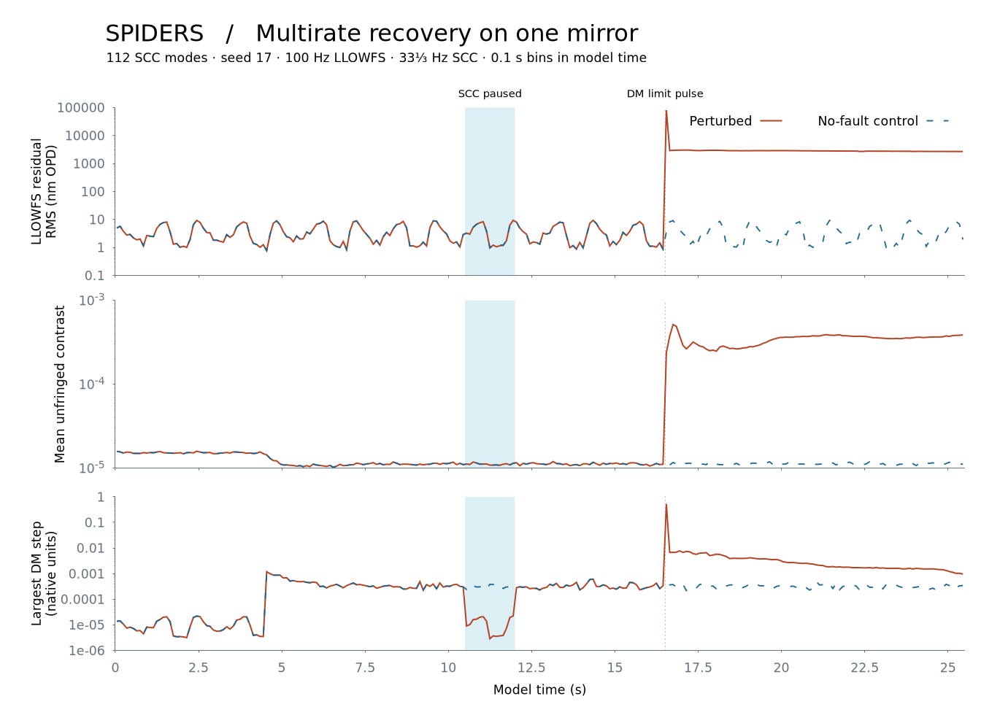

# SPIDERS multirate optical HIL with 112 SCC modes

The independent camera loops stayed closed through SCC dropout. LLOWFS
produced all 150 expected updates during the 1.5 s pause. The first SCC
exposure after the gap (tick 1201) primed the chop pair. Its opposite
phase 30 ms later produced the first fresh correction. Mean contrast
during the pause was within 0.14% of the uninterrupted reference.

A one-update reference pulse clipped 17 actuators. The peak requested
stroke was 0.57124, the delivered peak was 0.5, and the largest actuator
step was 0.52426 native units. The parameter receipt confirms restoration
of the original reference on the next tick. **All 1,197 subsequent
commands still clipped** during 8.98 s of observation. The final demand
clipped 144 actuators. Late mean unfringed contrast reached 3.69 × 10⁻⁴,
32.7 times the matched reference. Restoring the sensor reference alone
did not recover the dark hole within this window.

| Phase | LLOWFS RMS (nm OPD) | Mean unfringed contrast | Largest native DM step |
|---|---:|---:|---:|
| Both loops closed before dropout | 4.50 | 1.119 × 10⁻⁵ | 0.00118 |
| SCC paused, LLOWFS running | 4.95 | 1.119 × 10⁻⁵ | 0.0000220 |
| SCC resumed, before the pulse | 4.31 | 1.124 × 10⁻⁵ | 0.000605 |
| After restoring the reference, final 449 ticks | 2,739 | 3.689 × 10⁻⁴ | 0.00219 |
| Matched uninterrupted reference, same final ticks | 4.64 | 1.127 × 10⁻⁵ | 0.000488 |



The [phase comparison](paired-phases.csv) and [one-second recovery
windows](recovery-windows.csv) use the same physical exposure ticks in both
runs. Camera identifiers, native residuals, applied command cursors and
limiter feedback are retained in the [pulse](experiment/measurement.json)
and [uninterrupted](control/measurement.json) evidence directories.
All 3,348 pulse-run and 3,399 uninterrupted native returns matched their
constraint feedback. The shared command and constraint ports supply no
source timestamp. They are joined by exact acquisition identity.
Each DM step compares consecutive shared demands, including the two demands
when both cameras publish at one model tick. The plant uses the latest
command for its next exposure. Optical samples at the pulse tick precede
the resulting actuator motion.

## Measurement boundary

This experiment uses the [112-mode normal-flat calibration](../spiders-fringe-banks-20261117/README.md)
and held-out CUDA trajectory 17. The SCC and LLOWFS controller branches
write corrections to one modeled 468-actuator BAX307. The independent
camera inputs, controller and native DM output use a private PipeWire core.
This is a stepped model-time experiment. It measures optical and control
behavior. Wall-clock throughput and hardware deadlines are outside the
measurement. During the ordinary closed phase the synchronized harness delivered
12.7 LLOWFS and 4.2 SCC buffers per wall-clock second in the pulse run.
The private cores emitted mixer setup warnings while linking. Both reported
zero dropped, rejected or missing stream sequences at shutdown.

LLOWFS receives one 10 ms exposure per model step. SCC receives one 10 ms
exposure every third step (33⅓ Hz). The three-step spacing preserves
alternating chop phase and the calibration's exposure normalization.
A scheduled exposure withheld during dropout advances the SCC acquisition
sequence without delivering an SCC frame. Only fresh camera data can update
its branch. The recovery measurements distinguish the first SCC arrival
after the gap from the first new valid chopped pair.

Dark-hole contrast is mean unfringed intensity in the calibrated 12,703-pixel
mask divided by the unocculted stellar peak for the same exposure. The DM
step is measured from consecutive native demand vectors, so it includes
both branches. The actuator constraint residual distinguishes a clipped
request from a demand that merely approaches the allowed stroke.

One reference run keeps both cameras active throughout. The intervention
starts from the same flat, seed and closure schedule. LLOWFS closes on tick
5 and SCC on tick 451. Withholding SCC input on ticks 1051–1200 leaves the
last SCC correction in the shared demand. A one-update tip reference pulse
at tick 1652 drives the existing actuator limit. The controller receives
the ordinary reference again on tick 1653. The LLOWFS residual is measured
against the active reference, including that deliberately large offset on
the pulse tick. The subsequent residual is relative to the original
reference. A [separate sustained-offset trial](sustained-offset/README.md)
documents the response to a 120-tick offset and an interrupted command return.

## Reproduction

Use the seed-17, 112-mode installed application from the
[calibration and export instructions](../spiders-fringe-banks-20261117/README.md#reproduction).
Its registered cohort includes PipeWireAORTC 0.7.23, AdaptiveOpticsSimPipeWireHIL
0.5.9, FilterGraphPipeWire 0.5.6, FilterGraphs 0.10.3, FilterGraphAlgorithms
0.12.5, PipeWireAO 0.9.3 and CUDA 6.5.1. The controller and the simulator
exchange buffers through private PipeWire Nodes. Both live in the selector's
Julia process during this test. Each trial gets its own core and controller.
The HIL warmup restores the deterministic optical state between trials.

Select the installed application's Julia depot and matching PipeWireAO
artifact prefix. Set `SPIDERS_TRANSPORT_SELECTOR` to the instrument
repository's `test/spiders_dual_transport.jl` at revision
`58ecd8ac842a789c8df06586a2875273b0b80042`. Use fresh output
directories and a short temporary path so the core's Unix socket fits.
With `app`, `out` and `here` set to absolute paths:

```sh
(cd "$app" && sha256sum -c "$here/app-inputs.sha256")
mkdir -p "$out/control" "$out/experiment"
export TMPDIR="$(mktemp -d /tmp/spiders-rate.XXXXXX)"
export CUDA_VISIBLE_DEVICES=0 OPENBLAS_NUM_THREADS=1 JULIA_LOAD_PATH="@:@stdlib"
julia -O0 --startup-file=no --threads=3,1 --project="$app" \
  "$here/run.jl" "$app" "$out/control" control "$out/experiment" pulse
julia --project="$app" "$here/verify.jl" "$out/experiment" "$out/control"
julia "$here/paired.jl" "$out/experiment" "$out/control" "$out"
(cd "$out" && gnuplot "$here/timeline.gp")
```

The capture and transport checks passed. The final assertion in
`verify.jl` deliberately exits nonzero when the mirror remains clipped
through the last observed command. [Verification output](verification.log).
See the [modal filtering and MLLOWFS check](modal-sensing.md) for the
controller and higher-order sensing options.
